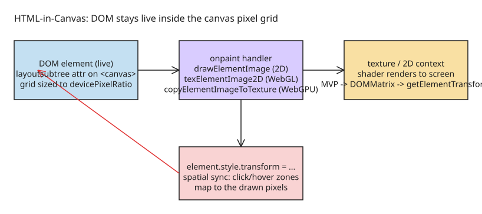

# HTML-in-Canvas API: Drawing Live DOM into 2D, WebGL, and WebGPU Canvases

The **HTML-in-Canvas API** (WICG proposal) lets you draw live DOM elements directly into a 2D `<canvas>`, a WebGL texture, or a WebGPU texture — while the element **remains real HTML**: still interactable, accessible, and connected to browser features (translate, find-in-page, reader mode, extensions, dark mode, DevTools). It is currently in **origin trial in Chrome 148–150**; in Chrome 149+ Canary it is behind the `chrome://flags/#canvas-draw-element` flag.

## DOM vs Canvas — and why the split is artificial

- **DOM**: rich text layout out of the box, semantic content, seamless user operations (highlight-to-copy, right-click save), and deep browser integration (a11y tools, translate, find-in-page, extensions, browser zoom, autofill).
- **Canvas/WebGL/WebGPU**: low-level pixel-grid access for high-performance 2D/3D graphics (games, Figma/Docs-style apps). But everything DOM-integrated breaks when UI is trapped inside a pixel grid — responsive text used to require custom UI logic and large bundles.

The API bridges the two: HTML lives *inside* the `<canvas>` element, and its transform is synchronized so the browser knows exactly where the element sits on screen.

## What you get by placing HTML in the canvas

- **Text layout/formatting** — multiline and bidirectional text with CSS styles applied
- **Form controls** — expressive, customizable, native behavior
- **Text selection, copy/paste, right-click** — even inside 3D scenes
- **Accessibility** — canvas content is exposed to the accessibility tree; screen readers parse it like normal HTML
- **Find-in-page** — Ctrl/Cmd+F highlights text directly inside WebGL textures
- **Indexability** — crawlers and AI agents can read text rendered into 2D/3D scenes
- **Extension integration** — a text-replacement extension updates text rendered on 3D meshes
- **DevTools** — inspect canvas content (including WebGL/WebGPU UI elements); tweak CSS in the inspector and watch the texture update

## High-level use cases

- **Large canvas-based applications**: render application UI components natively into canvas-driven workspaces (better accessibility, reduced bundle weight)
- **3D scenes and games**: fully interactable web UI in 3D — a 3D book with real DOM text, an in-game terminal with native copy/paste

## How the API works — three phases

### Phase 1: canvas setup

1. Add the `layoutsubtree` attribute to `<canvas>` — this makes the browser aware of nested content, prepares it for display inside the canvas, and exposes it to accessibility trees:

```html
<canvas id="canvas" style="width: 200px; height: 200px;" layoutsubtree>
  <div id="form_element">
    <label for="name">Name:</label>
    <input id="name" type="text">
  </div>
</canvas>
```

2. **Size the canvas grid to the device scale factor** to avoid blurriness (use `devicePixelContentBoxSize` when available):

```js
const observer = new ResizeObserver(([entry]) => {
  const dpc = entry.devicePixelContentBoxSize;
  canvas.width  = dpc ? dpc[0].inlineSize : Math.round(entry.contentRect.width * window.devicePixelRatio);
  canvas.height = dpc ? dpc[0].blockSize  : Math.round(entry.contentRect.height * window.devicePixelRatio);
});
const supportsDevicePixelContentBox =
  typeof ResizeObserverEntry !== 'undefined' &&
  'devicePixelContentBoxSize' in ResizeObserverEntry.prototype;
const options = supportsDevicePixelContentBox ? { box: 'device-pixel-content-box' } : {};
observer.observe(canvas, options);
```

### Phase 2: rendering (inside the `paint` event)

The `paint` event fires whenever the element redraws (text highlight, user input). Render inside it:

- **2D context**: `ctx.drawElementImage(element, x, y)` — returns a transform value
- **WebGL**: `gl.texElementImage2D(gl.TEXTURE_2D, 0, gl.RGBA, gl.RGBA, gl.UNSIGNED_BYTE, element)` — like `texImage2D` but takes a DOM element as source
- **WebGPU**: `root.device.queue.copyElementImageToTexture(element, { texture: targetTexture })` — analogous to `copyExternalImageToTexture`

```js
canvas.onpaint = () => {
  ctx.reset();
  let transform = ctx.drawElementImage(form_element, 0, 0);
  form_element.style.transform = transform.toString(); // keep interactivity working
};
```

### Phase 3: CSS transform synchronization

The browser must know where the element *physically* sits so it can map event zones (click/hover) correctly:

- **2D**: apply the transform returned by `drawElementImage` to `element.style.transform`.
- **WebGL/WebGPU**: the on-screen position depends on how the shader uses the output texture. With a typical model-view-projection, use the convenience function `element.getElementTransform()` with a composed DOMMatrix:

1. Convert the WebGL MVP matrix to a `DOMMatrix`
2. Normalize the element (pixels → 1×1 unit square, center it, flip Y)
3. Map unit space back to the canvas viewport (stretch, flip Y again — WebGL up-is-positive vs CSS down-is-positive)
4. Multiply in order: `Viewport * MVP * Normalization`, then apply the result via `canvas.getElementTransform(element, screenSpaceTransform)`

```js
const mvpDOM = new DOMMatrix(Array.from(htmlElementMVP));
const width = targetHTMLElement.offsetWidth;
const height = targetHTMLElement.offsetHeight;
const cssToUnitSpace = new DOMMatrix()
  .scale(1 / width, -1 / height, 1)   // shrink to unit size, flip Y
  .translate(-width / 2, -height / 2); // center
const clipToCanvasViewport = new DOMMatrix()
  .translate(canvas.width / 2, canvas.height / 2)
  .scale(canvas.width / 2, -canvas.height / 2, 1);
const screenSpaceTransform = clipToCanvasViewport.multiply(mvpDOM).multiply(cssToUnitSpace);
const computed = canvas.getElementTransform(targetHTMLElement, screenSpaceTransform);
if (computed) targetHTMLElement.style.transform = computed.toString();
```

## Library and framework support

- **Three.js**: experimental support via `THREE.HTMLTexture` — `material.map = new THREE.HTMLTexture(uiElement)`
- **PlayCanvas**: HTML texture API — `htmlTexture.setSource(htmlElement)` on the `paint` event, `material.diffuseMap = htmlTexture`

## Limitations (conscient, by design)

- **Cross-origin content**: the API does not work with cross-origin iframe content (security/privacy)
- **Main-thread drawing**: HTML-in-canvas is drawn with JavaScript, so scrolling and animations cannot update independently of JS the way they do outside canvas — consider scrolling the whole canvas vs. putting scrolling content inside it

## Status and ecosystem (researched 2026-10-23)

- Origin trial active in **Chrome 148–150** (trial ID 3478467762190286849); Canary 149+ behind the `canvas-draw-element` flag
- The API is still iterating — Chrome's follow-up post documents API changes in Chrome 150 and 155 (WebGL/WebGPU updates, canvas attributes, hit-test synchronization), so treat implementation details as unstable during the trial
- WICG explainer lives on GitHub (living document); community demo collection ("awesome-html-in-canvas") has demos like a WebGL 3D book with CSS-swappable fonts, a WebGPU jelly slider refracting light, an animated SVG billboard, and refractive typography that stays selectable and find-in-page searchable



## References

- [Introducing the HTML-in-Canvas API origin trial (Chrome for Developers)](https://developer.chrome.com/blog/html-in-canvas-origin-trial)
- [HTML-in-Canvas updates: Iterating toward a better Web API (Chrome 150/155 changes)](https://developer.chrome.com/blog/html-in-canvas-ot-changes)
- [WICG HTML-in-Canvas explainer (GitHub)](https://github.com/WICG/html-in-canvas)
- [HTML-in-Canvas Chrome Platform Status](https://chromestatus.com/feature/5172548013916160)
- [Three.js HTMLTexture documentation](https://threejs.org/docs/#HTMLTexture)
- [PlayCanvas HTML-in-Canvas developer documentation](https://developer.playcanvas.com/user-manual/graphics/advanced-rendering/html-in-canvas/)
- [Chrome.dev HTML-in-Canvas demos](https://chrome.dev/html-in-canvas/)
- [Awesome HTML-in-Canvas community demos](https://github.com/GoogleChromeLabs/css-web-ui-demos/blob/main/html-in-canvas/awesome-html-in-canvas.md)
