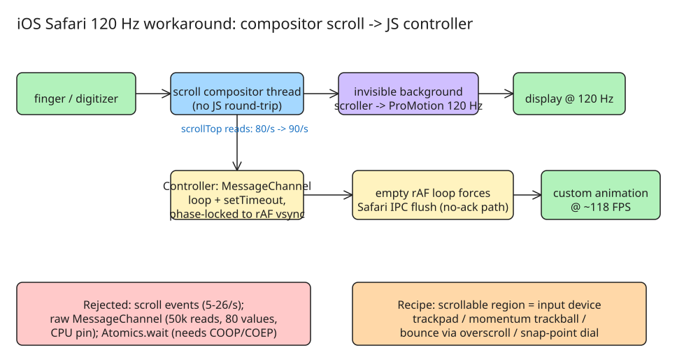

# Bypassing iOS Safari's 60 Hz Cap: Compositor-Scroll Sampling for 120 Hz Web Interactions

On iOS Safari, `requestAnimationFrame` and pointer/touch events are clamped to **60 Hz even on 120 Hz ProMotion screens** — unless the buried "Prefer Page Rendering Updates near 60fps" developer flag is flipped. This is why even excellent mobile web apps feel laggy next to native. This note documents an engineering investigation (Rida F'kih, Nov 2026) that recovers near-native input sampling and render rates by exploiting the one path Safari does *not* clamp: **the scroll compositor thread**.

## Why scrolling is the escape hatch

Scrolling is handled by the **compositor** on its own thread: finger → digitizer → compositor → GPU, with no JavaScript round-trip. That is why React Aria's swipeable-sheet trick feels native — it delegates motion to native scroll physics (bounce, momentum, snap points). The unresolved problem: to *drive custom animations* from that path, you must **read scroll position outside the renderer**, at the screen's refresh rate.

## Building "The Controller": four attempts

Measuring via `scroll` events is useless: **5–26 updates/s during momentum scroll** on an iPhone (best case ~60/s on slow deliberate scrolls).

1. **Recursive `MessageChannel`** — works, but produces 50,000 `scrollTop`/`scrollLeft` reads per second yielding only **80 distinct values**: it pins a CPU core and generates heat.
2. **`Atomics.wait` wakeups at refresh rate** — also reaches the same 80 distinct positions/s, but requires `SharedArrayBuffer`, hence **COOP/COEP headers that break cross-origin assets**. Rejected.
3. **Throttled `MessageChannel` + `setTimeout`, phase-locked to vsync via `requestAnimationFrame` timestamps** — the working solution. Complication: iOS rounds `performance.now()` to the millisecond, so the minimum inter-draw interval must be derived from the refresh interval instead. → **80 position reads/s**.
4. **Empty `requestAnimationFrame` loop** to force Safari's IPC to flush: the UI process sends **one scroll position at a time and waits for an ack**, overwriting anything that arrives meanwhile (dropped positions). Digging into WebKit revealed that on any tick with a rendering update queued, **Safari flushes the position without waiting** — so an always-queued empty rAF loop buys ~12.5% more reads: **90 unique positions/s**. The remaining ceiling wasn't IPC at all: **ProMotion itself refused to render above 90 Hz**.
5. **Invisible background scroller**: a GPU-accelerated CSS animation raises the display to full 120 Hz — but only while something is scrolling. So a tiny invisible scroller smooth-scrolls continuously in the background, keeping the panel at 120 Hz whenever the controller needs it.

## Recipe: scroll region as an input device

Once position can be read fast enough, a scrollable area becomes a general-purpose trackpad with native physics for free:

- **1:1 trackpad** → measure only while the finger is pressed.
- **Trackball with native momentum** → make the region infinitely scrollable.
- **Native bounce** → configure overscroll padding and container bounds.
- **Notched dial** → CSS scroll-snap points.

## Measured results

Benchmark on an iPhone 18 Pro recorded at 240 FPS and slowed 8x: over 3 s of dragging, the controller averaged **118 FPS** vs a steady **60 FPS** for the pointer-events + CSS-transform approach. Even in **Low Power Mode** (normally 30 FPS), it sustains 60.

## Caveats (the author's own)

- The whole technique relies on current WebKit internals. Apple could close it legitimately — e.g. by making `OffscreenCanvas` placeholders wait for the main-thread render pass — without violating any spec. Precedent: Apple's response to the `web-haptics` library.
- Not a foundation to rebuild an entire app on; it is the right tool for micro-interactions, swipeable sheets, and PWAs that need ProMotion-class smoothness without the developer flag.

## See also

- `programming/web-realtime/example-mouse-polling-rate-pointerrawupdate.md` — the same input-rate vs render-rate distinction on the pointer side.
- `programming/web-realtime/howto-scale-websocket-sse-redis-pubsub.md` — server-side counterpart: keeping real-time paths off critical threads.

## References

- [Bypassing iOS Safari's 60 FPS Limit to Build Web Applications That Feel Native — Rida F'kih](https://rida.dev/blog/bypassing-ios-safari-60-fps-limit)
- [React Aria: Scrolling is All You Need — Building a Swipeable Sheet](https://react-aria.adobe.com/blog/sheet)
