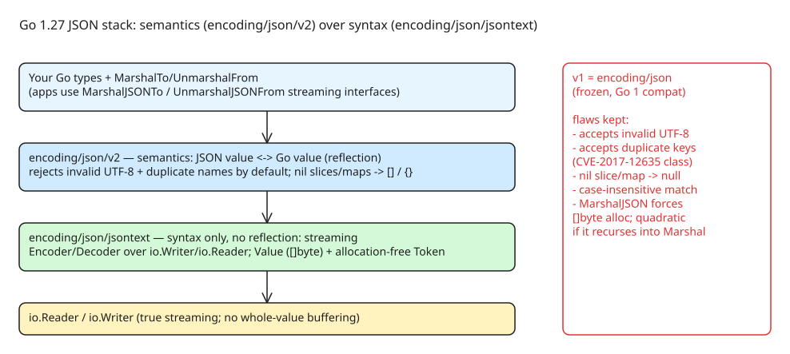

# Go 1.27 encoding/json/v2 and jsontext

After ~6 years of work (first drafted late 2020, formal proposal 2025, experiment in Go 1.25), `encoding/json/v2` and `encoding/json/jsontext` are **stable and generally available in Go 1.27** (Go blog, 2026-11-04). The old `encoding/json` (v1) is frozen by the Go 1 compatibility promise — most of its flaws cannot be fixed in place, so v2 lives in a separate namespace.



## Why v1 could not be fixed

**Behavior flaws** (all still true of `encoding/json` today):

- **Accepts invalid UTF-8** — RFC 8259 requires valid UTF-8; v1 silently corrupts data instead of erroring.
- **Accepts duplicate member names** — RFC 8259 leaves duplicates undefined, so two parsers can disagree. This is exploitable (see **CVE-2017-12635**, a CouchDB auth bypass via duplicate keys). v2 rejects duplicates by default.
- **Leaks nilness**: a nil slice/map marshals as `null`, which breaks peers that expect `[]`/`{}`. Most Go users surveyed (go.dev/issue/63397) preferred `[]`/`{}` — that is v2's default.
- **Case-insensitive field matching** on unmarshal — surprising, a security hazard, and a performance cost. v2 matches case-sensitively by default.
- **Inconsistent `MarshalJSON` pointer-receiver calls** (go.dev/issue/22967) — declared a bug that can never be fixed; v2's new interfaces avoid the trap.

**API deficiencies:**

- `json.NewDecoder(r).Decode(v)` silently accepts trailing junk after the first value.
- Options (`DisallowUnknownFields`, etc.) only exist on `Encoder`/`Decoder`, cannot reach `Marshal`/`Unmarshal`, and lose effect inside custom `UnmarshalJSON` methods.
- `Compact`/`Indent`/`HTMLEscape` force a `bytes.Buffer` instead of `[]byte`/`io.Writer`.

**Performance ceilings baked into the v1 API:**

- `MarshalJSON` must allocate a `[]byte`; the package re-validates and re-indents the result.
- `UnmarshalJSON` requires a complete pre-parsed value → the input is parsed twice (once to find the value's end, once by the method).
- `Encoder`/`Decoder` buffer whole values despite the `io.Reader`/`io.Writer` façade; `Decoder.Token` is allocation-heavy and has no write counterpart.
- A `MarshalJSON`/`UnmarshalJSON` that recursively calls `Marshal`/`Unmarshal` becomes **quadratic**.

## The two-layer design

The fix is a hard split between **syntax** and **semantics** ("encode/decode" = syntax, "marshal/unmarshal" = semantics):

- **`encoding/json/jsontext`** — syntax only, **no reflection**. `NewEncoder(io.Writer, ...Options)` / `NewDecoder(io.Reader, ...Options)` with `WriteValue`/`WriteToken` and `ReadValue`/`ReadToken`. Truly streaming, options via variadic `Options` at construction. Named types: `Value` (a named `[]byte` — v1's `RawMessage` is now a type alias to it) and an opaque allocation-free `Token`.
- **`encoding/json/v2`** — semantics: JSON values ↔ Go values, built on jsontext.

The key new customization interfaces replace the allocating `MarshalJSON`/`UnmarshalJSON` pair:

```go
type MarshalerTo interface {
    MarshalJSONTo(*jsontext.Encoder) error
}
type UnmarshalerFrom interface {
    UnmarshalJSONFrom(*jsontext.Decoder) error
}
```

Custom types now stream tokens directly through the encoder/decoder — no intermediate `[]byte`, no double parse, no re-indent pass.

## Migration notes

- v1 stays supported; nothing breaks automatically. `json.RawMessage` is already an alias to `jsontext.Value`, easing shared-type code.
- Official paths: the "Working with JSON" tutorial, the package docs, the v1→v2 comparison doc in `encoding/json`, and the **`encoding/json/v2` Migration Guide** (go.dev/doc/jsonv2-migration).
- Expect behavior changes when moving: stricter UTF-8 and duplicate-key rejection, case-sensitive matching, and `[]`/`{}` instead of `null` can surface as new errors in previously-lenient pipelines — treat them as bugs the old decoder let through.

## Why the process took 6 years

v1's fixes are impossible under the Go 1 compatibility promise; parallel names (`MarshalV2`) inside one package are "tantamount to a parallel namespace". The design was driven largely by non-Google maintainers (Daniel Martí, Joe Tsai et al.), prototyped from the `protojson` serialization code (which had to bypass `encoding/json` entirely to meet the stricter protobuf JSON spec), refined via public working-group meetings, and hardened as a Go experiment (Go 1.25) before GA.

## References

- [A new Go API for JSON — The Go Blog](https://go.dev/blog/jsonv2)
- [Earlier experiment announcement](https://go.dev/blog/jsonv2-exp)
- [encoding/json/v2 Migration Guide](https://go.dev/doc/jsonv2-migration)
- [CVE-2017-12635 (duplicate-key auth bypass)](https://nvd.nist.gov/vuln/detail/CVE-2017-12635)
