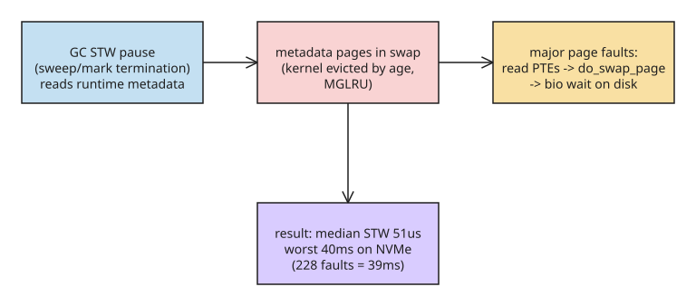

# A 40ms Go GC Pause Caused by Swap — Why the Collector's Metadata Pages Must Stay in RAM

Running swap "just to absorb memory spikes" is a common production decision. Fernando Simões' write-up (Hacker News front page) shows a concrete failure mode: **Go's garbage collector reads its own metadata during stop-the-world pauses, and that metadata can live in swap.** When the kernel evicts those pages, every GC pause pays major page-fault costs — turning a ~51µs median STW pause into 40ms worst-case on NVMe.

## The setup

A cgroup with two processes:

- A Go process calling `io.ReadAll` then `proto.Unmarshal`, creating a blob and a graph struct marked as `scan` by the allocator (the GC must read those spans pointer-by-pointer).
- An HTTP server that mostly stays quiet.

The author's initial reasoning was wrong in an important way: he assumed eviction is per-cgroup, so only a small chance of swap-in/swap-out churn between kernel and GC. In reality the runtime allocates metadata pages **outside the heap** (in a region that is never freed), reuses them across GC cycles, and reads them during STW pauses. The kernel evicts pages *by age* (MGLRU on kernel 6.8 in his test box), so least-recently-accessed metadata pages are exactly what gets swapped out — right before the next GC cycle needs them.

## Measuring it: bpf page-fault counting during STW

He wrote a small BPF script that counts page faults while the world is stopped. Worst case on NVMe: **39,902µs of pause with 228 faults — 39ms of the 40ms spent in faults**, all inside GC bookkeeping (`runtime.finishsweep_m`, `runtime.nextMarkBitArenaEpoch` per `addr2line`).

```bash
# The two STW points that pay this cost (Go runtime):
#   - sweep termination  (mgc.go)
#   - mark termination   (mgc.go)
# In the test: 312 such pauses in 30 minutes.
```

The kernel-side path for each fault is long: read PTEs → `do_swap_page` → find a new frame → charge it to the cgroup → read pages from disk → submit bio → wait for disk → put them back in memory. All of that happens with **every P stopped** — if a goroutine was waiting on I/O, the I/O may return during the pause with no one to handle it.

## The second cost: allocation-side swap-in

Building one 511 KiB message normally took 3–5ms; under swap pressure it jumped to **105ms on NVMe and 903ms on a network volume**. Unlike the metadata case, this cost is paid by only the allocating goroutine (localized), but per-message it exceeds the metadata pause.

## Why 40ms matters even when "rare"

- It is ~800× the median pause (51µs).
- It happens two or three times per memory spike.
- It is *global* (all Ps stopped), not localized to one goroutine.

The author's conclusion agrees with Chris Down's classic essay: swap is not evil — but it interacts badly with a concurrent GC that keeps long-lived metadata pages hot, and in production workloads the collector runs constantly. Practical mitigations implied by the analysis: keep GC metadata resident (e.g., `mlock`-style pinning or cgroup memory.high tuning so eviction doesn't reach runtime pages), avoid swap on latency-sensitive Go services, and measure STW pauses with BPF rather than trusting `GODEBUG=gctrace`.

## Cross-reference: does the new Green Tea GC change this?

Go 1.26 made the **Green Tea** collector the default (it was an experiment in 1.25 via `GOEXPERIMENT=greenteagc`; opt-out is `GOEXPERIMENT=nogreenteagc`, expected to be removed in Go 1.27). Green Tea reworks *marking* for small objects — it tracks pages instead of objects, uses two inline bitmaps per span (seen/scanned), FIFO span queues, and SIMD-accelerated batch scanning on Ice Lake/Zen4+ hardware, targeting a 10–40% reduction in GC CPU overhead.

But the author measured whether Green Tea changed *how metadata is read during STW* — **the impact of swap was negligible**. The failure mode is about metadata pages being evicted, not about the marking algorithm, so upgrading to Go 1.26 does not fix it.



## Key takeaways

- Go's GC metadata lives outside the heap and is read during STW pauses — it must stay in RAM.
- Swap + concurrent GC = major page faults inside global pauses; measure with BPF fault counting, not just `gctrace`.
- Allocation-side swap-in costs are localized per goroutine but can be 20–300× normal allocation time on slow volumes.
- Green Tea (Go 1.26 default) improves marking CPU cost but does **not** change the metadata-read failure mode under swap.

## References

- [A 40ms Go garbage collector pause caused by swap — Fernando Simões](https://frn.sh/go-gc/)
- [Experiment artifacts: plots, mock allocator, BPF scripts (go-gc-swap-cost)](https://github.com/frnsimoes/go-gc-swap-cost)
- [Go 1.26 Release Notes — Green Tea GC default](https://go.dev/doc/go1.26)
- [The Green Tea Garbage Collector — Go blog](https://go.dev/blog/greenteagc)
- [In Defence of Swap — Chris Down](https://chrisdown.name/2018/01/02/in-defence-of-swap.html)
