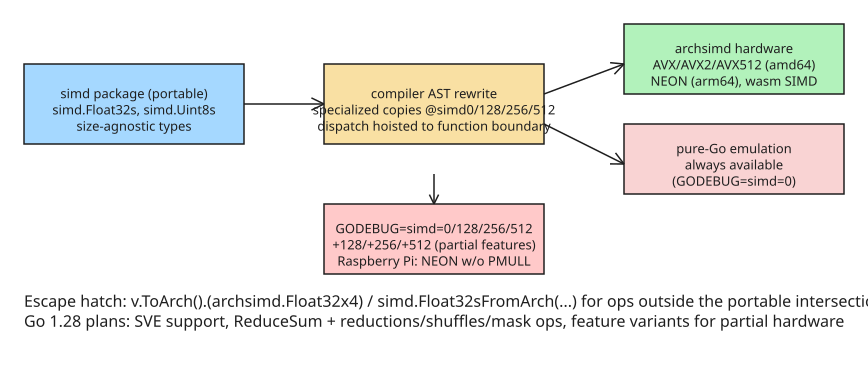

# Platform-Independent SIMD in Go — The Experimental `simd` Package (Go 1.27)

Go 1.26 and 1.27 ship experimental SIMD APIs. Before them, the only way to use
SIMD from Go was hand-written assembly, which meant most performance-sensitive
code left a lot of the CPU idle. The new work has two layers:

- **`simd/archsimd`** — architecture-*specific* vector types (Go 1.26 added amd64;
  Go 1.27 adds arm64 NEON and wasm). Low-level, non-portable, not subject to the
  Go 1 compatibility promise.
- **`simd`** (new in Go 1.27) — a fully portable, platform- and vector-size-*agnostic*
  interface, loosely based on Google's Highway for C++. Write once; get near-assembly
  performance where hardware matches, competent emulation elsewhere.

Both are enabled with `GOEXPERIMENT=simd` at build time. The `simd` package currently
supports AVX/AVX2/AVX512 on amd64, NEON on arm64, and wasm SIMD instructions. Even Go's
own Green Tea garbage collector uses SIMD to accelerate live-object scanning.

## Why a portable layer is hard: three axes of variation

SIMD architectures differ in ways that make "just expose the vectors" impossible:

1. **Vector size.** Some platforms have one fixed size (wasm, PowerPC, s390x: 128 bits).
   Some have several (amd64: 128/256/512; loong64: 128/256). RISC-V supports 128–65536
   bits in powers of two. arm64 has fixed NEON (128) *and* variable SVE (128–2048,
   powers of two only), with variants SVE/SVE2/SVE2.1 that must be feature-checked at runtime.
2. **Masking model.** Some platforms have no masks at all — "if-then-else" is done with
   vector bitmasks and boolean ops (wasm, AVX/AVX2, NEON). Others use one-bit-per-element
   mask registers (AVX512, RVV). SVE allocates one bit per *byte* but only the
   least-significant bit of each element's mask bits governs operations. AVX2 masked
   loads/stores use a plain vector as the mask with the *most*-significant bit governing.
3. **Operation support.** Element-rearrangement primitives differ (constant vs variable
   inputs), crypto ops vary, and even basic arithmetic is uneven — wasm lacks comparisons
   for 64-bit integer vectors.

The `archsimd` package smooths these quirks as far as possible without compromising
efficiency; the portable `simd` layer hides what remains.

## Design: intersection + emulation

The `simd` package removes fixed-size vectors from the type system and only supports
operations in the **intersection** of all platforms, filling gaps with efficient
emulation in terms of other SIMD instructions. Goals: adequate for many vectorizable
algorithms without tying them to a size; as fast as assembly when operations match
hardware; emulated well otherwise; readable even if an LLM writes it. On platforms
without SIMD support (or `archsimd` coverage), everything is emulated, so code always runs.

Vector types are capitalized plural primitives: `simd.Uint8s`, `simd.Float32s`. Vectors
load from and store to slices. Comparisons produce mask values matching the element width
(`Int8s` comparisons yield `Mask8s`), usable with `IfElse`/`Masked` for selection and filtering.

```go
// innerProduct returns the inner product of x and y.
func innerProduct(x, y []float32) float32 {
    var a simd.Float32s
    var i int
    for i = 0; i < len(x)-a.Len()+1; i += a.Len() {
        u := simd.LoadFloat32s(x[i : i+a.Len()])
        v := simd.LoadFloat32s(y[i : i+a.Len()])
        a = u.MulAdd(v, a)
    }
    if i < len(x) {
        u, _ := simd.LoadFloat32sPart(x[i:])
        v, _ := simd.LoadFloat32sPart(y[i:])
        a = u.MulAdd(v, a)
    }
    return sum(a)
}

// sum returns scalar sum of elements of x.
func sum(x simd.Float32s) float32 {
    s := make([]float32, x.Len())
    x.Store(s)
    var r float32
    for _, e := range s {
        r += e
    }
    return r
}
```

Known limitation of the first release: there is no cross-lane reduction yet — `ReduceSum`
is planned for the next release, until which you store to a slice and sum manually.

### Operation coverage (Go 1.27)

- **Load/broadcast:** `LoadV([]E) V`, `LoadVPart([]E) (V, int)`, `BroadcastV(E) V` — all ten vector types (`Int8s`…`Float64s`).
- **Store/string:** `Store(s []E)`, `StorePart(s []E) int`, `String()`.
- **Arithmetic:** `Add`, `Sub`, `Mul`, `Div` (float only), `Neg`, `Abs`, `Sqrt` (float), `Average`/`AddSaturated`/`SubSaturated` (int8/int16/uint8/uint16), `Max`/`Min`, and the fused `MulAdd(y, z)` for floats.
- **Boolean/masking:** `And`, `Or`, `Xor`, `Not`, `AndNot`, `IfElse(mask, y)`, `Masked(mask)`, plus carryless multiply `CarrylessMultiplyEven/Odd` on `Uint64s`.
- **Comparisons → masks:** `Equal`, `NotEqual`, `Greater`, `Less`, `GreaterEqual`, `LessEqual` (unsigned ordered comparisons only for 16/32-bit).
- **Conversions:** `ConvertToIntW/UintW/FloatW` between widths, `ToMask()`.

## Tuning with GODEBUG

On platforms with hardware support, the effective SIMD level is controlled at runtime:

| Setting | Meaning |
| --- | --- |
| `GODEBUG=simd=0` | Force pure-Go emulation even when hardware is available (great for testing) |
| `simd=128` / `256` / `512` | Use that vector width; panic immediately if features are missing |
| `simd=+128` / `+256` / `+512` | Use that width *even if some features are unsupported*; panics only if an unsupported instruction is actually executed |

The `+` variants matter for real hardware with partial feature sets: a Raspberry Pi has
NEON but lacks PMULL (carryless multiply); Apple Silicon running amd64 emulation supports
AVX2 but not VPCLMULQDQ. Go 1.28 plans "feature variants" so such platforms don't have to
downgrade all the way to full emulation.

## Implementation: compiler AST rewriting, not runtime dispatch

`simd` is simultaneously a package, an internal implementation package, and **AST rewriting
in the compiler front end**. The rewrite creates size-specialized copies of every function,
variable, and type that mentions `simd` types — with `simd` types replaced by bridge types in
`simd/internal/bridge`, each defined as an `archsimd` type with a restricted method set.
Specialized symbols get suffixes like `@simd128`, `@simd256`, `@simd512`, or `@simd0` (emulation).

Functions that mention `simd` only internally (not in their signature) become wrappers that
switch on the SIMD level detected at program start and call the right specialized version.
Specialized functions call other specialized functions directly — no dispatch overhead inside
the hot loop, with inlining possible. The dispatch is hoisted as high as necessary but not
higher; if it appears "too low" in a computation, mentioning a `simd` type gratuitously moves
it up:

```go
func BenchmarkVpsumdSIMD(b *testing.B) {
    // mention "simd" so the benchmark loop calls specialized vpsumd3 directly
    var _ simd.Uint64s
    ...
}
```

## Escape hatch: `ToArch()` / `FromArch`

When the portable set isn't enough, each vector type has `ToArch() any`, which you
type-assert to the platform's `archsimd` type (build-tagged per architecture), and generic
`simd.XxxFromArch` functions convert back. Example — a portable `OnesCount` that uses
hardware where available:

```go
func OnesCount(v simd.Int8s) simd.Int8s {
    switch x := v.ToArch().(type) {
    case archsimd.Int8x16:
        lut := archsimd.LoadInt8x16Array(&popcnt4x16)
        mask0f := archsimd.BroadcastInt8x16(0x0f)
        lo := x.And(mask0f)
        hi := x.ToBits().ReshapeToUint16s().ShiftAllRight(4).ReshapeToUint8s().BitsToInt8().And(mask0f)
        return simd.Int8sFromArch(lut.PermuteOrZero(lo).Add(lut.PermuteOrZero(hi)))
    case archsimd.Int8x32:
        // same idea with Int8x32 / PermuteOrZeroGrouped
    case archsimd.Int8x64:
        return simd.Int8sFromArch(x.OnesCount())
    default: // GODEBUG=simd=0 emulation
        return OnesCountEmulated(v)
    }
}
```

The price of the escape hatch is writing architecture-specific code (including an emulation)
for every platform you support.

## Roadmap (Go 1.28)

- SVE support in `archsimd`, and hopefully in `simd`.
- More portable operations: `OnesCount`, mask operations, reductions (`ReduceSum`), vector shuffles.
- "Feature variants" to avoid full-emulation downgrades on partially-supported hardware.
- A dedicated blog post on `archsimd` is planned.

## Practical takeaways

- Use `GOEXPERIMENT=simd` + the portable `simd` package for new performance-critical Go code;
  you get one codebase across amd64/arm64/wasm with automatic fallback to emulation.
- Test matrix: run benchmarks under `GODEBUG=simd=0`, `+128`, and native to catch both
  correctness regressions in emulations and accidental reliance on unsupported instructions.
- Don't expose `archsimd` types in public APIs; keep them behind build tags via `ToArch()`.
- Until `ReduceSum` lands, cross-lane reductions go through a slice store — budget for that.



## References

- [Platform-independent SIMD in Go — The Go Blog (David Chase & Junyang Shao)](https://go.dev/blog/simd-experiment)
- [Go 1.27 Release Notes — new experimental simd package](https://go.dev/doc/go1.27)
- [simd package documentation](https://pkg.go.dev/simd)
- [simd/archsimd package documentation](https://pkg.go.dev/simd/archsimd)

## Related

- [[example-go-gin-orders-api-layered]]

## Further Reading (added 2026-10-19 by KB Zookeeper audit)

- [Platform-independent SIMD in Go - The Go Programming Language](https://golang.google.cn/blog/simd-experiment) — This example also shows one of the limitations of the first experimental release of this package; it’s not supported by simd in Go 1.27, though ReduceSum will…
- [Go 1.27 brings platform-independent SIMD to the language | Zeli](https://zeli.app/story/49843269) — "Platform-Independent SIMD in Go" — 401 points, 146 comments on Hacker News. Go 1.26 and 1.27 introduce experimental SIMD APIs, with Go 1.27 adding a portable
- [Go 1.27 SIMD: How to Use the Experimental simd Package](https://blog.rottenwifi.com/platform-independent-simd-in-go-a-practical-guide-to-go-1-27s-experimental-simd-package/) — Learn how to enable Go 1.27’s experimental simd package, how it differs from archsimd, its ARM and WebAssembly support, and what to know about performance.
