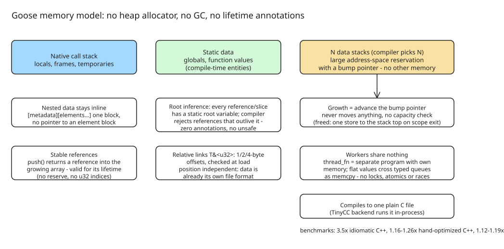

# The Goose Language: A Memory-Safe Systems Language with No Heap

Goose is a memory-safe systems language with **no heap allocator, no garbage
collector, and no lifetime annotations**, by Wouter van Oortmerssen (author of
the Lobster language). In the project's own benchmark suite Goose runs faster
than C++ and Rust while using less memory. The language was built almost
entirely with AI (Claude "Fable") from a human language design, per the
project's notes.

## The memory model: stacks, and scope exit is the free

A program has the native call stack, static data, and **N data stacks** (the
compiler works out N). A data stack is a large address-space reservation with
a **bump pointer**, and there is no other memory. At most one resizable value
is live per stack and it is always on top, so growth never moves anything and
never checks a capacity — all of it is proved at compile time; the runtime
tracks only the bump pointers.

```goose
for round in 3 {
    var scratch: u8[>..] = [];                        // grow-only: growth is a pointer bump
    for i in 100000 { scratch.push((i % 256) as! u8); }
    print("round ", round, ": ", scratch.len, " bytes");
}                                                     // the free: one store to the stack top
```

Freeing a million-element structure is **one store**, however deeply it nests.

## Nothing moves, so references survive growth

`push` returns a reference to the new element, so you can link elements while
building the array. A `vector<T>`/`Vec<T>` may reallocate and cannot provide
this guarantee:

```goose
struct Item { id: i32, weight: f32 }

var items: Item[>..] = [];
let first .= items.push(Item { 1, 0.5 });             // a reference to element 0
for i: i32 in 2..1000001 { items.push(Item { i, 0.0 }); }
first.weight = 99.5;                                  // still valid, a million pushes later
```

## Safe references with zero annotations

Every reference and slice has a static **root**: the variable that bounds its
target's lifetime. A reference must not outlive the variable that owns its
target. The compiler infers roots and specializes functions for them — no
annotations, no aliasing/exclusivity rules, no `unsafe`. When a check fails,
the error names the root and destination:

```goose
fn longest(a: u8[:], b: u8[:]) -> u8[:] { if a.len >= b.len { a } else { b } }

var outer: u8[>..] = [];
var w = outer[..];
{
    var inner: u8[>..] = [];
    format(inner, "inner text");
    w = longest(outer, inner);     // error: storing a reference rooted at inner,
}                                  //        which does not outlive the destination (§9.2)
```

A slice `T[:]` lets a function accept a range from any array kind without
copying (e.g. `split` returns slices into its input; a dictionary keyed by
`u8[:]` stores views of strings rather than copies).

## The array family (no single array type)

Every member is `[metadata][elements...]`, inline and packed, never a pointer
to an element block:

| Spelling | What it is |
| --- | --- |
| `T[k]` | fixed size, known at compile time |
| `T[]`, `T[varint]` | sized at construction, frozen after; fixed or variable-width length |
| `T[..k]`, `T[..]` | capacity inline; grows and shrinks within it |
| `T[>..]` | **grow-only**: the workhorse; references into it stay valid |
| `T[>..&lt;]` | **grow-shrink**: stacks, queues, heaps |

Strings are just `u8` arrays. Nested variable-size data sits **inline** in
declaration order — a record is a run of bytes with nothing indirect:

```goose
struct Item  { sku: u8[varint], qty: varint, cents: varint }
struct Order { id: varint, customer: u8[varint], items: Item[varint] }

var book: Order[>..] = [];
book.push(Order { id: 1001, customer: "alice",
                  items: [Item { sku: "SKU-441", qty: 2, cents: 1999 },
                          Item { sku: "SKU-7", qty: 1, cents: 500 }] });
```

That order is **29 bytes and 0 allocations** (C++ `std::string` +
`std::vector<Item>`: 160 bytes, 1 allocation; Rust `String` + `Vec<Item>`:
153 bytes, 4). The price: an array of variable-size elements is sequential —
you can iterate it but not index it (unless you keep a second array of
references as an index).

## Enums in two sizes

ADTs are the only dynamic polymorphism (no inheritance, no vtables). Each can
be stored two ways, chosen at the point of use:

- **Fixed mode** (`Shape`): tag + room for the largest payload; indexable and
  overwritable.
- **Variable mode** (`Shape..`): each value takes exactly its variant's size
  (4× less memory, 2× the speed of a Rust `enum` on the benchmark that
  exercises it); the array becomes sequential, a value never changes variant,
  and you may take references into a payload:

```goose
enum Shape { Circle { r: f64 }, Rect { w: f64, h: f64 }, Dot }

var packed: Shape..[>..] = [];                 // 9, 17 and 1 bytes, not 17 each
packed.push(Shape.Circle { r: 1.0 });
packed.push(Shape.Rect { w: 2.0, h: 3.0 });
packed.push(Shape.Dot);
for s in packed {
    match s { Rect &r => { r.w += 1.0; }, _ => {} }   // edits the payload in place
}
```

**Case functions** are another dispatch style: define one overload per variant,
dispatched through a jump table, with the compiler checking coverage.

## Links narrower than pointers

A `T&` is a machine address (8 bytes, never dangling). A **relative
reference** is the same link stored as a narrow offset: `T&<u32>` measured
from the field itself to a target in the same array (position independent),
or `T&<u32 in pool>` from a named pool's base. `T&<u32>?` uses offset 0 as
null. A binary search tree in one grow-only array, 12-byte nodes:

```goose
struct Node { key: i32, left: Node&<u32>?, right: Node&<u32>? }   // 12 bytes, links included

fn insert(pool: Node[>..]&, key: i32) {
    if pool.len == 0 { pool.push(Node { key: key }); return; }
    var cur .= pool[0];                             // .= binds a reference; = would copy
    loop {
        if key == cur.key { return; }
        let next = if key < cur.key { cur.left } else { cur.right };
        if next { cur .= next; continue; }          // narrowed by `if`: next is a Node&
        if key < cur.key { cur.left .= pool.push(Node { key: key }); }
        else             { cur.right .= pool.push(Node { key: key }); }
        return;
    }
}
```

References are transparent (no `*`, no `->`); `.=` binds or retargets one;
`Node?` is a nullable reference that `if`/`guard`/`assert` narrow. The insert
is one push and one store, and the push cannot invalidate `cur`. When
lifetimes are not nested, a `reusable` pool pairs a grow-only array with a
hidden freelist: `alloc_ref` reuses a slot or pushes; a stale slot reads a
*different value of the correct type* rather than corrupting memory.

## Your data is already a file format

Links are self-relative, so a structure means the same thing wherever it sits:
saving is a write, loading is a read plus a verification pass. `from_bytes`
checks the framing, every tag, every length and every link **before** the
bytes become a value — a corrupt or hostile file yields `false`, never a wild
reference. No serializer, no schema, no pointer fixups.

```goose
var image: u8[>..] = tree.to_bytes();           // a framed byte image of the whole array
var loaded, ok = from_bytes<Node[>..]>(image);  // verified before it becomes a value
```

## Built in place, always

The in-place construction guarantee (spec §4.3): a constructed value is
always built in its final home, propagated top-down through calls. A function
returning a grow-only array by value writes its elements straight into the
caller's variable — out-parameters mostly do not appear:

```goose
words.push(str("word", i));                    // formatted straight into the new element
let evens = xs.filter() { it % 2 == 0 };       // built straight into `evens`: no temporary
```

## Returning errors across calls

`return E from f` returns `E` as the result of the innermost active call of
`f`, however many frames up, with every intermediate function keeping its
plain signature. It is checked statically — every call of `parse_user` must
lie inside a `load` call, nothing uncaught at runtime. A hidden discriminant
checked per frame, not an unwinder; no `Result` type and no `?` on every call:

```goose
fn load(text: u8[:]) -> User[>..], u8[] {
    var users: User[>..] = [];
    each_split(text, '\n') { users.push(parse_user(it)); };
    return users, "";
}

fn parse_user(line: u8[:]) -> User {
    let comma = find(line, ",");
    guard comma >= 0 else { return [], str("expected name,age: ", line) from load; }
    ...
}
```

## Threads that share nothing

A `thread_fn` is compiled as a **separate program** with its own data stacks
and copies of the globals. Values cross through **typed queues**, one per
type, and must be *flat* (no references at any depth) — crossing is a
`memcpy` because a flat Goose value is contiguous. Data races, locks, atomics
and memory orderings do not exist in the language:

```goose
thread_fn worker() {                                // a separate program with its own memory
    loop {
        let job = qget<Job>();                      // blocks on the typed queue for Job
        guard job.n >= 0 else { break; }            // -1 means stop
        qput(Result { n: job.n, digits: count_digits(job.n) });
    }
}
```

A failed check or `abort` in a worker started with `thread_spawn_contained`
ends only that worker; its message goes to whoever waits for it, so a
supervisor can log it and restart another.

## Generics and function blocks with no overhead

An untyped parameter is generic; function values are **compile-time entities**
passed as generic parameters. Everything is monomorphized, every call direct
and inlinable, no closure objects or function pointers — a higher-order
function compiles to exactly the loop it looks like. A block may `return` from
its lexically enclosing function.

## Plain C in, plain C out

Goose compiles to **one C file**, so it runs wherever a C compiler does and
calls C directly through `extern fn` (a slice crosses as `{ data, len }`;
unsupported signatures are rejected at the declaration). The bundled TinyCC
backend compiles and runs that C inside the Goose compiler's process — no
build step.

## Where the speed comes from

No heap allocation or per-object teardown, contiguous data, narrow links, and
enums sized for the variant they contain. Every index is bounds-checked, and
the compiler removes checks it can prove unnecessary — an `assert` on a slice
length often lets a kernel eliminate its remaining checks and vectorize.
`--bce-lines` reports surviving checks; `checkfree fn` rejects a kernel if
any bounds check survives. Benchmark measurements use whole-process
wall-clock time, including teardown.

| Geometric mean over 16 benchmarks | vs idiomatic C++ | vs hand-optimized C++ | vs best safe Rust |
| --- | --- | --- | --- |
| speed, MSVC backend | 3.51× | 1.24× | 1.13× |
| speed, clang backend | 3.54× | 1.26× | 1.19× |
| peak memory | 1.95× less | 1.32× less | 1.25× less |

## Caveats

- Benchmarks are the project's own suite; the summary page explicitly includes
  losses, but independent replication is still missing (the project is new).
- Sequential (non-indexable) variable-size arrays and the flat-only
  cross-worker constraint are real design costs to weigh per use case.
- The compiler/toolchain maturity (packages, stdlib, 31 sample programs) is
  early-stage.



## References

- [The Goose Programming Language (official site: tutorial, reference, specification, samples, benchmarks)](https://aardappel.github.io/goose/)
- [aardappel/goose on GitHub](https://github.com/aardappel/goose)
- [Goose language discussion (r/Zig)](https://www.reddit.com/r/Zig/comments/1x1p2b0/goose_programming_language/)
- [What the Goose Language Is, and Where the 101 Starts (DEV.to)](https://dev.to/flisk/what-the-goose-language-is-and-where-the-101-starts-544c)
