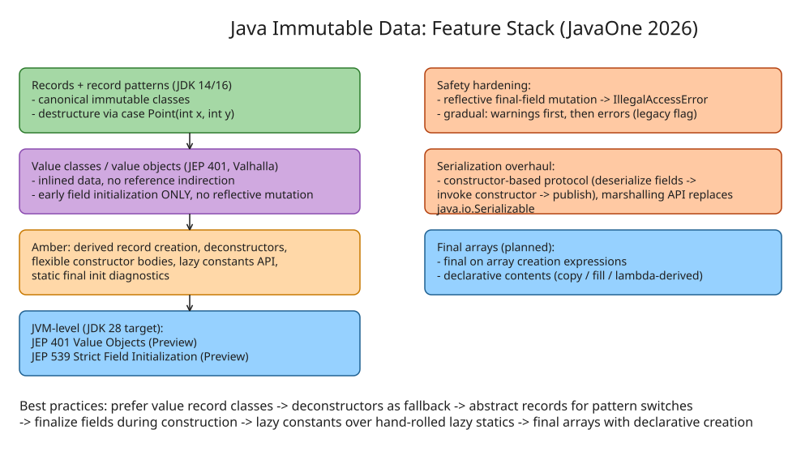

# Better Tools for Immutable Data in Java

Summary of Dan Smith's (Oracle, Java Platform Group) JavaOne 2026 talk reviewing the stack of new and upcoming language and JVM features that make immutable data more convenient, more reliable, and cheaper at runtime. The features come from **Project Valhalla** (value classes/objects, value records) and **Project Amber** (record patterns, deconstructors, flexible constructor bodies, the lazy constants API, and diagnostics around `static final` field initialization).

## The problem with mutable data

Every reference in a mutable object is a lie you might later break: two threads can read different values at different times, and an object handed to a library can be mutated behind its back. The canonical Java pattern — `final` fields set once in the constructor — is correct but verbose and, more importantly, invisible to the VM: the compiler/JIT cannot assume a reference is never reassigned or that the object it points at never changes, so it misses optimization opportunities (escape analysis, devirtualization, hoisting loads).

Immutable data gets you:
- **Correctness**: no synchronization needed for shared state.
- **Performance**: the JIT can inline, hoist, and devirtualize against stable shapes.
- **Interoperability**: safe to pass into other people's code.

The historical gap: Java only had `final`-field convention until records (JDK 14/16), and records are *shallowly* immutable — the components are final, but the component values can still be mutable objects.

## Feature stack

### Records and record patterns

Records give canonical immutable classes: `record Color(int r, int g, int b)`. Record patterns let you destructure:

```java
record Point(int x, int y) {}

var dist2 = switch (p) {
    case Point(int x, int y) -> x * x + y * y;
};
```

**Derived record creation** (new) extends this: an expression that takes a record, deconstructs it, modifies selected components, and reconstructs — a `with`-style copy. All the language needs is a constructor whose signature matches the component list, which is exactly what records provide (and, via deconstructors, what value classes will provide).

### Value classes and objects (JEP 401, Valhalla)

Value classes remove object indirection: value data can be inlined at the use site (like a primitive) while still being a real type with methods. **Value records** combine both — a record whose components are value objects. Value classes are *shallowly immutable* at the same level as records.

Two hard constraints that differentiate value classes:
1. **Early field initialization only** — fields must be fully initialized in the constructor body and never changed afterward. Unsafe reflective mutation and legacy deserialization are **not allowed** (a hard break, unlike other classes).
2. Fields of a value class must be initialized early and not changed — the JVM relies on this for its inlining optimizations.

### Early field initialization with flexible constructor bodies

Currently, field initializers run before the constructor body; this feature lets you move field initialization into the constructor body (and adds **abstract records** to the mix — records with abstract methods, usable as pattern-switch base types).

### Lazy constants API

A preview API (JEP 334 line of work) that finalizes in the near future, expected to land around **JDK 28** alongside JEP 401 and JEP 539 (Strict Field Initialization in the JVM). It expresses "compute this final field once, later, thread-safely":

```java
// Sketch of the idea: a final field with a lambda supplier,
// read through a get() method; the lambda runs at most once,
// and the VM knows the value is stable after first access.
static final Lazy<String> EXPENSIVE = Lazy.of(() -> computeOnce());
// ...
String value = EXPENSIVE.get(); // computed on first read, then cached
```

Why use it instead of hand-rolling `if (field == null) field = ...`:
- **Concurrency is handled for you** — the supplier is guaranteed to run exactly once under correct memory visibility.
- **The VM knows about it** — the "once set, never changes" invariant is visible to the JIT, enabling optimizations your hand-rolled version cannot get.

### Initialization diagnostics for `static final` fields

New diagnostics make it easier to catch initialization-order bugs in `static final` fields (the classic "static field reads a field that hasn't been initialized yet" failure), which is the main footgun of eager static initialization.

### Unsafe reflective mutation: deprecation path

The classic hack — `Field.setAccessible(true)` followed by `field.set(...)` on a final field — is how deserializers and some libraries bypass constructors. The new behavior:
- Mutating a final field this way will **throw `IllegalAccessError`** once the feature completes.
- Rollout is gradual: **warnings first**, then errors, with a command-line flag to re-enable the legacy behavior — no hard break for most code.
- **Value classes are the exception**: no legacy path at all; fields must be initialized early and never mutated.

### Deserialization and the marshalling API

Java's native serialization is inconvenient for immutable classes: it creates the object *without invoking any constructor*, caches it, runs arbitrary code against the uninitialized instance, and only then pokes the fields. Records already fixed this with a clean protocol — deserialize components, invoke the constructor, only then publish the fully-constructed instance into the cache. The plan is to extend that protocol to all classes, so class authors can be certain every live instance went through a constructor (and thus passed validation).

The **marshalling API** (coming, intended to replace `java.io.Serializable`) will use the same constructor-based construction protocol.

### Final arrays (on the horizon)

Arrays are mutable even when everything around them is not. The planned feature: a `final` modifier on array *creation expressions* — the type stays a regular array type, but the runtime representation carries a flag that makes any write attempt fail (an additional check on top of the usual array store check). Combined with "everything mutable at first, then immutable," this needs a declarative way to describe contents: copy-from-another-array, fill, or lambda-derived strategies.

## Best practices summary

1. **Prefer value record classes**; if you can't use either, declare **deconstructors** as the fallback.
2. **Prefer value classes** where indirection hurts.
3. Use **abstract records** as pattern-switch query bases.
4. **Finalize fields during construction** (early initialization).
5. Use **lazy constants** instead of hand-rolled lazy `static final` fields.
6. **Prefer final arrays** with declarative array creation wherever possible.

Caveat from the talk: everything in the "future features" section is still in flux; these are the intended shapes, not committed APIs.

## Roadmap anchors

| Item | Status (mid-2026) |
| --- | --- |
| Records, record patterns | Standard since JDK 14/16 |
| Lazy constants API | Preview now; finalization expected |
| JEP 401 Value Objects (Preview) | Integrated, targeted at **JDK 28** |
| JEP 539 Strict Field Initialization in the JVM (Preview) | Integrated, targeted at **JDK 28** |
| Marshalling API | Coming; replaces `Serializable` protocol for immutable classes |
| Final arrays | Planned; `final` on array creation expressions |

## Diagram

&lt;!-- Java Immutable Data feature stack -->
## References

- [Better Tools for Immutable Data — Inside Java (talk announcement)](https://inside.java/2026/06/21/better-tools-immutable-data/)
- [Dan Smith: Better Tools for Immutable Data — JavaOne 2026 video](https://www.youtube.com/watch?v=BdLND9D81lI)
- [JavaOne 2026 session page](https://dev.java/community/javaone-2026/sessions/)
- [Project Valhalla documentation](https://github.com/openjdk/valhalla-docs)
- [JEP 401: Value Objects (Preview)](https://openjdk.org/jeps/401)
- [JEP 539: Strict Field Initialization in the JVM (Preview)](https://openjdk.org/jeps/539)
