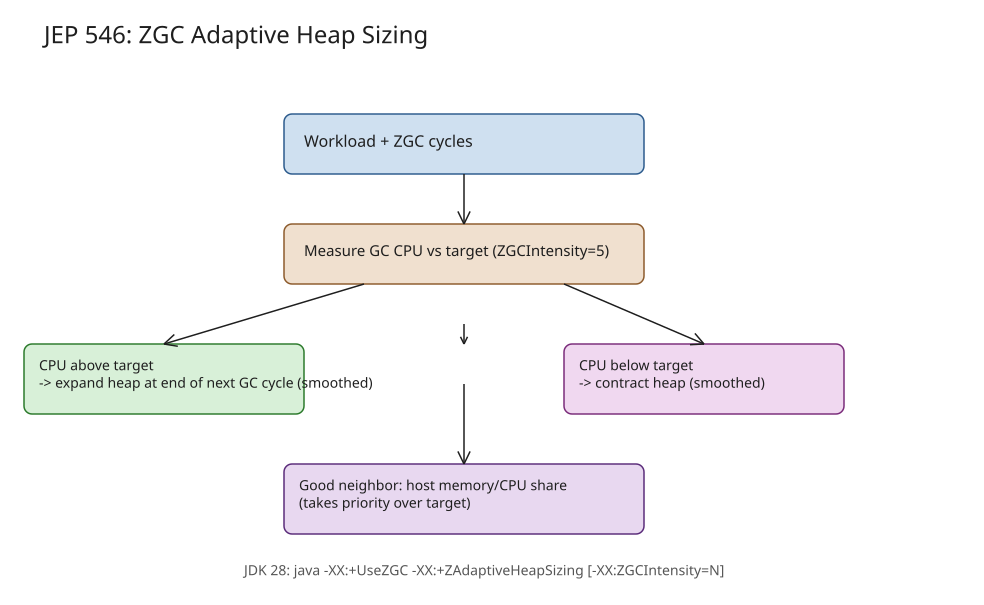

# JEP 546: Adaptive Heap Sizing for ZGC (JDK 28)

JEP 546 (owner Erik Österlund, status *Targeted* for JDK 28, component hotspot/gc, issue JDK-8377305) makes ZGC
manage its own heap size. Instead of you choosing `-Xmx` and `-XX:SoftMaxHeapSize` by hand, you run:

```bash
java -XX:+UseZGC -XX:+ZAdaptiveHeapSizing [ -XX:ZGCIntensity=N ] ...
```

and ZGC continuously trades memory for GC CPU usage until it reaches the target you imply. Combined with the
startup/warmup work of JEP 545, the JEP's claim is that setting `-Xmx` or `-XX:SoftMaxHeapSize` "will be neither
necessary nor desirable."

## Why manual heap sizing is hard

ZGC is a *tracing* collector: a collection cycle's CPU cost scales with the number and size of *live* objects,
**not** with heap size. GC starts when the heap is nearly full, so — all else equal — a larger heap means *less
frequent* collection and less GC CPU over time, while a smaller heap means more. GC CPU usage varies inversely
with heap size.

That gives two failure modes for a hand-picked `-Xmx`:

- **Too small** → more frequent GC, degraded performance, possible out-of-memory.
- **Too large** → the OS runs out of physical memory, starts swapping, or kills processes.

The existing escape hatch, the *soft maximum heap size* (`-Xmx5G -XX:SoftMaxHeapSize=2G`), lets ZGC keep the heap
below a low target but expand under allocation pressure. But choosing the soft maximum is no easier than choosing
the hard maximum, and a bad soft maximum has the same failure modes. Measuring the right values requires running
the app under representative workloads at several `-Xmx` values — an experiment that is rarely done right, must be
redone on every app/JVM update, and does not port across hardware.

## What the policy does

With adaptive heap sizing enabled, ZGC:

1. **Defaults the maximum heap to ~100% of physical memory minus a small reserve** (the HotSpot default today is
   25% of physical memory — e.g. a 128 GB host gives a 32 GB heap).
2. **Adaptively expands and contracts the heap** to hold GC CPU usage at the target level:
   - if GC CPU usage rises above the target → expand the heap at the end of the next GC cycle (CPU usage falls,
     throughput improves);
   - if GC CPU usage drops below the target → contract the heap (CPU usage rises, throughput declines).
   - Adjustments are *smoothed over time* to avoid disruptive swings (following Tavakolisomeh et al.,
     *Heap Size Adjustment with CPU Control*).
3. **Rebalances the young/old generations** (ZGC is generational): if a series of minor collections pushes GC CPU
   usage above target, ZGC expands the heap immediately.
4. **Acts as a good neighbor** by monitoring the JVM's share of the *host's* memory and CPU:
   - large memory share + small CPU share → contract the heap (trade memory for CPU, free memory for others);
   - small memory share + large CPU share → expand the heap (trade CPU for memory).
   - Being a good neighbor *takes priority over* the target intensity: ZGC biases the target up or down as needed,
     so several adaptive JVMs on one host settle into a fair division of resources.

### Tuning: `ZGCIntensity`

`-XX:ZGCIntensity=N` (positive integer, **default 5**) sets the *target intensity* of GC work:

- lower values → ZGC collects less often, uses less CPU, but keeps a larger heap;
- higher values → ZGC collects more often, uses more CPU, keeps a smaller heap.

```bash
# a bit less CPU, a bit more memory than default:
java -XX:+UseZGC -XX:+ZAdaptiveHeapSizing -XX:ZGCIntensity=4 ...
```

Intensity is deliberately an *abstract* measure — the mapping to actual CPU usage is intentionally unspecified so it
can change across releases, which also makes the setting portable across hardware.

## Case study: one 16 GB container, four JVMs

A 16 GB container runs a SPECjbb2015 instance (5,000 req/s), then an H2 in-memory database benchmark alongside it,
then two more SPECjbb2015 instances — monitored for 42 minutes:

| Phase | What runs | What ZGC does |
|---|---|---|
| 0–12 min | SPECjbb2015 alone | heap expands slowly until a good size is found; CPU not excessive |
| 12–24 min | + H2 database | H2 bursts to a large heap; SPECjbb **immediately contracts** so the database can take a larger memory share; SPECjbb keeps 5,000 req/s but with higher GC CPU (worse latency/throughput) |
| 24 min | H2 exits | SPECjbb **rapidly expands** back into the freed memory; latency and throughput recover |
| 30 min+ | + 2 more SPECjbb2015 | within ~2 minutes the three JVMs **evenly divide** the container's memory, each at 5,000 req/s |

The point: no per-JVM `-Xmx`, no tuning, yet all co-tenants run well — the adaptive policy *is* the good-neighbor
soft-maximum behavior, done automatically.

## Risks and alternatives

- **Risk**: with the feature enabled, the default maximum heap jumps from 25% of physical memory to ~100% minus a
  small reserve, so ZGC may use far more memory than past releases and starve other processes. (Even the old
  default carried that risk when several default JVMs ran in parallel.)
- **Rejected alternative**: a *target memory residency* knob (ratio of live data to heap, as some other language
  GCs offer). For a given residency, GC CPU usage can vary dramatically, measuring live data is hard in generational
  GCs, and GC CPU is what users actually monitor.

## Related notes

- [ZGC's decade of low-latency GC](explanation-zgc-decade-of-low-latency-gc.md) — the collector design this builds on (JEP 377)
- [ZGC weak reference processing](explanation-zgc-weak-reference-processing.md)
- [JDK 26 performance improvements](explanation-jdk-26-performance-improvements.md)

## References

- [JEP 546: Adaptive Heap Sizing for ZGC](https://openjdk.org/jeps/546) (targeted for JDK 28)
- [JEP 545: Faster Startup and Warmup with ZGC](https://openjdk.org/jeps/545) — the companion startup/warmup work
- [JEP 377: The Z Garbage Collector](https://openjdk.org/jeps/377)
- [The Java Magazine: JEP 546 targeted at JDK 28](https://inside.java/2026-10-19/jep546-target-jdk28/)
- [Inside Java Newscast #117 (2026-11-14) — adaptive heap sizing segment](https://inside.java/newscast/117/)
- [ZGC soft max heap size background](https://malloc.se/blog/zgc-softmaxheapsize)

## Diagram

