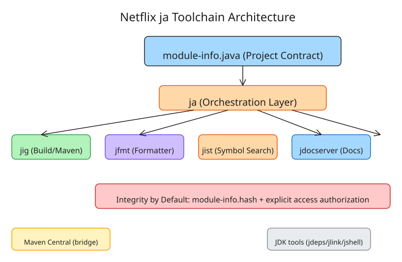

# Netflix ja: Module-System-Native CLI Toolchain for Modern Java

Netflix's JVM Ecosystem Team (Danny Thomas) previewed **`ja`** — a family of composable, module-system-native command-line tools that make the JPMS `module-info.java` descriptor into a *complete project description*, replacing the classpath-centric workflow with a module-first one. The toolchain is explicitly designed to be agent-friendly: coding agents can locate dependencies, symbols, and sources without LSPs or MCP indexing.

## Core Design Philosophy

The Java Module System (JEP 261) arrived after build tools like Maven/Gradle had already established strong project models. The module descriptor became "just another description of the project to keep in agreement." `ja` inverts this: **the module descriptor IS the project**.

```java
/**
 * @mainClass com.example.application.Main
 */
module com.example.application {
    requires com.example.framework; // @1.2.3
}
```

Dependency versions sit beside `requires` directives; metadata (main class, access requirements) lives in doc tags on the module declaration. No separate build file needed.

## The Four Standalone Tools

Each tool is independently usable without adopting `ja`:

| Tool | Purpose | Key Detail |
|------|---------|------------|
| **jig** | Version resolution, compilation, assembly; Maven bridge | Outputs standard module-system args for `javac`/`java`/`javadoc`/`jlink`; standalone module proxy + publishing commands |
| **jfmt** | Source formatting per Oracle Code Conventions (adapted) | Built on `google-java-format`, tuned for modern Java syntax; targets whitespace/import-ordering issues common in agent-written code |
| **jist** | Source-aware symbol search (`grep`-style) | Searches class files + associated sources without IDE indexing, LSPs, or MCPs; interoperates via an argument-file contract with other build tools |
| **jdocserver** | Locally browsable API documentation | Generates pages on demand for a JDK or `ja` workspace |

All four implement Java's `Tool` or `ToolProvider` interfaces (`javax.tools.Tool`, `java.util.spi.ToolProvider`), allowing in-process execution. They are intended to be installed alongside standard JDK tools like `jdeps`, `jlink`, and `jshell`.

## Tool Discovery and Orchestration

`ja` itself is an orchestration layer using the platform's tool discovery capabilities:

- **OptionChecker** (`javax.tools.OptionChecker`) + optional custom metadata → discovers which module-system options each tool supports
- Resolves arguments on behalf of tools, providing seamless transition from source-path modules to standard JDK tooling
- No lock-in: compose any subset of the four tools in your own workflow

## Maven as Foundation (Not Replacement)

`ja` does not abandon Maven Central. It uses Maven's verified group namespaces to derive **canonical module coordinates**:

```
pkg:maven/com.netflix/com.netflix.tools.ja
```

Discovery strategy for existing artifacts:
1. **Explicit relocation POM** at the canonical coordinate → follows to original location
2. **Namespace walk** from root using common Maven artifact conventions (infers coordinates from module names)
3. **Bundled alias list** for popular modules lacking reverse-DNS names (e.g., `joda-time`)

Survey data: of the 1,000 most popular Maven Central artifacts, only 232 had explicit module definitions and 248 declared automatic module names — the remaining 520 expressed no module name opinion. The `jig` module proxy presents resolved modules using filename-based naming conventions, making even unnamed automatic modules safe.

## Integrity by Default

The toolchain aligns with OpenJDK's **Integrity by Default** policy (JEP draft 8305968) and JEP 500 ("Prepare to Make Final Mean Final"):

- `ALL-UNNAMED` access is discouraged; runtime access requirements are declared as module metadata
- Libraries record required access via doc tags:

```java
/**
 * @enableFinalFieldMutation com.example.framework
 */
module com.example.framework {
}
```

- The consuming application must explicitly authorize:

```bash
ja require com.example.framework@1.2.3 \
  --enable-final-field-mutation com.example.framework
```

Without authorization, dependency resolution **fails** with an unsatisfied access requirement. Native access follows the same model via `@enableNativeAccess`.

### Integrity Mechanisms

- **Persistent hashes**: resolved binary dependencies are hashed into a `module-info.hash` file; subsequent resolutions verify and reject changed artifacts
- **Explicit code generation**: annotation processing is treated as a visible step — generated sources sit alongside regular module source, visible in code review, allowing assembly without executing generator code

## Requirements and Availability

- Requires **JDK 25+**
- Installer creates a `ja`-enabled copy of an existing JDK (non-destructive)
- Installation scripts for macOS, Linux, Windows
- Licensed under **Apache 2.0**
- Standalone artifacts available on Maven Central
- Latest release at preview: v0.21.5 (Sept 18, 2026), rapid iteration across Sept 17–18

## Why This Matters for Coding Agents

The article's central argument: Java developers were "exceptionally well served by graphical tools" — IDEs handle formatting, navigation, docs, and compiled views. This completeness meant less pressure to expose equivalent capabilities through small composable CLI tools. **That gap becomes immediately apparent when coding agents work with Java**: agents frequently struggle to locate dependencies, documentation, and sources without an IDE.

`ja` fills this by providing:
- `jig` → dependency resolution + build (replaces "what do I need to compile?")
- `jfmt` → deterministic formatting (eliminates style drift in agent output)
- `jist` → symbol search without indexing (answers "where is X defined/used?")
- `jdocserver` → API docs on demand (answers "what does this method do?")

## Architecture Diagram



## Key Takeaways

1. **Module descriptor as project contract** eliminates the sync problem between `module-info.java` and build files (Maven/Gradle)
2. **Composability over monolith**: each tool is standalone; adopt incrementally
3. **Agent-first design**: `jist` specifically targets the "where is X?" problem that blocks coding agents in Java projects without IDE indexing
4. **Integrity by Default alignment**: explicit access authorization + persistent dependency hashes make supply-chain attacks harder
5. **Maven-compatible, not Maven-replacing**: uses verified namespaces for discovery; relocation POMs bridge existing artifacts

## References

- [Netflix TechBlog: Leave the Class Path in the Rearview Mirror](https://netflixtechblog.com/leave-the-class-path-in-the-rearview-mirror-67a85b15b6be)
- [Netflix/ja GitHub Repository](https://github.com/Netflix/ja)
- [JEP 261: The Java Module System](https://openjdk.org/jeps/261)
- [JEP 500: Prepare to Make Final Mean Final](https://openjdk.org/jeps/500)
- [Integrity by Default (OpenJDK draft)](https://openjdk.org/jeps/8305968)
- [RuntimeWire coverage of ja preview](https://runtimewire.com/article/netflix-ja-java-toolchain-coding-agents)
