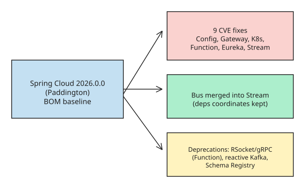

# Spring Cloud 2026.0.0 (Paddington): Nine CVEs Fixed and Architectural Consolidation on Spring Boot 4.2

The Spring Cloud 2026.0.0 release train ("Paddington", GA 2026-11-20) is notable for two reasons: it is a major version baseline built on **Spring Boot 4.2.0**, and it bundles fixes for **at least nine CVEs** across Config Server, Gateway, Kubernetes, Function, Netflix Eureka, and Stream. It is not a routine version bump — several fixes are credential-leak and RCE-class issues, and two modules are architecturally consolidated or deprecated.

## Security fixes (the headline)

### Spring Cloud Config Server

| CVE | Issue |
| --- | --- |
| CVE-2026-59435 | Backend **Git and SVN credentials leaked via property source names** |
| CVE-2026-59436 | Git repos do not validate **SSH host key** when using SSH |
| CVE-2026-59437 | **Man-in-the-middle** possible when using Git + SSH |

The SSH host-key/MITM pair (59436/59437) is a classic "trust-on-first-use" failure class: Config Server silently accepted unknown host keys, making git-over-SSH backends silently downgrade to no server authentication. If you run Config Server against a Git backend over SSH, upgrading is mandatory, not optional.

### Spring Cloud Gateway

| CVE | Issue |
| --- | --- |
| CVE-2026-59425 | `JsonToGrpc` filter leaks gRPC `ManagedChannel` resources |
| CVE-2026-59426 | Global `LocalResponseCache` **leaks responses across routes** |
| CVE-2026-59427 | `LocalResponseCache` stores `private`/`no-store` responses, leaking authenticated content |
| CVE-2026-59428 | WebSocket routing filter **does not enforce same-origin by default** |

CVE-2026-59426/427 are cache-confusion leaks: a response cache that ignores `Cache-Control: private/no-store` or keys without the route identity becomes a cross-user data-leak primitive. CVE-2026-59428 mirrors the long-known "WebSocket hijacking" pattern (WS handshakes are not subject to CORS) — same-origin enforcement now being default is the correct secure-by-default fix.

### Others

| CVE | Component | Issue |
| --- | --- | --- |
| CVE-2026-59434 | Spring Cloud Kubernetes | **RCE via ConfigMap/Secret YAML** (deserialization of YAML into typed config objects) |
| CVE-2026-59439 | Spring Cloud Function | Unbounded JSON collection (DoS) |
| CVE-2026-59440 | Spring Cloud Function | Potential **arbitrary class loading** |
| CVE-2026-59441 | Spring Cloud Stream | Subpackage deserialization |
| CVE-2026-59433 | Netflix Eureka Server | **Credential leakage via dashboard** |

The Kubernetes one (59434) matters most for platform teams: any principal able to create/modify ConfigMaps or Secrets consumed by the Configuration mechanism could reach code execution in the app pod. The Function/Stream entries (59439–441) are deserialization-class issues — the recurring theme in the Spring ecosystem.

## Architectural changes

- **Spring Cloud Bus is no longer its own project** — it has been folded into Spring Cloud Stream (`spring-cloud-stream/tree/v5.1.0/bus`). Artifact coordinates are unchanged, so the move should be seamless for consumers.
- **Deprecations**: Spring Cloud Function's RSocket and gRPC modules; Stream's reactive Kafka binder (upstream Reactor Kafka was discontinued) and the Schema Registry component.
- **Config Server new backends/features**: Google Cloud Storage backend, Azure DevOps workload identity, OAuth 2 for Config **clients** authorizing against the Config Server, HTTP property-path notifier, plain/binary file fetch as `Resource`, S3 environment repo can reuse an `S3Client` bean, `ConfigServerRestClientHolder` made public.
- **Gateway**: MVC flavor now supports **WebSockets**, gained the `LocalResponseCache` filter (now fixed), migrated from Reactor Addons Retry to Framework Core Retry, forwarded-header handling fixed for untrusted proxies.
- **Commons**: new property `spring.cloud.discovery.reactive.combine-instances` — the reactive composite discovery client can now return combined instances from *all* discovery clients instead of the first non-empty result.
- **Kubernetes**: Configuration Watcher gains high-availability support and native-image support for its controller image; Fabric8 → 8.0.0, Kubernetes Java Client → 27.0.0.
- **Netflix**: the Eureka client no longer uses the `@LoadBalanced` `RestClient.Builder`/`WebClient.Builder` for its calls to the Eureka server (avoids load-balancing the bootstrap call itself).
- **Openfeign**: Feign 13.14; nested objects in `@SpringQueryMap` are sent as nested query parameters.
- **Circuitbreaker**: Resilience4J 2.4.0; **Vault**: Spring Vault 4.1.0.

## Upgrade mechanics

BOM import (Maven):

```xml
<dependencyManagement>
    <dependencies>
        <dependency>
            <groupId>org.springframework.cloud</groupId>
            <artifactId>spring-cloud-dependencies</artifactId>
            <version>2026.0.0</version>
            <type>pom</type>
            <scope>import</scope>
        </dependency>
    </dependencies>
</dependencyManagement>
```

Gradle: set `springCloudVersion = "2026.0.0"` and apply the Boot plugin at `4.2.0` — the Boot 4.2 baseline is the main migration risk, not the Cloud modules themselves.

```groovy
plugins {
    id 'org.springframework.boot' version '4.2.0'
    id 'io.spring.dependency-management' version '1.1.7'
}
ext { set('springCloudVersion', "2026.0.0") }
dependencyManagement {
    imports { mavenBom "org.springframework.cloud:spring-cloud-dependencies:${springCloudVersion}" }
}
```



## Action items

1. Treat this as a **security-driven upgrade** if you use Config Server with Git-over-SSH, Gateway's response cache or WebSocket routing, or Spring Cloud Kubernetes config loading.
2. Inventory the deprecated modules (Function RSocket/gRPC, reactive Kafka binder, Schema Registry) and plan replacements before 2026.1.
3. Verify CI resolves Boot 4.2.0 + the 2026.0.0 BOM together before merging dependency bumps.

## References

- Spring Blog announcement: [Spring Cloud 2026.0.0 (aka Paddington) Has Been Released](https://spring.io/blog/2026/11/20/spring-cloud-2026-0-0-has-been-released)
- Release notes wiki: [Spring Cloud 2026.0 Release Notes](https://github.com/spring-cloud/spring-cloud-release/wiki/Spring-Cloud-2026.0-Release-Notes)
- CVE list (search each id on spring.io/security): [CVE-2026-59425](https://spring.io/security/cve-2026-59425), [CVE-2026-59434](https://spring.io/security/cve-2026-59434), [CVE-2026-59435](https://spring.io/security/cve-2026-59435), [CVE-2026-59439](https://spring.io/security/cve-2026-59439)
