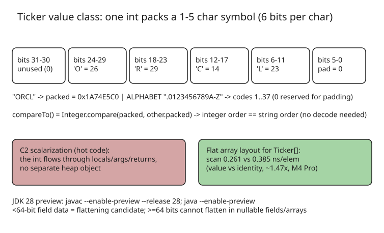

# A Valhalla Ticker in One int: Packed value class (JEP 401, JDK 28 preview)

Concrete, complete demonstration of a Project Valhalla `value` class (JEP 401, preview in JDK 28) that packs a stock ticker symbol (1–5 characters from `.0-9A-Z`) into a **single `int` field**, so HotSpot's C2 compiler can scalarize it — the `int` flows through locals, arguments and returns with no heap allocation.



## The encoding

A 37-symbol alphabet (`.`, `0`–`9`, `A`–`Z`) needs 6 bits per character, so five characters fit in 30 of the 32 bits. Code `0` is reserved for padding, so no length field is needed — decode stops at the first zero slot.

```java
public value class Ticker implements CharSequence, Comparable<Ticker> {
    private static final String ALPHABET = ".0123456789ABCDEFGHIJKLMNOPQRSTUVWXYZ";
    private final int packed; // the one and only instance field

    public Ticker(CharSequence symbol) {
        int length = symbol.length();
        if (length < 1 || length > 5)
            throw new IllegalArgumentException("Expected one to five characters");
        int bits = 0;
        for (int i = 0; i < length; i++) {
            char ch = symbol.charAt(i);
            int code;
            if (ch == '.')                 code = 1;
            else if (ch >= '0' && ch <= '9') code = ch - '0' + 2;
            else if (ch >= 'A' && ch <= 'Z') code = ch - 'A' + 12;
            else throw new IllegalArgumentException("Expected A-Z, 0-9, or .");
            bits = (bits << 6) | code;
        }
        this.packed = bits << (6 * (5 - length)); // left-align in the 30-bit space
    }

    @Override
    public String toString() {
        StringBuilder text = new StringBuilder(5);
        for (int shift = 24; shift >= 0; shift -= 6) {
            int code = (packed >>> shift) & 0x3f;
            if (code == 0) break;
            text.append(ALPHABET.charAt(code - 1));
        }
        return text.toString();
    }

    @Override
    public int compareTo(Ticker other) {
        return Integer.compare(packed, other.packed); // order-preserving!
    }
}
```

Key properties of this encoding:

- **`new Ticker("ORCL")` stores `0x1A74E5C0`** — 6-bit blocks 26/29/14/23/0 ("O","R","C","L",pad).
- **Order preservation**: `ALPHABET` follows `String.compareTo()` order (`.` &lt; digits &lt; letters), the first character sits in the highest slot, and zero padding sorts prefixes first — so `Integer.compare(packed, other.packed)` gives exactly string ordering. Sorting needs no decoding.
- Upper two bits are always zero ⇒ every packed value is non-negative, so signed comparison is safe.
- `length()` and `charAt()` read slots directly (no string built); `subSequence()` decodes via `toString()`.
- Implementing `CharSequence` lets `StringBuilder.append(new Ticker("ORCL"))` produce `Symbol: ORCL` without a `toString()` allocation.

## Performance with Valhalla

- Scalarization is an **optimization, not a guarantee**: it happens in C2-compiled hot code after warm-up. Calls through `CharSequence`/`Comparable` interfaces make the concrete type harder for C2 to see.
- A concrete `Ticker[]` can get a **flat array layout** (bits stored inline, not references). `CharSequence[]` (multiple concrete types) generally cannot.
- Measured (Apple M4 Pro, OpenJDK 28-internal, 8M-element scan benchmark, median of five JVM runs):

| Array | ns per element |
| --- | --- |
| `ValueTicker[]` (flat) | 0.261 |
| `IdentityTicker[]` (not flat) | 0.385 |

  Median within-JVM speedup **1.47×** (range 1.44–1.52×). This measures traversal only — not construction, decoding, or `toString()`. Use JMH on your own workload.

## Build & preview flags

```bash
javac --enable-preview --release 28 Ticker.java
java  --enable-preview  Main
```

Both stages need `--enable-preview`; use matching JDK 28 tools.

## Extension notes from the article

- 6 bits allow 64 codes; with 0 reserved, the alphabet could grow to 63 characters (codes must stay in character order to keep `compareTo` working).
- **≥64 bits of field data cannot normally be flattened** in nullable fields/arrays in JDK 28 (the JVM needs an atomic read/write including null). An `int`+`short`+`byte` (56 bits) would hold nine 6-bit codes.
- The 2 unused high bits encode only 4 distinct values — not enough for lengths 1–5; storing length explicitly requires restricting accepted lengths.
- Frequency-based variable-width codes could save bits but break the simple integer comparison.
- Validate against your exchange's symbol rules (Nasdaq allows longer than 5); see [JEP 401 migration guidance](https://openjdk.org/jeps/401#Migrating-to-value-classes) for when removing identity is appropriate.

## Cross-references in this KB

- [JEP 401 value classes preview overview](explanation-jdk-28-value-classes-preview.md)
- [Better Tools for Immutable Data in Java](explanation-better-tools-immutable-data-java.md)

## References

- [A Valhalla Ticker in One int — Inside Java (Per-Åke Minborg, 2026-11-09)](https://inside.java/2026/11/09/inside-java-ticker-value-class/)
- [JEP 401: Value Objects (Preview) — OpenJDK](https://openjdk.org/jeps/401)
- [Value Objects — Project Valhalla](https://openjdk.org/projects/valhalla/value-objects)
- [OpenJDK value-object performance notes](https://github.com/openjdk/valhalla-docs/blob/main/site/value-objects.md#value-object-performance)
