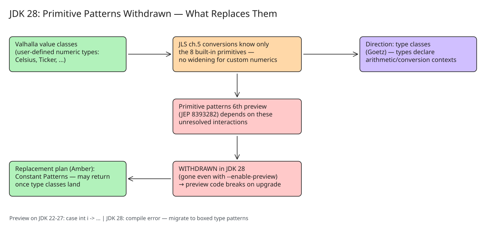

# Value Classes, Numeric Conversions, and the Withdrawal of Primitive Patterns (JDK 28)

Inside Java Newscast #117 (Nicolai Parlog, 2026-11-14) covers two tightly linked Valhalla/Amber
storylines and one retreat: **numeric conversions between custom numeric value classes**, the
longer-term **type classes** idea that could fix them, and the **withdrawal of primitive patterns
from JDK 28**. (The newscast's third headline, JEP 546 adaptive heap sizing for ZGC, is covered in
[[explanation-jep-546-zgc-adaptive-heap-sizing]].)



## Problem 1: custom numeric value classes don't convert like primitives

Java's conversion rules (JLS ch. 5, *Conversions and Contexts*) are defined for the built-in
primitive types: widening primitive conversion, narrowing primitive conversion, boxing, unboxing.
They apply to `int → long`, `byte → float`, etc.

Project Valhalla's **value classes** let you define your own *primitive-like* types — e.g. `Celsius`,
`Fahrenheit`, `UserId`, the packed `Ticker` example in the KB ([[explanation-valhalla-ticker-value-class]]).
But once `Celsius` is a *class* (even a `value class`), the JLS conversion machinery has no idea it
is numeric:

- `Celsius` does not widen to `Fahrenheit`, does not widen to `double`, does not convert through any
  implicit context the way `int` does.
- Every conversion must be an explicit method call (`Celsius.of(fah.toCelsius())`), and generic code
  over "any numeric type" is still impossible — there is no numeric supertype.

This is the gap between *representation* (a value class can be exactly as fast and compact as a
primitive — see the flat `Ticker[]` benchmarks) and *ergonomics* (the language's conversion and
operator contexts still only know the eight built-in primitives).

## The proposed direction: type classes

The direction discussed in the Java team (Brian Goetz's talks on type classes) is to attach
**opt-in capability dictionaries** to types — a type declares that it participates in arithmetic or
conversion contexts, and the language's operators/contexts consult that declaration. This is the
"type class" pattern from Haskell/Scala/Rust scaled to Java's gradual-typing constraints.

Key properties of the plan as discussed:

- Conversions become **declared by the type** (a `Celsius` type could declare a widening path to
  `double` or a mutual conversion with `Fahrenheit`), instead of hardcoded in the JLS for eight types.
- The mechanism is expected to be built on top of value classes themselves — the dictionary instances
  would naturally be value objects.
- **Open questions remain** about how type classes should interact with pattern matching and with
  `instanceof`/`switch` exhaustiveness, which is exactly what blocked the next preview cycle (below).

## Problem 2 (decided): primitive patterns are withdrawn from JDK 28

"Primitive Types in Patterns, `instanceof`, and switch" — the feature that let you write
`case int i ->`, `case 3.14 ->`, `case String s && s.length() > 3 ->`-style patterns over primitives —
has been in preview for several JDK releases. The draft JEP for its **sixth preview**
(draft JEP 8393282) **has been withdrawn**: the feature is removed in JDK 28 and is not available
there **even with `--enable-preview`**.

Why retreat rather than keep previewing?

- The feature's design assumed primitives are the only non-reference types. Valhalla changes that
  foundation: once user-defined value classes are first-class, "pattern over `int`" raises the
  question "pattern over `Celsius`?", and the answer depends on type classes / constant patterns
  that don't exist yet.
- Previewing a feature whose shape depends on unresolved Valhalla interactions locks the spec in the
  wrong direction — the Amber team chose to spend the preview cycle budget on a better-scoped feature.

**Replacement plan:** Amber intends to introduce **Constant Patterns** instead — patterns for compile-time
constants, scoped so they don't conflict with Valhalla's object model. Primitive patterns may return
later, once type classes define how patterns apply to arbitrary "primitive-like" value classes.

```java
// Before (JDK 22–27, preview): primitive patterns
return switch (obj) {
    case int i        -> "int: " + i;          // ✗ withdrawn in JDK 28
    case double d     -> "double: " + d;        // ✗ withdrawn in JDK 28
    case Character c  -> "char: " + c;          // ✗ withdrawn in JDK 28
    default           -> "other";
};

// JDK 28 safe baseline: type patterns on boxed types still work
return switch (obj) {
    case Integer i    -> "int: " + i;           // ✓
    case String s     -> "string: " + s;        // ✓
    default           -> "other";
};
```

## What this means in practice

1. If you ship code using primitive patterns with `--enable-preview` on JDK 22–27, it **breaks on
   JDK 28** — not with a warning, with a compile error after the feature is removed. Audit preview usage
   before upgrading.
2. Custom numeric types stay explicit-conversion for at least another release cycle; design APIs with
   named conversion methods (`toKelvin()`, `fromFahrenheit()`).
3. Watch the Amber spec-experts list for the **Constant Patterns** proposal — it is the successor to
   track, not the old primitive-patterns JEP.
4. JDK 28 early-access builds and the feature list are the source of truth for what actually lands.

## Related notes

- [[explanation-jep-546-zgc-adaptive-heap-sizing]] — the other headline of the same newscast
- [[explanation-valhalla-ticker-value-class]] — a concrete packed value class (representation side)
- [[explanation-java-sealed-classes-exhaustive-pattern-matching]] — the pattern-matching features that survive

## References

- [Inside Java Newscast #117 — Adaptive Heap Sizing + Numeric Conversion + Primitive Patterns](https://inside.java/newscast/117/)
- [Amber spec-experts: Withdrawing the Primitive Patterns preview feature](https://mail.openjdk.org/archives/list/amber-spec-experts@openjdk.org/thread/UYEK3PGOHN6R56AHJTSLPGAY363K666S/)
- [Amber spec-experts: Constant Patterns proposal](https://mail.openjdk.org/pipermail/amber-spec-experts/2026-January/004306.html)
- [JLS ch. 5: Conversions and Contexts](https://docs.oracle.com/en/java/javase/27/docs/specs/jls/jls-5.html)
- [Brian Goetz on type classes](https://www.youtube.com/watch?v=Gz7Or9C0TpM)
- [JDK 28 early-access builds](https://jdk.java.net/28/) and [JDK 28 feature list](https://openjdk.org/projects/jdk/28/)
