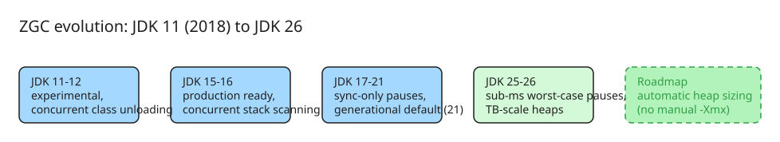

# ZGC: A Decade of Redefining Java Performance

ZGC (the "Z" Garbage Collector) has evolved over the past decade from an experimental feature in JDK 11 into a production-ready concurrent collector powering latency-critical services worldwide. This note summarizes the retrospective talk by Stefan Johansson (Oracle, Java Platform Group) at JavaOne 2026, covering ZGC's history, internal mechanisms, performance in recent JDKs, and future plans.

## Why ZGC exists

Ten years ago, one of Java's biggest performance problems was long GC pause times: "mostly concurrent" collectors like G1 and CMS still did substantial work inside stop-the-world pauses. ZGC's guiding principle is **concurrency** — all heavy GC tasks (marking, relocation, class unloading) run alongside application threads, leaving only tiny synchronization pauses so that application threads and GC threads agree on the current phase.

The initial goal was pause times below 10 ms; today's refined goal is **always below 1 millisecond**, with remaining pauses existing purely for synchronization (phase agreement during marking or object relocation).

## Milestones across the decade

| JDK | Milestone |
| --- | --- |
| 11 | ZGC released as an experimental feature (`-XX:+UnlockExperimentalVMOptions -XX:+UseZGC`) |
| 12 | Concurrent class unloading — no more stop-the-world during class loading/unloading |
| 15 | Production-ready (no longer experimental) |
| 16 | Concurrent thread stack scanning |
| 17 | Pauses reduced to synchronization-only; non-generational mode |
| 21 | Generational ZGC becomes the default out of the box (`-XX:+ZGenerational`) |
| 25/26 | Best-in-class worst-case pauses; generational throughput gains; automatic heap sizing on the roadmap |

## How it achieves low latency

- **Concurrent everything**: marking, object relocation (copying), and class unloading all happen concurrently with application threads.
- **Colored pointers / load barriers**: ZGC uses pointer tagging so that application threads can detect stale references cheaply at load time instead of requiring write barriers for every reference store — this is what keeps the collector concurrent without stalling the app.
- **Generational collection (JDK 21+)**: a young generation lets ZGC handle much higher allocation rates, avoid allocation stalls on smaller heaps, and use less CPU than non-generational mode. This was roughly two years of focused work and is what made ZGC suitable for far more workloads — it now scales from a few hundred megabytes up to the official **16 TB** heap limit (raised from 4 TB in JDK 13).
- **Store barriers in generational mode**: alongside the load barriers of classic ZGC, generational mode also uses store barriers to keep young/old promotion consistent while application threads keep running.
- **Adaptive behaviour**: ZGC is designed to require minimal manual configuration. At runtime it dynamically resizes generations, scales the number of GC threads, and adjusts tenuring thresholds — the main tuning knob is simply giving it a larger maximum heap (`-Xmx`).
- **Pause semantics**: pauses are only used to synchronize phases (e.g., "we are relocating objects now"), typically in the low hundreds of microseconds even at large heap sizes.

## Performance picture (SPECjbb 2015, fixed load)

- JDK 11 ZGC: average pause ~1 ms, worst pauses just under 5 ms — versus G1's default pause target of 200 ms and observed worst-case pauses around 250 ms at the time.
- JDK 17/21 (non-generational): worst-case pauses in the low hundreds of microseconds; further reduced in JDK 25 with generational mode.
- Throughput: significant boost from JDK 11 → JDK 17, a big jump again at JDK 25 (partly GC improvements, partly JIT and platform work). Enabling `-XX:+ZGenerational` on older releases recovers much of the gain.

## When to use it

If you care about short, deterministic response times — trading platforms, real-time APIs, anything where a 100 ms pause is unacceptable — ZGC is the default recommendation in modern JDKs. The main requirement is **heap headroom**: ZGC needs enough free space to finish concurrent cycles before allocation catches up; with sufficient room it works well for essentially all workloads.

## What's next: automatic heap sizing

The remaining manual knob is `-Xmx`, and picking an optimal heap size is genuinely hard (it depends on workload, memory pressure, CPU). The roadmap feature under discussion is **automatic heap sizing**: the JVM dynamically adjusts heap allocation across multiple instances based on system memory and CPU pressure, removing manual heap configuration entirely.

A second open item worth tracking is **faster startup and warmup** with ZGC (JDK 25 draft, [JEP 8329758](https://openjdk.org/jeps/8329758)): pre-touching a large initial heap (`-Xms` == `-Xmx` with `-XX:+AlwaysPreTouch`) and related warmup improvements so that ZGC's low-latency guarantees hold from process start rather than only after warmup.

## Key takeaways

1. Java is a strong choice for low-latency workloads; if you need short deterministic response times, use ZGC.
2. Generational mode (default since JDK 21) is the biggest recent improvement — it raises throughput and lowers CPU cost without hurting pause times.
3. Give ZGC heap headroom; stalls happen when concurrent cycles can't keep up with allocation.
4. Watch for automatic heap sizing to eliminate the last major tuning knob.

## Diagram: ZGC evolution timeline

## Practical status and measured impact (enriched 2026-11-10)

- **Java 25 is the first LTS release where Generational ZGC is the *only* form of ZGC** — the non-generational implementation has been removed. If you are on Java 25+ and choose ZGC, you are automatically on the generational collector (JEP 333 lineage).
- **Measured tail-latency win, default settings, small heap.** Gunnar Morling benchmarked a Quarkus REST microservice (Postgres-backed, 1,000 req/s via Vegeta, 4 CPUs / 4 GB RAM — a typical microservice footprint, not a multi-hundred-GB heap) on JDK 25:
  - Latencies were practically identical up to p99, but **p999/p9999 strongly favored ZGC**; the G1 outliers were confirmed via JDK Flight Recorder as GC pauses **>20 ms**, while ZGC's longest observed pause was **~50 microseconds**.
  - Conclusion: switching to ZGC alone, with zero tuning, substantially improved tail latency. G1 can be narrowed with `-XX:MaxGCPauseMillis` tuning, but ZGC's out-of-the-box behavior is the appeal.
- **No free lunch:** concurrency costs CPU — under high CPU load, ZGC's background GC threads can actually produce *higher* request times than G1 (throughput tax). Also remember GC is not the only source of JVM pauses: deoptimization and heap-dump creation also require safepoints (see Zac Blanco's work on JVM safepoint pauses).
- **Adoption rule of thumb (community consensus, 2026):** latency-sensitive services (p99.9 SLAs, user-facing APIs) → try ZGC first; CPU-bound batch/throughput workloads → G1 remains competitive.

## References

- [Lower Java Tail Latencies With ZGC (Gunnar Morling)](https://www.morling.dev/blog/lower-java-tail-latencies-with-zgc/) — hands-on G1-vs-ZGC benchmark on JDK 25, JFR pause measurements, benchmark source code
- [ZGC vs G1GC in Java 26: Which GC Should You Actually Use? (Java Code Geeks)](https://www.javacodegeeks.com/2026/06/zgc-vs-g1gc-in-java-26-which-gc-should-you-actually-use.html) — current decision guidance
- [ZGC: A Decade of Redefining Java Performance (Inside Java, Stefan Johansson)](https://inside.java/2026-06-30/zgc-performance-decade/) — original talk summary and article
- [JavaOne 2026 ZGC session video](https://www.youtube.com/watch?v=Of0fvtIRwzY)
- [ZGC - Paving the GC On-Ramp (Inside Java, Erik Österlund)](https://inside.java/2025-07-10/javaone-zgc/) — companion talk on ZGC configuration pitfalls
- [JEP: Adaptive Heap Sizing for ZGC (OpenJDK, 8377305)](https://openjdk.org/jeps/8377305) — the formal proposal behind the automatic heap sizing roadmap item
- [JEP draft: Faster Startup and Warmup with ZGC (OpenJDK, 8329758)](https://openjdk.org/jeps/8329758)
- [ZGC project wiki (OpenJDK)](https://wiki.openjdk.org/spaces/zgc/pages/34668579/Main) — authoritative status: supported platforms, JDK-by-JDK release notes, FAQ
