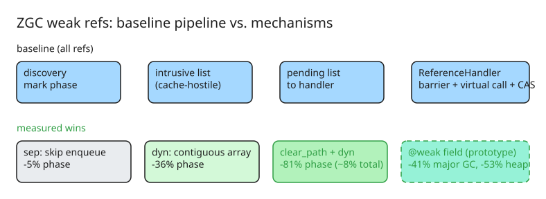

# Simplifying Weak Reference Processing in ZGC

A master's thesis (Fredrik Hammarberg, Uppsala University, with Oracle's GC team in Stockholm) investigates why Java's `WeakReference` processing is a bottleneck in generational ZGC and tests four mechanisms to fix it. Headline finding: **weak-reference overhead is a representation problem, not a pipeline problem** — the best pipeline optimisations only buy ~8% end-to-end, while re-encoding weak semantics as a field annotation (`@weak`) delivers 41% major-collection-time savings.

## The problem

`WeakReference` holds an object without keeping it alive. When the GC finds a weakly reachable object it clears the referent and — *if a `ReferenceQueue` was registered* — enqueues the reference so the app can react. The queue is optional (`new WeakReference&lt;>(obj, null)`), and most real uses (caches, interning maps, listener registries) never register one.

Yet ZGC's pipeline treats **every** discovered weak reference identically:

1. Linked into a per-worker intrusive list via a hidden `discovered` field.
2. Transferred to a pending list.
3. Iterated by the `ReferenceHandler` thread — whether or not anything will actually be enqueued.

That unconditional work scales linearly with the number of weak references (tracked as [JDK-8029205](https://bugs.openjdk.org/browse/JDK-8029205), still open). The intrusive linked list is also cache-hostile: each `WeakReference` object sits somewhere else on the heap, so following the chain loads a new cache line per reference.

## Four mechanisms

### 1. Skip-enqueue separation (`sep`)

At discovery time, check whether the reference has a queue; if not, route it to a separate per-worker list that GC threads process directly — never touching the pending list or `ReferenceHandler`. The queue check happens once at discovery, not per-reference in the hot path:

```java
if (type == REF_WEAK && !has_reference_queue(ref)) {
    weak_no_queue_list_per_worker.append(ref);  // bypasses pending list entirely
} else {
    discovered_list_per_worker.append(ref);     // normal enqueue pipeline
}
```

Modest on its own: −5% single-object / 0% multi-object.

### 2. Dynamic array (`dyn`)

Replace the scattered intrusive linked list with a contiguous `ZWeakRefArray` on the C heap. Appends are O(1) amortised; iteration is sequential index access that stays in L1/L2 cache. The array keeps its capacity between cycles to avoid reallocation when the reference population is stable. Side benefit: field data can be pre-loaded at discovery and stored inline, enabling the next optimisation.

### 3. Optimised clear path (`clear_path`)

The standard clear performs three operations: a load barrier, a virtual call to determine the reference type, and a CAS through a ZGC barrier to store a coloured null. For queue-less weak references all three are removable:

- **Load barrier eliminated** — with `dyn`, the referent address is pre-loaded into the array entry.
- **Virtual call eliminated** — the reference type is statically known at the call site.
- **CAS replaced by a plain store** — the only concurrent operations on the referent field are clearing/enqueueing (both null it), so a plain store is correct.

Individually each is small (−7% and −36%), but **together they are superadditive**: `clear_path + dyn` hits an 81% reduction in the concurrent non-strong phase. The dynamic array removes the pointer-chasing bottleneck that would otherwise survive eliminating the CAS, and pre-loaded data removes the last barrier.

### 4. Weak fields (`weak_fields`)

The three pipeline optimisations speed up *processing*, but the `WeakReference` objects themselves still get marked, promoted, and relocated every cycle. `weak_fields` removes them from the equation entirely by encoding weak semantics as a field annotation:

```java
// Instead of:
public class Cache {
    private final WeakReference<Value> entry;
}

// With the @weak annotation:
public class Cache {
    private @weak Value entry;
}
```

The annotation is recognised by the class-file parser and stored in `fieldInfo` metadata. At mark time, ZGC's marking closure checks each reference field against `fieldInfo` and diverts `@weak` fields to a per-worker `ZWeakFieldArray` instead of treating them as strong references. After marking, unreachable weak fields are nulled via a CAS. This aligns Java with Go's `weak.Pointer`, C++'s `std::weak_ptr`, and .NET's `WeakReference<T>`, which all treat weak reachability and cleanup notification as separate concerns.

## Benchmarks and results

Two custom microbenchmarks (20M holder objects on one shared target; 2M objects in five 20% release rounds) on an exclusive AMD EPYC 9454P node (48 cores, 768 GiB), 100 GB heap, 250 iterations per variant, on the UPPMAX Pelle cluster. Metric: `Concurrent Process Non-Strong` wall time.

| Variant | Single-object | vs baseline | Multi-object | vs baseline |
| --- | --- | --- | --- | --- |
| `none` (baseline) | 996.9 ms | — | 44.1 ms | — |
| `sep_only` | 943.8 ms | −5% | 44.1 ms | 0% |
| `dyn_only` | 639.1 ms | −36% | 27.5 ms | −38% |
| `clear_path_only` | 923.7 ms | −7% | 41.5 ms | −6% |
| `clear_path_dyn` | 187.9 ms | **−81%** | 18.8 ms | **−57%** |
| `all` | 184.4 ms | **−81%** | 18.7 ms | **−57%** |
| `weak_fields` | 484.6 ms | −51% | 35.8 ms | −19% |

Even the 81% phase reduction translates to only ~8% total collection time — the phase is a small slice of a full cycle. `weak_fields`, by eliminating millions of wrapper objects from every phase of every cycle, delivers **41% major-collection-time savings and 53% heap savings** (1720 MB → 806 MB) in the single-object benchmark. Its implementation is heavier: 27 files touched versus at most 10 for the most complex pipeline variant, and it remains a prototype.

## Key takeaways

1. **Optimising the pipeline has a ceiling.** Even a 5× speedup of the targeted phase moves total collection time by single digits.
2. **Representation beats pipeline.** Removing the wrapper objects (`@weak`) wins because it reduces work in *every* GC phase, not one.
3. **Optimisations interact superadditively** — cache-friendly structure and simplified per-element logic must land together to compound.
4. **The ecosystem already split the concerns** (Go, C++, .NET): weak reachability is cheap by default; cleanup notification is opt-in. Java's single uniform path pays the notification cost even when nobody enqueues.
5. Path forward per the thesis: integrate one or more pipeline variants into OpenJDK (low-risk, modest win); treat `@weak` as the structural fix if the language is willing to change.

## Diagram: baseline pipeline vs. mechanisms



## The 2026 GC landscape around this work

Context for why the thesis targets *generational* ZGC specifically:

- **JDK 25 (LTS)** is the first release where generational ZGC is the **only** ZGC — the non-generational implementation was removed. Any weak-reference optimisation landing now lands on the generational collector.
- **Generational Shenandoah** went experimental in JDK 24 and production-ready in JDK 25 (no experimental flags), so low-pause collectors are now a three-way race.
- **JDK 26's JEP 522** cut synchronization overhead between application and GC threads in **G1**, narrowing (not closing) G1's latency gap — G1 remains the throughput-favouring default, with independent 2026 benchmarks showing generational ZGC at ~1.4 ms p99.9 vs G1's ~95 ms on latency-sensitive heaps, at a throughput cost.
- The practical read for the thesis findings: teams stuck on G1 for "weak-reference-heavy caches" (the JDK-8029205 pain point) get relief from moving to generational ZGC *plus* the pipeline fixes; the `@weak` annotation remains the bigger structural win if it ever graduates from prototype.

## References

- [Simplifying Weak Reference Processing in ZGC (Inside Java, Fredrik Hammarberg)](https://inside.java/2026/06/11/thesis-simplify-weak-reference-processing-zgc/) — original article
- [Thesis: Optimising Weak Reference Processing in HotSpot's Z Garbage Collector (Uppsala DiVA)](https://uu.diva-portal.org/smash/get/diva2:2068442/FULLTEXT01.pdf) — full paper
- [Source code (OpenJDK fork with all four mechanisms)](https://github.com/efreham1/SimplifyingWeakRefs)
- [Measurement dataset (Zenodo)](https://doi.org/10.5281/zenodo.20445473)
- [JDK-8029205: weak reference handling overhead (OpenJDK bug tracker)](https://bugs.openjdk.org/browse/JDK-8029205)
- [Generational ZGC on JDK 25: benchmarks vs G1 (ankurm.com)](https://ankurm.com/generational-zgc-jdk-25-vs-g1/) — JDK 25 LTS context, p99.9 measurements
- [ZGC vs G1GC in Java 26: which GC should you actually use? (JavaCodeGeeks)](https://www.javacodegeeks.com/2026/06/zgc-vs-g1gc-in-java-26-which-gc-should-you-actually-use.html) — JEP 522 G1 synchronization changes
- [Companion KB note: ZGC: A Decade of Redefining Java Performance](explanation-zgc-decade-of-low-latency-gc.md)
