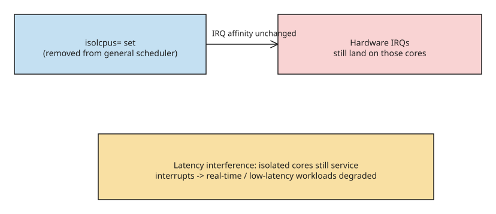

# isolcpus Takes CPUs Off the Scheduler, but Hardware IRQs Still Land There

`isolcpus=` is a **scheduler** isolation hint. It stops userspace tasks landing
on the named cores. It does **not** stop hardware interrupts from firing there.
This is the missing "IRQ half" of isolation that most GRUB files get wrong:

```bash
GRUB_CMDLINE_LINUX_DEFAULT="isolcpus=0,1"
# then update-grub (or grub2-mkconfig) and reboot
```

The author watched seven tight loops leave CPU0/1 idle for processes while
`/proc/interrupts` still ticked on those cores. For DPDK, a user-space NIC, or a
cycle-accurate loop, scheduler isolation is necessary and **not sufficient**.



## How to see what you actually isolated

```bash
cat /proc/cmdline            # isolcpus=0,1 must be present
grep PREEMPT /boot/config-$(uname -r) || true
taskset -cp 1               # a known userspace pid; should NOT be 0 or 1
watch -n1 'grep -E "^ *[0-9]" /proc/interrupts | head'
```

If IRQs still increment on CPU0/1, isolation is incomplete — which is expected
with classic `isolcpus=`.

## The modern split

- `isolcpus=domain` / cpusets / cgroup cpuset — userspace
- `isolcpus=managed_irq` or manual `irqaffinity` / `/proc/irq/*/smp_affinity` —
  interrupts
- `nohz_full=` — tick reduction; another knob, not a substitute

`isolcpus` is also marked deprecated in some trees in favor of cpusets; the IRQ
caveat did not go away when the docs changed the preferred interface.

## Moving IRQs by hand

```bash
# find the noisy ones (eth0, NVMe, GPU)
grep -E 'eth|nvme|enp' /proc/interrupts
# smp_affinity is a hex CPU mask. CPU2 only -> 4
echo 4 > /proc/irq/IRQNUM/smp_affinity
```

Or set the default affinity so *new* IRQs skip 0/1: `irqaffinity=2-7` on the same
GRUB line (adjust to your CPU count). Some devices ignore it (managed IRQs,
VFIO). For full isolation at the driver, bind the NIC to `vfio-pci` and poll from
a pinned thread.

## The irqbalance wildcard

Most distros run **irqbalance** as a daemon that continuously re-binds IRQs
across *all* online CPUs — including ones you isolated. If `/proc/interrupts`
shows IRQ counts wandering back onto CPU0/1 minutes after you pinned them,
check whether irqbalance is the actor (`systemctl status irqbalance`, or its
logs). Options: disable the daemon on the machine, or use its ban list
(`/etc/irqbalance.banlist` for per-IRQ exclusion) so it leaves your cores alone
while keeping general balancing elsewhere.

## When this shows up next to SR-IOV

Passing a VF into KVM does not pin host IRQs for you. `intel_iommu=on iommu=pt`
is a different checklist. Typical datapath box:

1. IOMMU on, VFs created, `vfio-pci` bound.
2. `isolcpus` **and** IRQ affinity so the poll thread is not preempted by the
   host NIC's own interrupt.
3. Confirm with `/proc/interrupts`, not `top`.

## References

- [isolcpus and IRQs (dev.to)](https://dev.to/sunshoutkernel/isolcpus-takes-cpus-off-the-scheduler-hardware-irqs-still-land-there-ihe)
- [irqbalance (official source tree)](https://github.com/Irqbalance/irqbalance)
- [Red Hat Tech Brief: Optimizing RHEL Performance by Tuning IRQ Affinity](https://access.redhat.com/articles/216733)
- [Linux kernel docs: generic IRQ handling](https://docs.kernel.org/core-api/genericirq.html)
- [Linux kernel docs: CPU isolation (isolcpus, nohz_full, housekeeping)](https://docs.kernel.org/admin-guide/cpu-isolation.html) — canonical reference for the scheduler/tick knobs

## Related
- [[explanation-linux-containers-namespaces-cgroups]]
- [[explanation-bpf-vs-logs-metrics-observability]]
