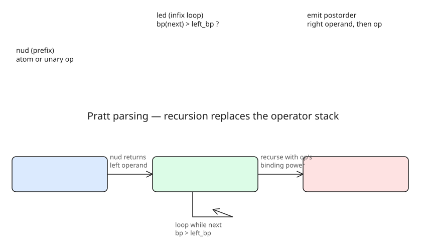

# Pratt Parsing: Turning Shunting-Yard Into Recursion (nud/led)

Pratt parsing ("top-down operator precedence") is a single-loop expression parser that replaces shunting-yard's explicit operator stack with the **call stack**. It barely appears in formal CS curricula (the Dragon Book doesn't mention it) — its most mainstream exposure is *Crafting Interpreters*, plus Pratt's original 1979 paper.

## Shunting-yard, briefly
- Output stream + operator stack; each operator has a **binding power** (higher binds tighter).
- Operator token: if higher binding power than stack top, push; else pop all operators with higher-or-equal power to the output, then push (assumes left-associativity).
- Weakness: no concept of "subexpressions" — parentheses, unary operators, right-associative chains, and varargs all get awkward to bolt on.

## The transformation
Replace the explicit stack with recursion: `expr(parser, left_bp)` parses a **prefix** token first (what Pratt calls the **nud** — "null denotation": atoms or unary operators), then loops: while the next token's binding power exceeds `left_bp`, consume the operator (the **led** — "left denotation" half) and recurse on the right operand with that operator's binding power as the new `left_bp`. Unwinding the recursion is the same as popping the operator stack. Unlike recursive descent, calls nest only when entering subexpressions — not once per precedence level.

```c
void expr(Parser *p, int left_bp) {
    if (cur(p) == '(')      { bump(p); paren(p); }      // nud: prefix tokens
    else if (isdigit(cur(p))) { printf("EMIT '%c'\n", cur(p)); bump(p); }
    else { fprintf(stderr, "expression doesn't start with a number\n"); abort(); }

    while (left_bp < get_bindpower(cur(p))) {          // led: infix loop
        int new_left_bp = get_bindpower(cur(p));
        char op = cur(p);
        bump(p);
        expr(p, new_left_bp);                          // right operand first
        printf("EMIT '%c'\n", op);
    }
}
```

`get_bindpower` defines `['\0'] = 0` so the loop terminates. Adding parentheses is just `['('] = 0` plus `paren() = expr(p, bp('('))` and a matching `')'` check. Extending further means either adding a token to the `bps` table plus a branch, or (the *Crafting Interpreters* generalization) coalescing into a rule struct: binding power + prefix routine + infix routine per operator. The author's structured C example (unary `+`/`-`, postfix `!`) lives in [their snippets repo](https://git.unix.dog/yosh/snippets/src/branch/main/c/pratt).



## Why this shape
- **Prefix operators get first-class handling** in the first half of `expr()` (nud) — unary and parenthesized expressions are just another token rule.
- **Arbitrary code per operator** as soon as the operator is seen (like recursive descent), but the single loop handles precedence instead of a hand-written production per level.
- `1+5*2+6` → `1 5 2 * + 6 +`; `1+5*(2+6)` → `1 5 2 6 + * +`.

## References
- [Pratt parsing, unix.dog (~yosh, 2026-10-25)](https://www.unix.dog/~yosh/blog/2026-10-25_pratt-parsing.html) — C implementation, shunting-yard → pratt walkthrough
- [Crafting Interpreters: Compiling Expressions](https://craftinginterpreters.com/compiling-expressions.html) — the rule-table generalization
- [Pratt's original paper (tdop.github.io)](https://tdop.github.io/)
- [Shunting-yard algorithm (Wikipedia)](https://en.wikipedia.org/wiki/Shunting_yard_algorithm)
