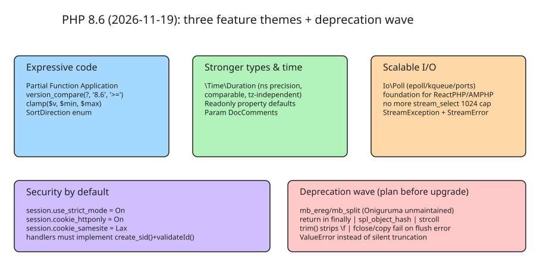

# PHP 8.6: Partial Function Application, Duration, Polling API and the Big Deprecation List

PHP 8.6.0 released **2026-11-19** ("Faster, Safer, More Powerful"). The release clusters into three themes: **more expressive code** (Partial Function Application, `clamp()`, `SortDirection`), **stronger types and time handling** (`\Time\Duration`, readonly property defaults), and **scalable I/O** (the new `Io\Poll` polling API, structured stream error handling) — plus one of the largest deprecation lists in a PHP minor release.



## Partial Function Application (PFA)

Some arguments can be supplied in advance using `?` and `...` placeholders; the result is a `Closure` that accepts the rest. The function only runs once all arguments are provided:

```php
// Before: wrap in a closure by hand
$supportsPfa = array_filter(
    $versions,
    fn ($version) => version_compare($version, '8.6', '>='),
);

// PHP 8.6: placeholder for the missing first argument
$supportsPfa = array_filter(
    $versions,
    version_compare(?, '8.6', '>='),
);
```

PFA composes nicely with named placeholders (`attempt: ?`), e.g. pre-configuring a retry/backoff helper into a reusable `$waitBeforeRetry($attempt)` callable.

## `\Time\Duration`

A stopwatch-style elapsed-time value type: timezone-independent, nanosecond precision, range > 250 years. Built for timeouts and benchmark timings:

```php
use Time\Duration;

$delay = $baseDelay->add($step->multiplyBy(2 ** $attempt));
$delay = min($delay, Duration::fromSeconds(30));  // Durations are comparable
time_nanosleep($delay->seconds, $delay->nanoseconds);
```

Replaces the `usleep(min($delay, 30_000_000))` microsecond-integer idiom with a typed, comparable value. `clamp()` works on it directly (see below).

## `Io\Poll` — the polling API

`stream_select()` typically caps at ~1024 connections. The new `Io\Poll\Context` uses the best native mechanism per platform (epoll, kqueue, event ports, WSAPoll) and is explicitly designed as a **common foundation for event-loop libraries** such as ReactPHP and AMPHP:

```php
use Io\Poll\{Context, Event};

$poll = new Context();  // picks epoll/kqueue/... automatically
$poll->add(new StreamPollHandle($server), [Event::Read]);

while (true) {
    foreach ($poll->wait() as $watcher) {
        $stream = $watcher->getHandle()->getStream();
        if ($stream === $server) {
            $poll->add(new StreamPollHandle(stream_socket_accept($server)), [Event::Read]);
            continue;
        }
        // read / handle close / watcher->remove()
    }
}
```

## Smaller additions

- **`clamp($value, $min, $max)`** — replaces the `max(0, min($v, 100))` idiom; works on any comparable value, including `Duration`.
- **`SortDirection` enum** (`Ascending`/`Descending`) — a stdlib-wide, type-safe sort order. Previously libraries invented incompatible ints/strings/bools; `SORT_STRING` accidentally passed to a `match (SORT_ASC|SORT_DESC)` blew up at runtime, whereas the enum turns it into a `TypeError` at the boundary.
- **Readonly property defaults** — readonly properties can declare defaults instead of assigning fixed values in the constructor.
- **Stream error handling** — stream ops can be configured (`error_mode => StreamErrorMode::Exception`) to throw `StreamException` with structured `StreamError` objects (`code` as `StreamErrorCode` enum, wrapper name, path) instead of emitting warnings; also `stream_last_errors()`.
- **DocComments for function parameters** — parameter-level documentation support.

## Security-relevant defaults and the deprecation list

Sessions are hardened **by default**: `session.use_strict_mode` and `session.cookie_httponly` are enabled, and `session.cookie_samesite` is `Lax`. Custom session handlers that don't implement both `create_sid()` and `validateId()` are deprecated.

Notable deprecations / BC breaks to plan for before upgrading:

- `return` inside `finally` (silently discards exceptions) — deprecated.
- Returning values from `__construct()`/`__destruct()` (and making them generators) — deprecated.
- `let` and `is` as class/function/constant names; `readonly` as a function name; `_` as a constant name.
- **mbstring regex functions** (`mb_ereg()`, `mb_split()`, …) — the underlying Oniguruma library is unmaintained; migrate to PCRE with the `u` modifier.
- Aliases `is_double()`, `is_long()`, `is_integer()`, `doubleval()`; `spl_object_hash()` (use `spl_object_id()`); `strcoll()`/`SORT_LOCALE_STRING` (use intl `Collator`).
- `trim()`/`ltrim()`/`rtrim()` now also strip form feed (`\f`) by default.
- `fclose()`, `file_put_contents()`, `copy()` now return `false` on flush/close failure instead of silently ignoring it.
- Many functions now throw `ValueError` for out-of-range values, invalid flags, or NUL bytes instead of silent truncation.

## Why it matters

- The Polling API is the first stdlib primitive that lets pure-PHP servers compete with async runtimes on connection scale without an extension dependency.
- `Duration` + `clamp()` + PFA remove large categories of helper code; `SortDirection` is the first stdlib-wide type-safe cross-library enum convention.
- The deprecation list (especially mbstring regex and silent stream warnings) is the migration work — audit `mb_ereg|mb_split|spl_object_hash|strcoll` in your codebase before bumping.

## References

- Official release announcement and feature guide: [PHP 8.6 Release Announcement — php.net](https://www.php.net/releases/8.6/en.php)
- Full change list: [PHP 8 ChangeLog](https://www.php.net/ChangeLog-8.php#PHP_8_6)
- Migration guide: [Migrating to PHP 8.6 — php.net manual](https://www.php.net/manual/en/migration86.php)
- Stdlib investment background (SortDirection): [The PHP Foundation blog](https://thephp.foundation/blog/2026-11-03/stdlib-investment/)
