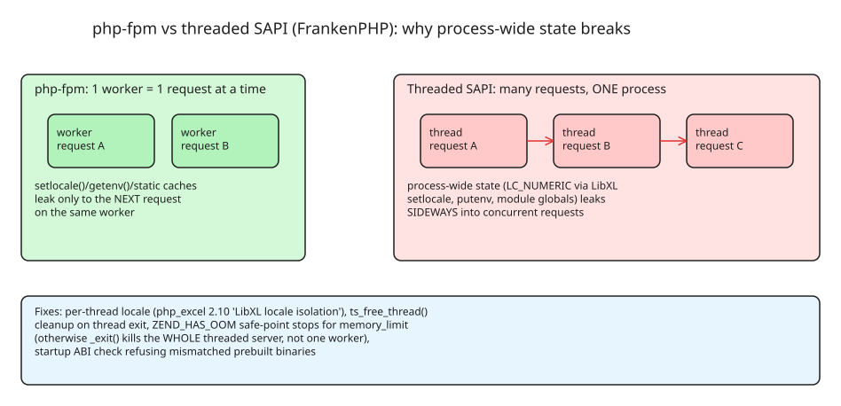

# Why ZTS Breaks PHP Extensions Written for php-fpm: Shared State, Thread Lifecycle, and the memory_limit Trap

Most PHP extensions are written and tested under **php-fpm**, where a worker serves one request at
a time — so anything "process-wide" behaves as if it were private to the request. Threaded SAPIs
(**FrankenPHP**, embed SAPI) run many requests concurrently in **one process**, and every
`setlocale()`, `getenv()`, static cache, or `_exit()` becomes shared with every request in flight.
PHP's **ZTS (Zend Thread Safety)** model gives each thread its own *engine* globals, but it does
nothing for **C-level process globals** the extension or its vendored libraries mutate. A November
2026 release round fixed exactly this class across ten extensions (right after PHP 8.6.0 landed on
the 19th), making it a clean natural experiment in what "works under php-fpm" really means.

 — process-wide state leaking sideways between concurrent threads vs. sequential leakage under php-fpm, and the mitigation set.

## 1. Process-wide state is shared state (sideways vs. sequential leaks)

Under php-fpm a global can leak from one request only into the **next** request on the same worker.
Under threads it leaks **sideways, concurrently**. Concrete bugs from the round:

- **Locale hijacking (php_excel 2.10.0):** LibXL calls `setlocale()` while creating/loading/saving
  workbooks, and the C locale is **process-wide**. Two concurrent saves could pin `LC_NUMERIC` to
  `C` for *every* thread. Fix: LibXL runs on a **per-thread locale** layered on `C`
  (`phpinfo()` reports "LibXL locale isolation"). Behavioral consequence to know: on ZTS + glibc,
  LibXL no longer follows your `setlocale()` — call `ExcelBook::setLocale()` instead.
- **Stalled syscalls block threads (statgrab 2.3.2):** an `sg_fs_stats()` stuck on a hung NFS-style
  mount blocked other threads' statgrab calls on glibc; and `sg_error_details()` could report a
  *previous* request's error in FrankenPHP worker mode.
- **Per-thread conversion state poisoning (php_clickhouse 0.14.0):** a conversion abandoned by a
  fatal error kept its NULL/nesting-depth state per thread, so a later request accepted `NULL` for
  a non-Nullable column or failed with bogus "nested-type depth exceeds limit".
- **Env race (fastchart 1.9.0):** reading `FASTCHART_NETWORK_SCALAR` without PHP's environment lock
  raced a `putenv()` from another thread.
- **Global lock convoy (pdo_duckdb 0.9.0 → 0.10.0):** the ZTS build serialized **every query** on a
  shared DuckDB file. Measured: 4 concurrent aggregate queries took wall 9.19 s on 0.9.0 vs
  **2.01 s on 0.10.0**, which allows concurrent `SELECT`s while still queueing writes so concurrent
  autocommit updates don't collide.

The shape of every bug: *a global that was safe under the one-request-per-process model and wrong
under the many-requests-per-process model*.

## 2. Thread lifecycle is where the crashes were

php-fpm workers start the module once and live until exit. Threaded servers **start, retire, and
unload around running threads** — and each transition hid a crash:

- **`session.auto_start=1` + per-thread module init (phpser 0.11.0):** on ZTS, the first request on
  each *new thread* crashed because ext/session decoded the stored session before the serializer
  had initialized that thread.
- **Missing `ts_free_thread()` (fastchart 1.9.0):** embed-SAPI hosts can let worker threads exit
  without `ts_free_thread()`; PHP then runs the extension's **globals destructor on the main thread
  at shutdown**, which freed the *calling* thread's FreeType state instead of the handed-over one.
  Any extension with per-thread globals must clean up in `ts_free_thread()` (phpser 0.11.0 now
  wipes cached signing keys there).
- **`assert()` is a whole-server abort:** vendored plutovg/qrcodegen was compiled without
  `-DNDEBUG`. Under php-fpm a failed assertion kills one worker; under a threaded SAPI `abort()`
  ends **every request in the process**.
- **Small thread stacks:** musl defaults to 128 KiB per thread stack. phpser 0.11.0 now throws the
  engine's "Maximum call stack size" `Error` (encode) or rejects the payload (decode) instead of
  segfaulting on deep recursion.
- **ABI guard:** prebuilt binaries now refuse to start on a PHP patch older than the one they were
  compiled against, instead of loading and crashing mid-request on a missing symbol.

## 3. The memory_limit trap: one overrun exits the whole server

Since the October 2026 fixes (PHP 8.2.35 / 8.3.36 / 8.4.27 / 8.5.12 / 8.6.0), the engine records the
`memory_limit` error and raises it at the **next safe point**. A C loop that never reaches a safe
point keeps allocating until the **hard limit (default 2× memory_limit)** — then the engine calls
`_exit()`. Under php-fpm that costs one worker; **under FrankenPHP, exit status 137 ends the whole
server and every request in it**. The November round pushed the safe-point stop into extensions
that lacked it (fastchart's raster encoders could allocate an 8192×8192 PNG in one step past the
limit; fastjson, php_clickhouse, statgrab, phpser loops now stop on a pending error).

Build-time caveat: the stop is compiled in only against headers defining **`ZEND_HAS_OOM`** —
source builds on patched PHP have it; prebuilt binaries split into two groups depending on their
headers. And `max_execution_time` interruption of DuckDB queries works on Linux/FreeBSD ZTS and
non-ZTS POSIX builds, **not** on macOS ZTS or Windows.

## What this means for your stack

If you run FrankenPHP or embed SAPI in production, audit every extension's vendored libraries for
process-wide mutation (`setlocale`, `putenv`, static caches, `assert`) and pin versions that carry
the ZTS fixes. If you *write* extensions, test on ZTS builds, clean up in `ts_free_thread()`, build
vendored deps with `-DNDEBUG`, and treat `_exit()` reachability as a server-wide outage primitive.
FrankenPHP's internals doc confirms the model: each PHP execution runs on a **real POSIX thread**
(not a goroutine) precisely because the ZTS model requires it.

## References

- [Original article (dev.to, iliaa)](https://dev.to/iliaa/what-threads-broke-in-ten-php-extensions-22ee)
- [FrankenPHP internals: threads, state machine, and CGO](https://frankenphp.dev/docs/internals/)
- [pdo_duckdb 0.10.0 release notes](https://github.com/iliaal/pdo_duckdb/releases/tag/0.10.0)
- [php_excel 2.10.0 release notes](https://github.com/iliaal/php_excel/releases/tag/2.10.0)
- [phpser 0.11.0 release notes](https://github.com/iliaal/phpser/releases/tag/0.11.0)
