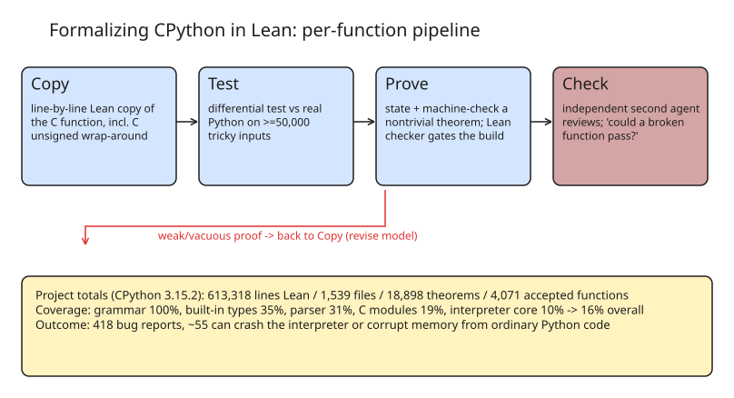

# Formalizing CPython in Lean: AI-Written Machine-Checked Model, 418 Bug Reports

David Andrews & Chao Zhang pointed AI agents (Claude Opus 5.5, with GPT-6.1 Sol in Codex for final report review) at CPython 3.15.2 and produced a **line-by-line Lean 4 model of the interpreter**: 613,318 lines of Lean across 1,539 files, 18,898 theorems — all machine-checked on every build — and **418 bug reports against CPython**, ~55 of which can crash the interpreter or corrupt memory from ordinary Python code.

## Why formalize something whose spec is "whatever CPython does"

Python has no precise written semantics — the reference manual covers normal use and says little about the odd corners where bugs live (dict mutated during lookup, error thrown mid-update, one-past-max in C arithmetic). A proof *forces* you to state exactly what a function does in every case, because the checker rejects vagueness. Proofs thus double as a bug-finding instrument.

## The four-step pipeline per function

1. **Copy** — rewrite the C function in Lean line by line, including error messages, odd corners, and C's *unsigned wrap-around arithmetic* (`uadd`/`usub`, wrapping past 2⁶⁴).
2. **Test** — run the Lean copy and real Python side by side on ≥ **50,000 adversarial inputs**; any disagreement means the copy is wrong.
3. **Prove** — state an invariant and machine-check it; if it's actually false, prove that instead.
4. **Check** — a **second agent that didn't write the code** reviews it against the original and attacks it. Only accepted work counts (4,071 functions so far).

Example: `get_len_of_range()` from `Objects/rangeobject.c` and its Lean mirror `getLenOfRange` keep identical unsigned semantics; the proof ties the fast path, the slow bignum path, and the dispatcher to one correct count.

## The hard part: proofs that prove nothing

The first breadth-first attempt produced correct-but-vacuous proofs — fewer than half of checked functions held up, 21% in the worst file. "If it returns, the result is ≥ 0" is true of a function that *always crashes*. The reviewer's filter question became: **"could a broken version of the function pass this proof?"**

| Mutant function | "returns ≥ 0" | "always returns the right count" |
| --- | --- | --- |
| Always crashes | passes ✅ | caught 🛑 |
| Returns 0 for very large numbers | passes ✅ | caught 🛑 |
| Off-by-one counting down | passes ✅ | caught 🛑 |

Weak proofs send you back to make the *model* more realistic (e.g., letting user code raise exceptions mid-call). Acceptance rates climb over review rounds (e.g. `typeobject.c`: 0→135 of 142 over 5 rounds); a round can go **down** when a reviewer invalidates previously accepted work — everything depending on it is withdrawn.

Additionally, every accepted theorem is re-run against real Python: a *checked* proof only guarantees the statement follows from the copy, not that the copy matches Python. That layer caught proofs that were valid and still wrong (e.g. the "16-terabyte string" case).

## Coverage snapshot (accepted + checked, CPython 3.15.2)

| Area | Coverage |
| --- | --- |
| Grammar rules | 100% |
| Built-in types | 35% |
| Parser | 31% |
| C modules | 19% |
| All of CPython | **16%** |
| Interpreter core / stdlib | 10% / 9% |

## Why it matters

- Precedent stack: seL4 (kernel), CompCert (compiler), Watt's WebAssembly spec, Bodin et al.'s mechanised JavaScript — but this is mechanisation at *AI-agent scale* on a beloved, spec-less codebase, echoing the Julia-in-Lean (400+ Base bugs) result.
- Demonstrates a working **agent QA protocol**: writer/reviewer separation, differential testing as ground truth, mutation-style proof-strength screening, and monotone-with-rollback acceptance. Directly applicable to AI-written code review pipelines.
- Most of CPython remains `todo`; the project is open — contributions follow `AGENTS.md` in the repo, and independent reviews count as much as new models.

## Cross-references in this KB

- Precedent lineage: seL4, CompCert, mechanised WebAssembly/JavaScript specs — and Miles Cranmer's *Formalizing Julia in Lean* (400+ Base bugs), cited by the project itself
- [Harbor Oracle/NOP evaluation discipline](../../../tutorials/aimachinelearning/llmevaluation/tutorial-harbor-coding-agent-evaluation-oracle-nop.md) — "could a broken version pass your test?" is the same question

## References

- [Formalizing CPython — broyojo.com/python-formalization/ (Andrews & Zhang, 2026-11-09)](https://broyojo.com/python-formalization/)
- [Code & data — github.com/Broyojo/python-formalization](https://github.com/Broyojo/python-formalization)
- [Discussion thread on discuss.python.org](https://discuss.python.org/t/formalizing-cpython-in-lean-findings-from-a-machine-checked-model-and-how-youd-like-them/109978)
- [Formalizing Julia in Lean (400+ Base bugs) — Miles Cranmer](https://discourse.julialang.org/t/formalizing-julia-in-lean-and-finding-400-bugs-in-base/140243)
