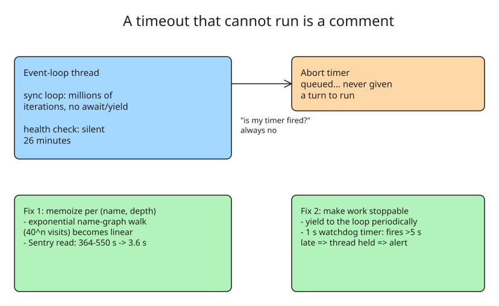

# The Timeout That Never Fired: Event-Loop Starvation, Exponential Name Walks, and Watchdog Timers

A production postmortem with two transferable lessons. One request froze an entire API for **26.5 minutes (1,593,543 ms)** — no errors, no crash, no other request logged; the health check failed and the proxy refused everything until the single request finished. Two independent bugs stacked: an **exponential algorithm** made the work slow, and a **timeout that structurally could not fire** made it fatal.

## Bug 1: the tree that wasn't a tree

The endpoint inspected a Python package for default AI model ids, which requires walking class inheritance bases to depth 6 — **looking bases up by name**. In Django-style code (Sentry), hundreds of classes are named `Meta` or `Serializer`, and their bases are also named `Meta`. So a name lookup doesn't return one class; it returns *every declaration of that name*, and each fans out again: an **exponential blowup wearing a tree's clothes**.

The reproducible toy — 40 classes named `Meta`, each subclassing `Meta`:

```python
import time
from functools import lru_cache

classes = {"Meta": [["Meta"] for _ in range(40)]}

def holds(name, depth, seen=None):
    seen = seen if seen is not None else [0]
    seen[0] += 1
    if depth == 0:
        return False
    for bases in classes.get(name, []):      # every declaration of the name
        for base in bases:
            if holds(base, depth - 1, seen):
                return True
    return False

@lru_cache(maxsize=None)
def holds_memo(name, depth):
    if depth == 0:
        return False
    return any(holds_memo(b, depth - 1)
               for bases in classes.get(name, []) for b in bases)
```

Measured (Python 3.9): depth 3 → 65,641 visits; depth 4 → 2,625,641 visits; depth 5 → **105,025,641 visits, 16.58 s** — every level multiplies work ×40. The memoized version at depth 6: **7 visits, 0.0001 s**, because there are only `(#names × depths)` distinct questions. The production fix (memoize per name+depth, clear each round) took the Sentry read from **364–550 s to 3.6 s** with identical answers.

**Rule: "look it up by name" is a graph, not a tree, the moment two things can share a name. Memoize anything that walks it.**

## Bug 2: a deadline check inside a synchronous loop is decoration

The slow walk explains slowness, not the 26-minute full outage. The read *had* a timeout, and the loop even checked "has my signal been aborted?" every iteration. But **in an event loop (JavaScript's, Python's asyncio, any of them), a timer can only fire when the thread gets a chance to run something else**. The loop did millions of synchronous iterations with no `await`/yield, so the abort timer sat queued while the loop dutifully asked "has my timer fired?" — and the answer kept being no. (Like checking your phone for a text while holding it face down in a drawer.)

The fix set:

1. **Make the work smaller** — memoization turns the exponential walk linear.
2. **Make the work stoppable** — loops periodically hand the thread back so a timer can fire, a health check can answer, and the read can actually be cancelled. Reads past their budget get stored as "too large to read in the time one read has" instead of hanging.

The first fix solves this package; the second solves the next package you haven't met.

## Making thread starvation loud

The team learned about the outage from an unrelated site build failing. Now every process runs a **1-second watchdog timer**: if it fires **≥5 s late**, something held the thread — logged at error level with the delay and raised as an alert. It cannot detect a thread held *forever* (then the timer never fires at all); the health check covers that case. The site build additionally retries the read 3× / 10 s apart instead of failing on the first slow answer.

**Measure "the thread was busy" directly: errors tell you what failed; a late timer tells you nothing else got to run — the failure you can't see.**



## Transferable takeaways

- Any recursive lookup keyed by **name/identifier over a registry** is exponential in the worst case — cache on `(key, depth)`-style state, not on tree nodes.
- Cancellation/timeouts in cooperative schedulers only work if the work **yields**; a deadline check inside a non-yielding loop is decoration that looks exactly like working code (it passed every test, because normal work finished before its deadline).
- Health-check failure + total log silence + one giant request duration in the log = classic event-loop starvation signature.

## Corroboration (KB Zookeeper audit, 2026-11-23)

Verified against the official Python asyncio documentation (docs.python.org, Event loop):

- The event loop is documented as **the core of every asyncio application** and a **single-threaded** construct: "Event loops run asynchronous tasks and callbacks, perform network IO operations, and run subprocesses." Coroutines run *on* the loop thread, so nothing the loop is busy computing can preempt it — exactly the starvation mechanism described above. This is why `asyncio.CancelledError` delivery, `call_later`/`call_at` timers, and `asyncio.wait_for` deadlines all require the current coroutine to `await` (suspend and hand control back to the loop) to take effect.
- Python's sanctioned mitigations for CPU-bound work in an event-driven program are `loop.run_in_executor()` (offload to a thread/process pool — documented in the same page's executor API) and periodic yields (`await asyncio.sleep(0)` every N iterations). The postmortem's fix ("make the work stoppable by handing the thread back") is the informal equivalent of these documented patterns.
- Python's own watchdog for this class of bug is the debug-mode **slow-callback** detector: enabling asyncio debug mode warns when a callback takes longer than `loop.slow_callback_duration` (default 0.1 s) — a built-in version of the team's home-grown 1-second late-timer watchdog. Use `PYTHONASYNCIODEBUG=1` (or `asyncio.run(..., debug=True)`) in development to catch starvation before production does.
- JavaScript note: the same cooperative model is documented for the web/event-loop concurrency model — timers scheduled with `setTimeout` cannot fire while a synchronous function holds the thread; Node.js exposes the equivalent signal as **event-loop lag** (`perf_hooks.monitorEventLoopDelay`) and the `--trace-event-async-lag` flag, mirroring the late-timer watchdog.

## References

- [DEV.to — One Request Froze Our API for 26 Minutes. Its Timeout Never Fired.](https://dev.to/nabil_since_dev/one-request-froze-our-api-for-26-minutes-its-timeout-never-fired-49l2)
- [Python docs — asyncio Event Loop (single-threaded loop, timers, run_in_executor)](https://docs.python.org/3/library/asyncio-eventloop.html)
- [Python docs — asyncio debug mode & slow_callback_duration](https://docs.python.org/3/library/asyncio-dev.html)
