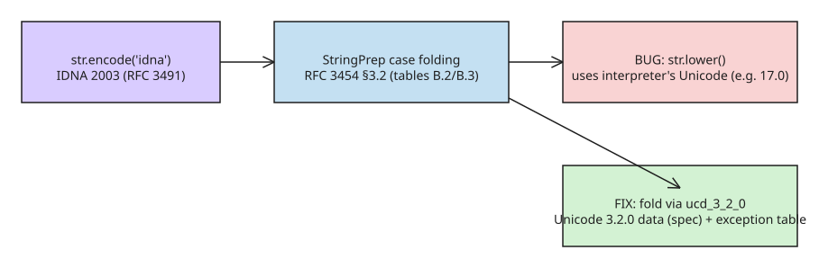

# When str.lower() Is a Security Vulnerability: CVE-2026-17084

Python's built-in `idna` codec (IDNA 2003, RFC 3491) turned out to be
spec-non-compliant because of a single call: `str.lower()` inside the
StringPrep case-folding step. Tracked as **CVE-2026-17084** (reported by
Bitshift/TheShiftedBit; published 2026-08-18 by the PSF, CVSS v4.0 6.0,
CWE-436 "Interpretation Conflict"), this is a good case study in "the
interpreter's Unicode version leaking into a standardized algorithm."
Impact: IDNA 2003 domain names with newer Unicode characters or updated
case-folding rules normalize inconsistently, enabling domain spoofing and
hostname-check bypass.

## Why the spec pins a Unicode version

StringPrep (RFC 3454, section 3.2) defines case folding via mapping tables
B.2 and B.3. Those tables are effectively **Unicode 3.2.0** case-folding
rules. Every CPython ships a `unicodedata.ucd_3_2_0` database precisely for
StringPrep/IDNA use, and both `Lib/stringprep.py` and `Lib/encodings/idna.py`
import it as their `unicodedata`:

```python
# CPython source
Lib/stringprep.py:     from unicodedata import ucd_3_2_0 as unicodedata
Lib/encodings/idna.py: from unicodedata import ucd_3_2_0 as unicodedata
```

## The bug

The case-folding implementation applied the B.3 exception table, then fell
back to the *interpreter's* `str.lower()` — which uses whatever Unicode data
the interpreter was built with (check `unicodedata.unidata_version`, e.g.
`'17.0.0'`). For codepoints whose folding changed between Unicode 3.2.0 and
newer versions, the output diverges from the spec:

```python
# RFC 3454-compliant value for "ᎠᎠ" (U+13A0, Cherokee):
"ᎠᎠ".encode("idna")  # expected per spec: b'xn--58da'
# actual, using Unicode 17 case folding:
"ᎠᎠ".encode("idna")  # got: b'xn--kz9aa'
```

Concretely, the pre-fix logic was:

```python
def map_table_b3(code):
    r = b3_exceptions.get(ord(code))
    if r is not None:
        return r
    return code.lower()   # BUG: uses interpreter's Unicode version
```

## Attack surface: version-dependent punycode

The same Unicode domain name can encode to **two entirely different ASCII/punycode domains depending only on which Python version processes the string** (reptile.haus, Stork.AI). Anything that compares hostnames across processes/services built against different CPythons — allow-lists, cookie domains, redirect validation, certificate matching done in Python — is a candidate for a spoofing or bypass bug. The failure is an *interpretation conflict* (CWE-436), not a memory-safety bug: both outputs are deterministic, they just disagree.

## Distribution status

- CVSS v4.0 base score **6.0 (Medium)**, vector `CVSS:4.0/AV:N/AC:L/AT:P/PR:N/UI:P/VC:N/VI:H/VA:N/SC:N/SI:N/SA:N` (Ubuntu Security Tracker).
- Ubuntu: 24.04 LTS / 22.04 LTS list `python3-stdlib` as "Not in release"-affected for this tracker entry; 26.04 LTS "Needs evaluation" — check `ubuntu.com/security/CVE-2026-17084` for your release rather than assuming.
- SentinelOne's vuln DB frames the impact as information disclosure via Unicode character mismatches in RFC 3454 tables (B.2/B.3) during IDNA 2003 processing.

## The fix

The remediation adds a per-codepoint exception table recording exactly where
the interpreter's `str.lower()` differs from Unicode 3.2.0 case folding, so
the StringPrep path behaves as specified regardless of the interpreter's
Unicode data. Result: IDNA 2003 encodings are now consistent with the RFC.

## Practical guidance

- Prefer the PyPI [`idna`](https://pypi.org/project/idna/) package (IDNA 2008)
  for new code; use the stdlib codec only when IDNA 2003 behavior is required.
- If you implement or compare standardized string processing (IDNA, StringPrep,
  SASLprep), pin the Unicode version of the data tables instead of relying on
  interpreter defaults.
- Lesson: "convenience" standard-library calls that embed versioned data can
  silently break standards compliance — and security boundaries built on those
  standards (domain-name comparisons, protocol identifiers).



## References

- [Seth Larson: When str.lower() is a security vulnerability in Python](https://sethmlarson.dev/when-str-lower-is-a-security-vulnerability)
- [reptile.haus: Your Login Compares Two Strings — Unicode version skew](https://reptile.haus/journal/unicode-case-folding-identity-comparison-security-2026/)
- [Ubuntu Security Tracker: CVE-2026-17084](https://ubuntu.com/security/CVE-2026-17084) — CVSS v4.0 vector + per-release status
- [SentinelOne: CVE-2026-17084 Unicode Stringprep Information Disclosure](https://www.sentinelone.com/vulnerability-database/cve-2026-17084/)
- [NVD record for CVE-2026-17084](https://nvd.nist.gov/vuln/detail/CVE-2026-17084) — confirms the `stringprep` / `in_table()` code paths affected
- [CVE-2026-17084 record](https://www.cve.org/CVERecord?id=CVE-2026-17084)
- [CPython fix PR #155293](https://github.com/python/cpython/pull/155293)
- [RFC 3454 (StringPrep)](https://datatracker.ietf.org/doc/html/rfc3454) / [RFC 3491 (IDNA)](https://datatracker.ietf.org/doc/html/rfc3491)
- [Unicode UTS #46: Unicode IDNA Compatibility Processing](https://www.unicode.org/reports/tr46/)

## Related
- [[explanation-bpf-verifier-safety-mechanisms]]
- [[explanation-ssl-tls-three-jobs]]
