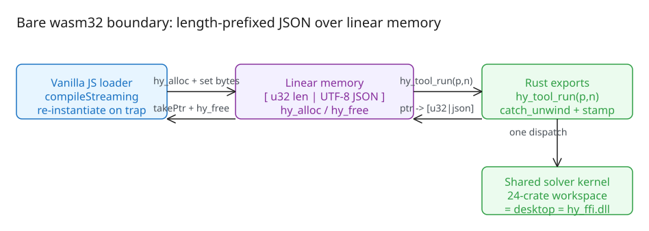

# Shipping a 24-Crate Rust Numerics Engine to Bare wasm32-unknown-unknown Without wasm-bindgen

Case study (HyGeoWorks, 24-crate Rust workspace, `wasm32-unknown-unknown`, no `wasm-bindgen`): how one
numerical engine produces **bit-identical results** natively (desktop/CLI), over a C-ABI DLL, and in
the browser — and why a hand-rolled C-style export ABI beats `wasm-bindgen` for a compute-only module
behind vanilla-JS static pages.



## Why bare wasm instead of wasm-bindgen

`wasm-bindgen` is the right tool for DOM-heavy Rust web apps. For a **deterministic RPC pipe**
(JSON in, JSON out) it adds a runtime dependency layer and glue-code churn for no benefit. The
alternative is a tiny set of `extern "C"` exports sharing linear memory with a fixed wire format:

```
[4-byte little-endian u32 length | UTF-8 JSON payload]
```

Required exports:

- `hy_alloc(n)` / `hy_free(p, n)` — manage linear-memory slices safely from JS.
- `hy_tool_run(p, n)`, `hy_tool_sketch(p, n)`, `hy_project_toml(p, n)`, `hy_project_merge(p, n)` —
  UTF-8 JSON request in, length-prefixed JSON response out.
- `hy_tools_list()` / `hy_tool_names()` — localization and field-label tables live **only** in the
  Rust crate, never duplicated in frontend scripts.

Rust side (minimal ABI pattern):

```rust
fn out_str(s: &str) -> *mut u8 {
    let s = s.as_bytes();
    let mut buf = Vec::with_capacity(4 + s.len());
    buf.extend_from_slice(&(s.len() as u32).to_le_bytes());
    buf.extend_from_slice(s);
    let mut b = buf.into_boxed_slice();
    let p = b.as_mut_ptr();
    std::mem::forget(b);   // memory handed to the host; freed via hy_free
    p
}

pub fn run_json(text: &str) -> Value {
    let v: Value = match serde_json::from_str(text) {
        Ok(v) => v,
        Err(e) => return json!({"ok": false, "error": format!("Invalid JSON: {e}")}),
    };
    let mut env = std::panic::catch_unwind(|| hy_tools::run_envelope(id, &input))
        .unwrap_or_else(|_| json!({"ok": false, "error": "Calculation kernel panic"}));
    stamp_run(&mut env, loc);   // see "bypass-resistant stamping" below
    env
}
```

**Every** solver call is wrapped in `std::panic::catch_unwind`, so pathological geometry returns a
clean JSON error instead of poisoning the module (a Rust panic in wasm aborts the instance).

JS side — read the header, free both slices immediately, and **re-instantiate on trap**:

```js
function takePtr(ex, ptr) {
  const len = new DataView(ex.memory.buffer).getUint32(ptr, true);
  const jsonStr = dec.decode(new Uint8Array(ex.memory.buffer, ptr + 4, len));
  ex.hy_free(ptr, 4 + len);
  return JSON.parse(jsonStr);
}

try {
  const inPtr = ex.hy_alloc(bytes.length);
  new Uint8Array(ex.memory.buffer, inPtr, bytes.length).set(bytes);
  const outPtr = ex.hy_tool_run(inPtr, bytes.length);
  ex.hy_free(inPtr, bytes.length);
  return takePtr(ex, outPtr);
} catch (err) {
  if (err instanceof WebAssembly.RuntimeError) {
    WebAssembly.instantiate(wasmMod, {}).then((next) => { ex = next.exports; });
    return { ok: false, error: "Numerical exception; check input geometry bounds." };
  }
  throw err;
}
```

Also on the loader checklist: prefer `WebAssembly.compileStreaming` with an `ArrayBuffer` fallback
(some static hosts omit the `application/wasm` MIME type), and cache one compiled
`WebAssembly.Module` across page switches.

## One workspace, three targets, IEEE-754 parity

The same 24-crate workspace (1,565+ unit tests via `cargo test --workspace`) compiles to:

1. **Native CLI/desktop** (`hydro.exe`, WPF app) — workspace used directly.
2. **C-ABI library** (`hy_ffi.dll`) — stable JSON-over-C contract for an Excel workbook bridge.
3. **Browser wasm** (`hy_tools_bg.wasm`, 4.53 MiB raw / 1.88 MiB inline gzip).

Because there is exactly **one solver dispatch** shared by all three targets, there are no
"TypeScript rewrite" formula forks to drift. Parity is verified, not assumed: 376 desktop-vs-wasm
comparison cases (101,613 values) match with max relative difference **≤ 4.9e-16** — pure IEEE 754
double-precision equivalence. 69 embedded benchmarks validate against published references (FHWA
HDS-5, EPA SWMM 5.2.4, Rocscience Slide2, USGS SLAMMER, analytical solutions), archived under
CC BY 4.0 with a Zenodo concept DOI.

**Generalizable pattern:** any "quick web calculator vs formal desktop submittal" pair (engineering,
finance, science) is a QA liability when reimplemented in two languages. A single shared kernel plus a
JSON-RPC-over-linear-memory boundary removes the drift class entirely.

## Air-gapped `file://` delivery

Field engineers double-click a single HTML file from a USB stick. Browsers block `fetch()` of local
`.wasm` files under `null`-origin CORS. Solution: embed the gzip'd wasm **inline in the HTML** and
decompress natively with `DecompressionStream("gzip")` — no server, no build step, works under
`file://`.

## Bypass-resistant output stamping

For free-tier previews, stamping is done **inside Rust** before the payload is serialized back to
linear memory — not as a hideable CSS overlay in JS:

- preview headers are prepended into `/output/text` and `plain` fields;
- watermark strokes are injected into the sketch geometry itself;
- client flags trying to disable stamping are simply ignored.

Anything the browser can render, the browser can strip; anything baked into the returned data cannot.
Paid exports bypass the free path via server-side generation with RFC 8032 Ed25519 QR seals that are
verified client-side.

## When this pattern fits / does not

| Fits | Does not fit |
| --- | --- |
| Compute-only modules behind any frontend (vanilla JS, SSG, offline HTML) | DOM-heavy apps (`wasm-bindgen`/leptos/yew are better) |
| Strict numeric parity requirements across targets | Rapidly evolving JS object graphs across the boundary |
| Air-gapped / zero-upload delivery of sensitive data | Heavy streaming/bidirectional callback needs |

## References

- [DEV.to: Why We Compiled a 24-Crate Rust Civil Engineering Engine to Bare wasm32-unknown-unknown](https://dev.to/hygeoworks/why-we-compiled-a-24-crate-rust-civil-engineering-engine-to-bare-wasm32-unknown-unknown-no-56p7) (original source)
- [MDN: WebAssembly — Using WebAssembly](https://developer.mozilla.org/en-US/docs/WebAssembly/Using_JavaScript)
- [Rust reference: std::panic::catch_unwind](https://doc.rust-lang.org/std/panic/fn.catch_unwind.html)
- Related in KB: [Porting Concurrent C++ to Rust](../../../how-to/programming/rust/howto-porting-concurrent-cpp-to-rust.md)
