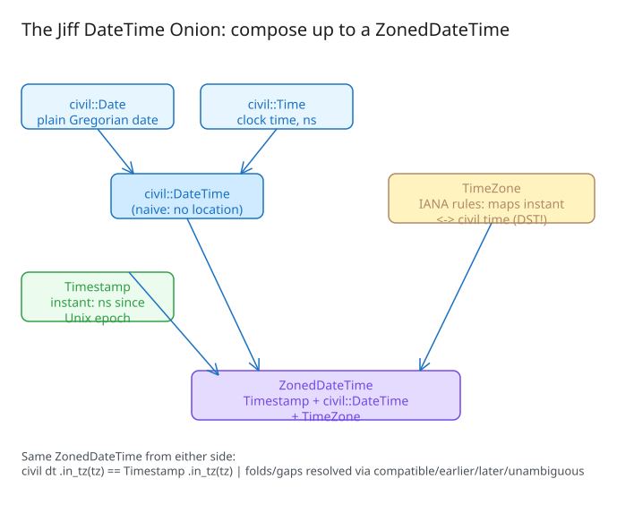

# Jiff 1.0 Explained: The DateTime Onion, DST Ambiguity, and Span vs SignedDuration

Andrew Gallant (BurntSushi, author of ripgrep) released **Jiff 1.0** on 2026-11-15 — a Rust datetime library whose central design goal is pushing users into the *pit of success* for daylight-saving-time (DST) handling by putting time zones front and center in the API. Announced with an API tour on his blog.



## Why 1.0 now, and what the commitment means

Jiff is already a production dependency of **uv, Cargo, Starship, fd, Nushell, mise, Jujutsu, uutils/coreutils**, and is the basis of the Temporal implementation in **AWS LLRT**. Because Jiff is intended to appear in the *public API* of other libraries (an ecosystem building block), semver-incompatible releases cause outsized pain — so the stated commitment is: no breaking changes unless a significant API defect is found. Breaking changes between 0.2 and 1.0 are enumerated in the CHANGELOG (see References).

Why write a new library instead of improving `chrono` or `time`? Gallant's argument: both had reached a *local maximum* in API design by 2024, and convincing maintainers to change radically would have been a tall order. His design/comparison docs document the specific differences.

## The DateTime Onion: six core types

Jiff models time as composable layers ("an onion") between **system time** (Unix time, nanoseconds since epoch) and **civil time** (the clock/calendar humans agree on locally):

| Type | What it is |
|---|---|
| `civil::Date` | Plain Gregorian date, unattached to any location |
| `civil::Time` | Plain clock time, nanosecond precision, unattached to a location |
| `civil::DateTime` | `Date` + `Time` — still no location (aka naive/local time) |
| `Timestamp` | Unambiguous instant: nanoseconds since Unix epoch |
| `TimeZone` | Rules mapping `Timestamp` ↔ `civil::DateTime` for a geographic region (IANA id, e.g. `Europe/Paris`) |
| `ZonedDateTime` | `Timestamp` + `civil::DateTime` + `TimeZone` — an instant in a place |

You can build a `ZonedDateTime` from either direction and land on the same value:

```rust
use jiff::{civil, Timestamp};

// civil time -> instant
let zdt = civil::date(2026, 11, 1)
    .at(17, 30, 0, 0)
    .in_tz("America/New_York")?;
assert_eq!(zdt.timestamp().as_second(), 1793572200);

// instant -> civil time
let zdt = Timestamp::from_second(1793572200)?.in_tz("America/New_York")?;
assert_eq!(zdt.datetime(), civil::date(2026, 11, 1).at(17, 30, 0, 0));
```

A time zone is a *geographic region* providing two mappings: instant → UTC offset (always unambiguous) and civil datetime → offset (potentially ambiguous — the source of all DST bugs).

## DST folds and gaps: explicit ambiguity strategies

DST transitions create two failure modes:

- **Fold** (clocks move back): one civil hour repeats. `2026-11-01 01:30` in New York happens twice (offsets `-04` and `-05`).
- **Gap** (clocks jump forward): some civil times never occur. `2026-03-08 02:30` doesn't exist in New York.

Jiff makes the choice *explicit* instead of silently picking one:

```rust
let dt = civil::date(2026, 11, 1).at(1, 30, 0, 0); // ambiguous (fold)
tz.to_ambiguous_zoned_datetime(dt).compatible()?; // default: first repetition (-04)
tz.to_ambiguous_zoned_datetime(dt).earlier()?;    // always earlier (-04 in a fold)
tz.to_ambiguous_zoned_datetime(dt).later()?;      // always later    (-05 in a fold)
tz.to_ambiguous_zoned_datetime(dt).unambiguous()?; // hard error on any ambiguity
```

Note `compatible` is not "earlier": it picks the first repetition for folds but the *later* side for gaps. This is the class of bug `chrono`/`time` users normally hit with `Local.from_local_datetime`-style APIs.

## Span vs SignedDuration: two kinds of "how long"

- **`Span`** — hybrid duration keeping *distinct unit fields* for both calendar units (years, months, weeks, days) and physical units (hours…nanoseconds). Because fields are preserved, `2.hours()` and `120.minutes()` are **distinct values** under `Span::fieldwise()` — you keep the human meaning (film runtimes in minutes, "1 month" contracts).
- **`SignedDuration`** — signed 96-bit nanosecond count, physical time only (hours or smaller); cheaper/bulkier tradeoff vs `Span`, the `std::time::Duration` analog.

Guidance from the blog: use `Span` when you can, `SignedDuration` when `Span` is too bulky or slow. Calendar-aware rounding ties spans back to dates:

```rust
use jiff::{SpanRound, ToSpan, Unit};
let span = 1.month().days(1).hours(1);
let rounded = span.round(
    SpanRound::new()
        .largest(Unit::Day).smallest(Unit::Day)
        .relative("2022-01-01".parse::<jiff::civil::Date>()?),
)?;
assert_eq!(rounded.to_string(), "P32D"); // relative to the anchor date
```

## Formatting and parsing

- Every core type implements `FromStr`/`Display` with an ISO 8601-derived grammar (Temporal's RFC 9557 grammar, e.g. `2026-11-12T15:30:00`, `P5Y3MT20H`).
- A **"friendly" duration format** adds human units: `1 year 2 months`, `1h 30m`.
- `jiff::fmt::strtime` provides `strptime`/`strftime`-style formatting; `jiff::fmt::temporal` and an **ICU4X integration** cover locale-sensitive output.

## Relationship to JavaScript Temporal (and java.time)

Jiff is heavily inspired by **Temporal** (the TC39 datetime proposal) — nearly a direct translation of its API. Intentional renames to avoid clashing with `std::time`: Temporal `Duration` → Jiff `Span`, Temporal `Instant` → Jiff `Timestamp`, Temporal "plain" types → Jiff "civil" types. Jiff is Gregorian-only and bounds datetime range to ±9999 (Temporal is wider). The same mental model maps onto Java's `java.time`: `Instant` ≈ `Timestamp`, `LocalDateTime` ≈ `civil::DateTime`, `ZonedDateTime` ≈ `ZonedDateTime` — see the Java-DateTime notes in this vault for the Java side.

## References

- [Jiff 1.0 announcement and API tour — Andrew Gallant's blog](https://burntsushi.net/jiff/)
- [jiff on crates.io](https://crates.io/crates/jiff)
- [Jiff CHANGELOG (1.0.0, 2026-11-15 — breaking changes vs 0.2)](https://github.com/BurntSushi/jiff/blob/master/CHANGELOG.md#100-2026-11-15)
- [MDN: Temporal (JS datetime proposal that inspired Jiff)](https://developer.mozilla.org/en-US/docs/Web/JavaScript/Reference/Global_Objects/Temporal)
