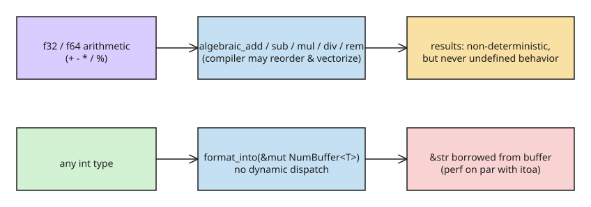

# Rust 1.98: Algebraic Floating-Point Methods and Buffered Integer Formatting

Rust 1.98.0 (released 2026-08-20) ships two headline library features plus a
documentation fix. Update with `rustup update stable`.

## Algebraic floating-point methods

`f32` and `f64` gain `algebraic_add`, `algebraic_sub`, `algebraic_mul`,
`algebraic_div`, and `algebraic_rem`. They let the compiler apply optimizations
based on the algebraic properties of real numbers — properties that strictly do
not hold for floating point (e.g. addition is not associative). The exact
optimization set is unspecified; it is analogous to `-ffast-math` in other
languages.

```rust
// a + b + c + d must be evaluated left-associatively: ((a+b)+c)+d
// but with algebraic_add the compiler may regroup:
let s = a.algebraic_add(b).algebraic_add(c).algebraic_add(d);
// compiler is free to compute (a+b) + (c+d) in parallel,
// and can often vectorize the loop more aggressively.
```

Key semantics: these methods are **non-deterministic** (the compiler may choose
different optimizations), but they **never** introduce undefined behavior.

The same operations exist at the `std::intrinsics` level as
`fadd_algebraic`, `fsub_algebraic`, `fmul_algebraic`, and friends — useful in
`const fn` contexts or when you want to be explicit about which algebraic rules
the compiler may apply. The public method API is the ergonomic front door; the
intrinsics are what the methods lower to.

## Buffered integer formatting

Every primitive integer type gains `format_into(&mut NumBuffer<Self>) -> &str`,
where `NumBuffer<T>` is an opaque buffer sized for the decimal format of any
`T`. The returned `&str` borrows from the buffer. This bypasses most of the
dynamic dispatch of buffered `write!` formatting.

```rust
use core::fmt::NumBuffer;

let mut buf = NumBuffer::<i64>::new();
let s: &str = 42_i64.format_into(&mut buf); // no FormatArgs indirection
```

The [itoa-benchmark](https://github.com/dtolnay/itoa-benchmark) repo shows
`format_into` performs on par with `itoa` itself — a viable standard-library
replacement for that dependency.

## `ManuallyDrop` / `Box` UB fix made stable in docs

Before 1.96.0 this code was undefined behavior (moving a dropped `Box` is UB,
and `ManuallyDrop` propagated it):

```rust
let mut x = ManuallyDrop::new(Box::new(1));
unsafe { ManuallyDrop::drop(&mut x) };
let x = x; // was UB before 1.96
```

1.96.0 fixed the behavior; 1.98.0 updates the `ManuallyDrop` docs to guarantee
it stays non-UB. See the [ManuallyDrop docs](https://doc.rust-lang.org/stable/std/mem/struct.ManuallyDrop.html) and [RFC 3336](https://rust-lang.github.io/rfcs/3336-maybe-dangling.html).



## Takeaways

- Reach for `algebraic_*` in hot numeric loops where strict IEEE
  left-associative evaluation order is not a correctness requirement.
- Consider dropping the `itoa`/`ryu` dependencies in favor of `format_into`.
- The `ManuallyDrop<Box<T>>` + `drop` + move pattern is now documented as safe
  going forward.

## References

- [Developpez: Rust 1.98 release coverage](https://rust.developpez.com/actu/386430/La-version-1-98-de-Rust-introduit-des-methodes-algebriques-pour-les-nombres-a-virgule-flottante-le-formatage-des-entiers-avec-mise-en-memoire-tampon-et-ameliore-la-documentation-de-ManuallyDrop/)
- [Official Rust blog: Announcing Rust 1.98.0](https://blog.rust-lang.org/2026/08/20/Rust-1.98.0/)
- [Algebraic operators API change proposal (libs-team#532)](https://github.com/rust-lang/libs-team/issues/532)
- [Tracking issue for algebraic floating point methods (rust-lang/rust#136469)](https://github.com/rust-lang/rust/issues/136469)
- [`std::intrinsics` algebraic counterparts, e.g. `fmul_algebraic`](https://doc.rust-lang.org/stable/std/intrinsics/fn.fmul_algebraic.html)
- [itoa-benchmark](https://github.com/dtolnay/itoa-benchmark)
- [itoa crate documentation (docs.rs)](https://docs.rs/itoa/latest/itoa/)

## Related
- [[explanation-react-rerender-vs-expensive-work]]
- [[How-to-Benchmark-JAX-Backends-CPU-GPU-Eager-vs-JIT]]
- [[How-to-Speed-Up-a-JAX-Training-Loop-with-JIT-Compilation]]

## Further Reading (added 2026-10-19 by KB Zookeeper audit)

- [Rust language adds algebraic floating-point methods](https://www.infoworld.com/article/4215422/rust-language-adds-algebraic-floating-point-methods.html) — Rust 1.98.0 also introduces buffered integer formatting. Rust 1.98.0 brings algebraic methods for addition 
- [Rust 1.98 Adds Algebraic Floating-Point Methods Akin To "-ffast-math"](https://www.phoronix.com/news/Rust-1.98-Released) — Rust 1.98 released today and is headlined the debut of new algebraic floating-point methods.
