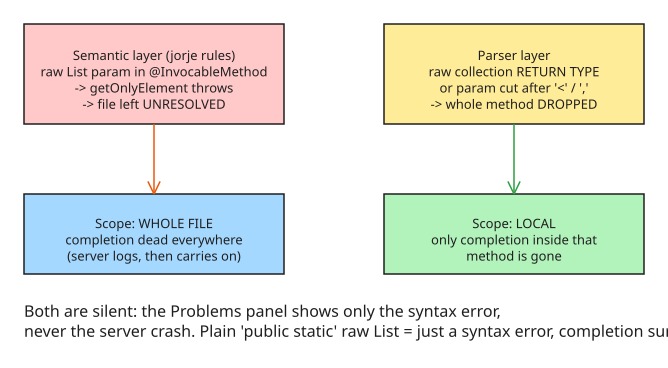

# How a Raw List in an @InvocableMethod Silently Kills Apex Completion (jorje Language Server)

Symptom: an `@InvocableMethod` with an untyped collection parameter — `public static List<Result> take(List requests)` — makes **member completion stop working in the whole class**. Typing `r.` on any variable gives nothing, in every method. The Problems panel shows a syntax error and nothing else; the language server never tells you it crashed.

## Reproducing it

In a project with the Salesforce Extension Pack installed:

```apex
public with sharing class OrderIntake {
    @InvocableMethod(label='Take orders' description='Accepts or rejects each order.')
    public static List<Result> take(List requests) {   // raw List = the trigger
        List<Result> results = new List<Result>();
        return results;
    }

    public static void probe() {
        Request r = new Request();
        r.   // completion here returns NOTHING for the whole file
    }

    public class Request { @InvocableVariable(required=true) public String orderNumber; }
    public class Result { @InvocableVariable public Boolean accepted; }
}
```

Fix the signature to `List<Request> requests` and completion returns. Note: the broken signature and the method where completion fails **don't have to be the same method**.

## Root cause: the jorje language server's semantic checks

The Apex language server in the Extension Pack is called **jorje** (shipped in `salesforcedx-vscode-apex`). It runs extra semantic checks on methods marked `@InvocableMethod`, static `@AuraEnabled`, `@HttpGet`/`@HttpPost` and other `@Http*` annotations, `webservice`, and `global`. Those checks **unwrap the element types of collection parameters**, and which collections they unwrap depends on the method:

| Method kind | Collections unwrapped |
| --- | --- |
| `@InvocableMethod` | `List` (two levels deep) |
| `webservice` | `List` |
| static `@AuraEnabled`, `@Http*` | `List` and `Map` |
| `global` | `List`, `Set` and `Map` |

A raw `List` has no type argument, so the unwrap gets an empty list where it expects exactly one element. In the server log:

```
java.lang.IllegalArgumentException: Expected list of size 1 but was: []
    at apex.common.collect.MoreIterables.getOnlyElement(MoreIterables.java:186)
    at apex.jorje.semantic.symbol.type.common.CollectionTypeInfoUtil.getElementType(CollectionTypeInfoUtil.java:44)
    at apex.jorje.semantic.ast.modifier.rule.InvocableContextRule.isAtMostTwoNestedLists(InvocableContextRule.java:134)
```

The server logs the exception and **goes on** — but the file is left without resolved types, so completion after `.` returns nothing anywhere in it until the signature is fixed. Same crash with `List&lt;>`, with an unfinished `List<Req` directly followed by `)`, and with the wrong number of type arguments (`List<String, String>`).

## A second, separate mechanism: the parser dropping the method

A raw collection as a **return type** (`List check(...)`, `List&lt;>`, `List<List>`) makes the **parser drop the whole method**. Same for a parameter cut off right after `&lt;` or a comma (`List&lt;`). That one is **local**: only completion inside that method is gone.



## Measuring instead of guessing

The obvious rule — flag every raw collection in a signature — is **wrong in many places**: a raw `List` in a plain `public static` method is just a syntax error (the server reports it, completion keeps working). A check that fires on harmless code teaches people to ignore it.

So instead of guessing, the author measured: took the language-server jar from the extension (`salesforcedx-vscode-apex` 67.26), started it **headless with the same flags VS Code uses**, and talked to it over the language-server protocol. For each of **274 signatures** he sent the class as a document change and asked for completion after `r.` on a local variable of an inner-class type. Recorded per shape: did the server log an exception, and did that completion come back empty?

| Signature shape | Where | Result |
| --- | --- | --- |
| `List requests` | `@InvocableMethod` | crash, whole file |
| `List<List> requests` | `@InvocableMethod` | crash, whole file |
| `List<List<List>> requests` | `@InvocableMethod` | **clean** |
| `Set requests`, `Map requests` | `@InvocableMethod` | **clean** |
| `List<Request requests` (no `>`) | `@InvocableMethod` | **clean** — parser inserts the `>` |
| `List<Request) {` | `@InvocableMethod` | crash, whole file |
| `Map requests`, `Map<String> requests` | static `@AuraEnabled` | crash, whole file |

Surprises worth remembering: the **double-nested** `List<List<List>>` is clean (the rule only unwraps two levels), raw `Set`/`Map` in `@InvocableMethod` are clean (the rule only unwraps `List` there), and the parser silently repairs a missing `>`.

## The fix: Virga

The author's VS Code extension **Virga** ([github.com/wiktormalyska/virga](https://github.com/wiktormalyska/virga)) flags **only the shapes that broke the server in the measurement**. After the quick fix, the server threw in **none of the 184 breaking cases**, and completion after `.` came back in **180 of the 181** where it had been empty (the one exception: `@InvocableMethod` on an interface method, which the parser rejects anyway).

## Practical implications

| Situation | What to do |
| --- | --- |
| Completion died file-wide in an Apex class | Search the class for raw `List`/`List&lt;>`/`List<Req` in `@InvocableMethod`, `@AuraEnabled`, `@Http*`, `webservice`, `global` signatures before blaming your setup |
| Completion died in one method only | Check for a raw collection **return type** or a parameter cut off after `&lt;`/comma |
| Building Apex tooling on LSP | Treat an empty completion response + logged `IllegalArgumentException` in `CollectionTypeInfoUtil` as "file unresolved", not "no members" |
| Writing `@InvocableMethod` signatures | Always parameterize: `List<Request> requests`, never `List requests` |

## Related notes

- (none yet — first note in the `salesforce-apex` topic)

## References

- [How a raw List in an @InvocableMethod breaks Apex completion, measured on 274 signatures (DEV.to)](https://dev.to/wiktormalyska/how-a-raw-list-in-an-invocablemethod-breaks-apex-completion-measured-on-274-signatures-1df7)
- [Virga — run Apex and SOQL from a scratch project (GitHub)](https://github.com/wiktormalyska/virga)
- [Apex Language Server (Salesforce Extensions for VS Code)](https://developer.salesforce.com/docs/platform/sfvscode-extensions/guide/apex-language-server.html)
- [InvocableMethod Annotation — official Apex documentation](https://developer.salesforce.com/docs/atlas.en-us.apexcode.meta/apexcode/apex_classes_annotation_InvocableMethod.htm) — the annotation contract (typed `List<T>` parameters/return, `label`, `description`) that a raw `List` violates.
- [Salesforce Invocable Apex Methods — A Complete Breakdown (SalesforceBen)](https://www.salesforceben.com/salesforce-invocable-apex-methods-a-complete-breakdown/) — practical walkthrough of the `@InvocableMethod` contract, including the type rules that make a raw `List` a violation.
- [Salesforce Apex language server not outputting anything (Salesforce Stack Exchange)](https://salesforce.stackexchange.com/questions/430438/salesforce-apex-language-server-not-outputting-anything) — a symptom report matching the silent-failure behavior described here.
