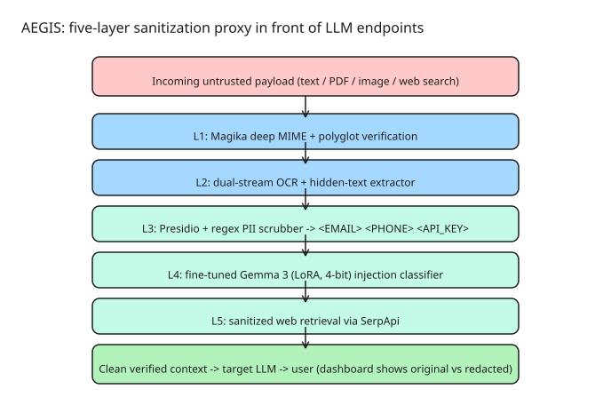

# AEGIS: A Multi-Layer Security Proxy for LLM Endpoints

**AEGIS** is a lightweight, drop-in **security proxy** placed in front of LLM endpoints — built for independent developers and small studios who can't afford enterprise AI-security platforms. Clients and end users frequently paste sensitive personal data (contact info, phone numbers, **production API credentials**) directly into prompt inputs; input fields are vulnerable to **adversarial prompt injections** that bypass system instructions; and document-analysis workflows can be targeted with **hidden or low-contrast text** embedded in PDFs and images that hijacks downstream reasoning.

The gateway handles inbound requests across multiple input types. Plain-text prompts are stripped of credentials and personal identifiers before evaluation by the safety classifier. File uploads undergo deep MIME verification and visual OCR to detect obscured text before extraction proceeds. When web-search augmentation is enabled, retrieved results are scrubbed before being appended to model context. A web dashboard gives real-time visibility into each verification step — exactly what data was modified and why.

## The five-layer pipeline

1. **Layer 1 — Magika deep MIME & polyglot verification.** Deep MIME-type verification of file uploads, including polyglot files (one file, multiple embedded formats).
2. **Layer 2 — Dual-stream OCR & hidden-text extractor.** Visual OCR to detect obscured / low-contrast text embedded in PDFs and images, before any text extraction proceeds.
3. **Layer 3 — Context-aware Presidio + regex PII scrubber.** Transforms PII into placeholder tokens: `<EMAIL>`, `<PHONE>`, `<API_KEY>`. Context-aware (Microsoft Presidio) plus regex for credentials.
4. **Layer 4 — Fine-tuned Gemma 3 / LoRA safety classifier.** A fine-tuned open-weight **Gemma 3** model (LoRA adapters, **4-bit quantized** inference) detects prompt injections and malicious payloads. Deterministic, low-latency classification without relying on closed cloud moderation APIs.
5. **Layer 5 — Sanitized web retrieval via SerpApi.** Web-search results are filtered for poisoned knowledge blocks and injections before being appended to the model context.

Output: clean, verified context → target LLM → user.

## Tech stack and artifacts

| Component | Technology |
|---|---|
| Gateway | Python 3.10+, **FastAPI** (`backend.py`) |
| PII detection | Microsoft **Presidio** + regex |
| MIME verification | **Magika** |
| Safety classifier | **Gemma 3** (google/gemma-3-4b-it) fine-tuned with **LoRA** via Hugging Face **PEFT**, 4-bit inference |
| Web retrieval | **SerpApi** (sanitized) |
| Frontend | React + Vite |
| Deployment | Docker |

The repository (github.com/prathamanvekar/secure-llm-proxy) includes the FastAPI gateway, the training + inference notebook for the Gemma 3 fine-tune, and the frontend.

## What to learn from the architecture

- **Layering matters**: MIME verification before OCR, OCR before text extraction, PII scrubbing before classification, classification before context assembly. Each layer assumes the previous one ran.
- **Open-weight classifiers for the judgment layer**: a fine-tuned open model (LoRA + 4-bit) keeps the safety decision local, cheap, and deterministic — no closed API in the hot path.
- **Inbound *and* outbound-of-retrieval sanitization**: prompt injection can arrive in user text, in uploaded documents, *and* in web-search results — all three surfaces need scrubbing.
- **Observability is part of the security**: a dashboard showing original vs redacted text side-by-side, plus OCR confidence scores, makes the pipeline auditable rather than a black box.
- **Positioning**: for small studios this is a compliance add-on / managed microservice — the enterprise platforms solve the same problem at enterprise price points and onboarding complexity.

## References

- [Building a Secure LLM Proxy with Fine-Tuned Gemma 3 (DEV.to source article)](https://dev.to/prathamanvekar/building-a-secure-llm-proxy-with-fine-tuned-gemma-3-for-production-applications-2fdj)
- [AEGIS source code (GitHub: prathamanvekar/secure-llm-proxy)](https://github.com/prathamanvekar/secure-llm-proxy)
