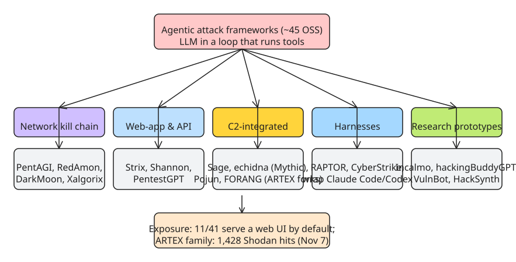

# The Agentic Attack Framework Landscape: ~45 Open-Source LLM Attack Loops

## Overview
GitGuardian catalogued the ecosystem around **ARTEX** (open-source agentic pentesting platform, taken down by its creator on 2026-10-08, 74 days after first commit, after reports of threat-actor use): ~45 open-source projects now wire an LLM into a loop that runs tools and acts on their output. The takedown did not stop spread — **102 forks and ARTEX-named repos appeared in takedown week alone**. Coverage of the field: where the code lives, what ships for secret-hunting on public GitHub, and how visible each is on the internet.

## Five families (32 catalogued, ~13 forks/variants)
1. **Network kill chain** — end-to-end recon/exploitation/post-exploitation, usually from a Kali container: PentAGI (agent teams with Nmap/Metasploit/sqlmap, 33.6k stars), RedAmon (attack-surface graph), Xalgorix, Pentest-Swarm-AI, LuaN1aoAgent, AIRecon, redcell, PentestCode, cain-agent; DarkMoon ships 50 specialist agents across web, cloud, Active Directory, CI/CD.
2. **Web-app and API** — Strix (autonomous web app testing, 74.2k stars), Shannon (source-code based, closer to SAST, 51.4k), PentestGPT (advisory), T3MP3ST, Apex, deadend-cli, PentesterFlow.
3. **C2-integrated** — Sage and echidna run as LLM operators inside Mythic C2; virga puts a local model inside the implant; Pojun, FORANG, ycode, ScopeWeaver are ARTEX derivatives bolting on C2 consoles.
4. **Harnesses** — RAPTOR, CyberStrike, cyber-harness, Nebula, Cybermes wrap a general coding agent (Claude Code, Codex, Hermes) with offensive skills; plugin packs count as one group.
5. **Research prototypes** — Incalmo, hackingBuddyGPT, VulnBot, HackSynth, AutoPT, Ares.

Plus three reported in the wild: **Cairn** (worker agents on a shared fact graph, *no authentication by default*), **HexStrike** (MCP server exposing 150+ offensive tools to any MCP client, *no authentication by default*), **Agent Zero** (general agent, no auth by default, experimented with by threat actors).

## Weaponized in practice: the Cairn campaign
Unit 42 (Nov 12, 2026) reported a campaign of autonomous AI attacks on a customized Cairn fork: **CL-STA-1238, Chinese-speaking operators, Aug-Sep 2026, 25 operations against >=19 organizations, access or data gained at 10**, including a credential/secret collection phase even though the public Cairn repo has no secret-hunting capability — the operator extended it.

## What actually ships for secret-hunting
Of 24 reviewed tools: **Provisioned 4, Text-only 5, Unwired 2, None found 13**. Only four ship a real scanner wired to the agent — Pojun (gitleaks named in worker prompt + default skill pointing at public GitHub), Cybermes (own `secret_scan` binary with 48 regex patterns, 13 GitHub code-search dorks, nine read-only credential validators for AWS/GitHub/Slack/OpenAI/Anthropic), Xalgorix (gitleaks + trufflehog in default "full" checklist), AIRecon (gitleaks + trufflehog in Kali container, `site:github.com` dork skills). **None contains a GitHub fetcher** — but each framework hands its agent a shell and web access, so the model can assemble the missing pieces at runtime.

## Exposure findings
- Of 41 frameworks fingerprinted for Shodan, **11 serve a web UI by default** (Cairn, Agent Zero, RedAmon, Pentest-Swarm-AI, ScopeWeaver, redcell, Incalmo, Pojun, FORANG...); ARTEX family alone matched **1,428 Shodan services on Nov 7, 2026**.
- Risk clusters in **a handful of widely forked bases**, not in the most-starred repos.

## Defensive implications
- Fingerprint and hunt these consoles on your perimeter and internal network — default-no-auth operator UIs are both attacker tooling and your own exposure if staff run them.
- Treat secret-scanner + agent + shell as a pipeline even when the repo "ships no scanner": the agent can install one.
- Rotate secrets that ever touched public repos; monitor for the reported dork/validator patterns (e.g., probes hitting credential-validation endpoints).
- Pair with patch-window pressure: GTIG/Mandiant report agents turning patch diffs into exploits in minutes (see daily digest 2026-11-17).

## References
- Original: [Beyond ARTEX: 45 Agentic Attack Frameworks](https://dev.to/gitguardian/beyond-artex-45-agentic-attack-frameworks-what-they-hunt-for-and-how-to-find-them-4g6h)
- Unit 42: [Cairn framework autonomous AI attacks](https://unit42.paloaltonetworks.com/cairn-framework-ai-autonomous-attacks/)
- Related: [[explanation-threat-model-agent-payment-card]], [[explanation-tool-update-gap-llm-agents-etude]]
