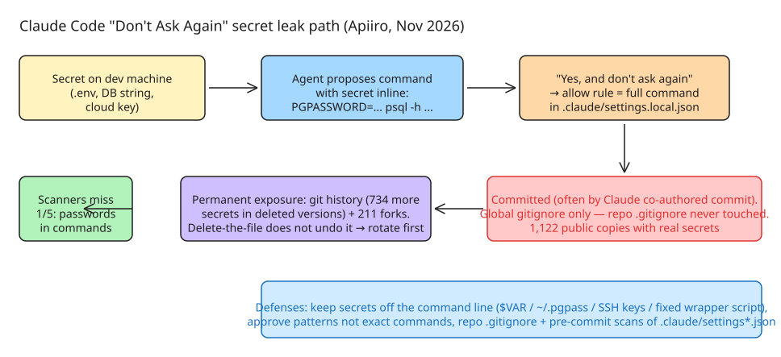

# Claude Code's "Don't Ask Again" Allowlist: How Approved Commands Leak Secrets to Public GitHub

Apiiro research (Nov 2026) found **2,539 real secrets across 1,994 public GitHub repositories** that came from AI coding-agent settings files — database passwords, cloud keys, API tokens, SSH root logins. 63 organizations are affected; one confirmed its exposed key was still live. The root cause is a mundane interaction between a permission-approval UX and git: **a secret typed into a command becomes part of a saved permission rule, and the file holding that rule gets committed**.

## The leak mechanism, step by step



1. Developer machines hold secrets: a DB connection string in a config file, cloud keys, an API token in `.env`.
2. Ask Claude Code to run a migration or check a database — the proposed command **carries the secret in plain text**, because it can't work without it.
3. Claude Code asks before running shell commands. Choosing **"Yes, and don't ask again"** saves an `allow` rule to `.claude/settings.local.json` at the **git repository root**, so matching commands run silently in all future sessions.
4. The rule **is the command string itself** — `Bash(PGPASSWORD=hunter2 psql -h prod.example.com ...)` keeps the password verbatim.
5. Nothing in the repo protects the file. Claude Code does add `**/.claude/settings.local.json` to the developer's **global** git excludes (`core.excludesFile`, else `~/.config/git/ignore`) when it first writes the file — but that does not cover a folder that becomes a repo later, a clone on another machine, or a file committed before Claude created it. The rule **never goes into the repository's own `.gitignore`**, so no protection travels with the project.
6. Often the agent commits the file itself: in **539 of 1,105** traced secret-bearing repos, a commit *co-authored by Claude* modified the file (spanning models from Sonnet 4.5 to Opus 5.5).

This is Claude Code's own permission-system behavior, not a model defect — reproduced across Anthropic's current models. Per the official docs, Bash approvals are "permanently per repository and command"; file-edit approvals, by contrast, expire at session end.

## The numbers

- **104,185** public copies of `.claude/settings.local.json` in 103,617 repos; **1,122 (1.1%)** hold at least one real secret, totaling **1,379 distinct secrets** (636 provider-format keys, 743 host-adjacent passwords/tokens).
- Over a third open a database directly: 379 DB passwords, 122 Supabase service-role keys, 103 Supabase account tokens. Plus 43 SSH logins (some root via `sshpass`), 42 GitHub/GitLab/npm tokens, 23 AWS keys, 6 private keys.
- **Allowlist size predicts leakage**: 1 in 10 files over 8 KB holds a real secret vs &lt; 1 in 500 files under 500 bytes. The longer someone clicks "don't ask again", the hotter the file.
- Leaks are old and sticky: the median secret-bearing file was first committed **217 days** before the scan; 118 repos over a year. **211 forks** of 74 repos carry the same secrets. Git history holds 734 more real secrets (509 repos) in deleted versions — deleting the file does nothing.
- Beyond this one file (same "type the secret into a command the agent records" habit): shared `.claude/settings.json` (298 secret-bearing files of 76,011), agent chat transcripts (.specstory/aider/Cursor: 120 files in 87 repos), agent memory files (MEMORY.md: 9 repos), handoff/deploy notes (33 files — a third *written by the agent itself*), VS Code Copilot auto-approve settings (9 repos). Also outside GitHub: 126 of 31,053 Hugging Face Spaces ship the file, and 2 of 69 public GitLab copies hold a real secret.

## Why secret scanners miss a third of them

Apiiro ran **gitleaks** and **TruffleHog** over all 104,185 files: of the 1,122 with a real secret, gitleaks flagged **564**, TruffleHog **643** — and **215 were flagged by neither**. The blind spot is the format: scanners match *provider key shapes* (prefix + long random string). A password typed after `PGPASSWORD=`, `sshpass -p`, `mysql -p`, or a `Bearer` header in a `curl` call is an ordinary word on an ordinary command line. The same gap applies to every artifact where agents record what they ran: transcripts, memory files, handoff notes.

The file is also an **on-machine** target even when never committed: the Shai-Hulud npm worm (Sept 2025) ran TruffleHog over victims' files — the same scan flags 643 of the 1,122. The malicious Nx packages attack told the victim's *own Claude Code and Gemini CLI* to search the disk for secrets.

## Detection commands

```bash
# Find local copies whose rules hold password-shaped content (lists filenames,
# not matches, so secrets don't scroll past / enter your agent transcript):
PAT='PASSWORD=|sshpass -p|-p[^ "*)]{3,}|Bearer [^ \"*]+|://[^/:@ ]+:[^@ ]+@|(api[_-]?key|token|secret)='
find ~ -path '*/.claude/settings*.json' -not -path '*/node_modules/*' -exec grep -lEi "$PAT" {} + 2>/dev/null

# Session transcripts keep the FULL command even where the rule wildcarded it:
grep -rlEi "$PAT" ~/.claude/projects/ 2>/dev/null   # JSONL transcripts per session
```

Search your GitHub org for `.claude/settings.local.json` and `.claude/settings.json`, **and each repo's git history** — forks and clones keep deleted files forever.

## Remediation (rotate first, clean up second)

1. **Rotate every credential the file has ever held** — deleting the file clears your copy, not history, forks, or clones.
2. Untrack: `git rm --cached .claude/settings.local.json`, then add it to the **repo's own** `.gitignore`.
3. Even if never committed, open the file locally and delete every rule containing a secret.
4. **Keep secrets off the command line**: reference `$VAR` from a secrets manager so the saved rule holds the name, not the value. Caveat from independent testing (Claude Code 2.1.319): rules containing unresolvable variables may keep prompting ("A variable in this command can't be checked before it runs") — pushing users back to inline values. Better: let the tool find its own credential (`~/.pgpass` with `chmod 0600` for psql; SSH keys instead of `sshpass -p`; a fixed-purpose wrapper script approved as `Bash(./scripts/db-query.sh *)` — with no free-form input and a least-privilege login).
5. **Approve patterns, not exact commands** — e.g. `Bash(npm run:*)`. Note the flip side: Bash rules match command *text*, so a wildcard grant (`curl *`, `mysql *`) authorizes far more than the one command on screen.

## Related in this vault

- [[The Miasma Worm: How AI Coding Agents Became a Supply Chain Attack Surface]] — agents as the execution vector for secret theft
- [[Abliterated Models Can Carry Backdoors]] — the other direction: poisoned models exfiltrating credentials
- [[Five Identity Patterns Production AI Agents Need]] — why per-agent scoped credentials beat shared ones
- France supermarket fridge attack (IoT: same "default/static credential in reachable artifact" failure class)

## References

- **Apiiro research — Coding Agents Copy Your Secrets to a Hidden File**: https://apiiro.com/blog/coding-agents-leaking-secrets-github-dont-ask-again
- **The Hacker News coverage (Nov 6, 2026)**: https://thehackernews.com/2026/11/claude-codes-dont-ask-again-file.html
- **Claude Code permissions docs (official rule-storage behavior)**: https://code.claude.com/docs/en/permissions
- **Claude Code settings precedence docs (global git excludes mechanism)**: https://code.claude.com/docs/en/settings
- **Independent reproduction + detection/mitigation commands (Claude Code 2.1.319)**: https://max.nardit.com/articles/claude-code-settings-local-json-secrets
- **Claude Code GitHub issues reporting this since Aug 2025**: https://github.com/anthropics/claude-code/issues/5544
