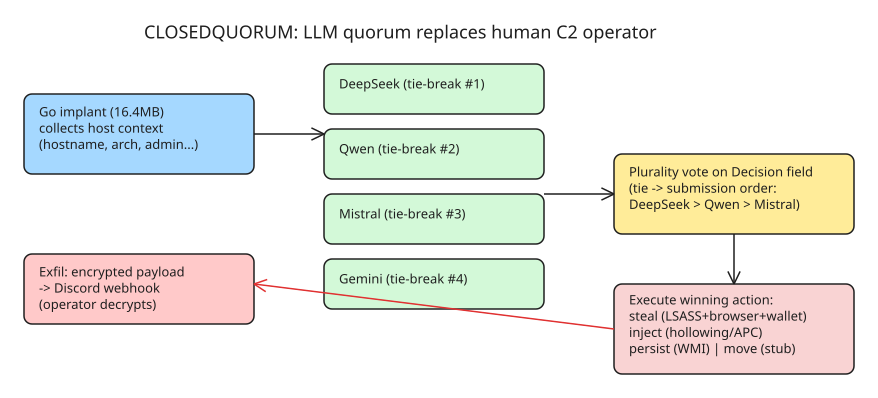

# CLOSEDQUORUM — The First Windows Malware That Lets Four LLMs Vote on Its Next Attack Step

CLOSEDQUORUM (disclosed by Cisco Talos in September 2026 via the CAIRN project) is the first publicly documented **Windows implant that delegates tactical command-and-control to a panel of commercial LLMs** instead of a human operator or attacker-owned C2 server. It was discovered through **CAIRN** (Cognitive Artifact Intelligence Research Network), an open-source Talos toolkit for classifying and tracking AI-integrated malware — the first artifact in its library.

## Architecture: the LLM providers *are* the C2 channel

- 16.4 MB, 64-bit Windows executable compiled in **Go** (with some C).
- No check-ins to an attacker-controlled server. Instead it gathers host context (hostname, OS arch, CPU count, Windows version, admin status) and queries up to four LLM providers — **DeepSeek, Qwen, Mistral, Google Gemini** — one by one via a `ModelOrchestrator`.
- Each model must answer in a strict typed JSON schema; the system prompt extracted from the binary reads: *"You are an advanced malware strategist. Provide ONLY executable decisions."* Responses not matching the schema are discarded.
- The four verdicts are aggregated as a `[]LLMDecision` slice and resolved by **plurality voting** (`interModelDiscussion()`): each provider's `Decision` field increments a counter; highest count wins.
- **Tie-break is deterministic and biased**: votes are counted in submission order with a strict `&lt;` comparison, so the first-encountered maximum wins — DeepSeek first, then Qwen, Mistral, Gemini. If all four fail (refusal, timeout, malformed output), the fallback decision has no handler: the implant sleeps and retries rather than acting by default.
- The multi-provider design buys **resilience**: one provider's guardrail refusal or outage doesn't stall the loop — which is also its biggest operational weakness (rate limits, outages, malformed responses can stall it).

## What it does once a decision wins

| Decision | Implementation in the binary |
| --- | --- |
| `steal` | `lsassDump()` + `dumpBrowserCredentials()` (Chrome/Edge/Firefox) + `extractCryptoWallets()`, all run together |
| `inject` | `generateShellcode()` then branch: PEB-walk **process hollowing** or **Early Bird APC injection** into a suspended process |
| `persist` | `establishPersistence()` (WMI persistence entries) |
| `move` | Present in the code but **non-functional** in the distribution build — lateral movement is not yet wired up, so the "autonomous attack" is bounded to one compromised host |

Stolen data is encrypted and exfiltrated through a **Discord webhook** into an operator-controlled channel. The human still exists at the edges: someone compiles each copy with per-operator API keys and webhook baked in via `-ldflags`, deploys it, and decrypts results. The AI runs the tactical decision loop; it doesn't run the business.

## Why this is an architectural shift (not just a buzzword)

Attackers have used AI for phishing and obfuscation for years. What's new: the **tactical decision during an active compromise** — traditionally the most human-dependent part of an intrusion — is delegated to models. Human operators are bounded by attention, working hours, and how many hosts one person can babysit; a model panel voting in a loop isn't. The value proposition is not smarter attacks but attacks that keep moving without a human awake.

Caveats from Talos: **no confirmed in-the-wild deployment** — the publicly distributed build ships with placeholder API keys and a dummy webhook (inert). Binary artifacts were linked to a developer posting on carding forums dating back to 2025. The `move` capability is non-functional, so it's not yet a self-propagating worm.

## What defenders should actually look for

Blocking AI provider domains is useless — legitimate software talks to DeepSeek/Gemini/Mistral all day. The signal is the **combination**, in one process, in a short window:

1. Contacting *several* LLM providers (not just one) with structured prompts carrying host context;
2. Accessing **LSASS** memory or injecting into suspended processes;
3. Creating WMI persistence entries;
4. Posting to a Discord webhook (`cdn.discordapp.com`);
5. Waking on a randomized 5–15 minute cycle.

Individually each is unremarkable; together they are not something a normal application does. This pushes detection toward **behavioral analysis across multiple actions** and away from static signatures or domain blocklists — a harder discipline to staff for in a SOC. Talos also published a YARA rule anchored on binary-level strings (system prompt, decision schema, unstripped Go DWARF function names like `main.ModelOrchestrator`, `main.interModelDiscussion`) plus VT metadata anchors.

## Key facts at a glance

| Attribute | Value |
| --- | --- |
| Language / size | Go (+ some C), 16.4 MB, 64-bit Windows |
| LLM quorum | DeepSeek, Qwen, Mistral, Gemini (up to 4) |
| Decision space | `steal` \| `inject` \| `persist` \| `move` (typed JSON schema) |
| Tie-break | Submission order: DeepSeek > Qwen > Mistral > Gemini |
| Exfil channel | Encrypted → Discord webhook |
| Discovery | Cisco Talos CAIRN project, disclosed 2026-09-22 |
| In-the-wild | Not confirmed; distributed build is inert (placeholder keys) |

## References

- [DEV.to: CLOSEDQUORUM — The Malware That Lets Four AI Models Vote on How to Attack You](https://dev.to/thesnehamk/closedquorum-the-malware-that-lets-four-ai-models-vote-on-how-to-attack-you-g1d)
- [Cisco Talos: Inside the first reported autonomous AI C2 implant](https://blog.talosintelligence.com/the-closed-quorum-inside-the-first-reported-autonomous-ai-c2-implant/)
- [The Register: Windows CLOSEDQUORUM malware uses AI models to autonomously select post-compromise actions](https://www.theregister.com/security/2026/09/22/windows-closedquorum-malware-uses-ai-models-to-autonomously-select-post-compromise-actions/5298435)
- [WIRED: A New Tool Found Malware That's Guided by an AI Hive Mind](https://www.wired.com/story/a-tool-for-tracking-ai-integrated-malware-uncovered-an-autonomous-command-system/)

## Further Reading (added 2026-10-19 by KB Zookeeper audit)

- [CLOSEDQUORUM: Malware That Lets Four LLMs Vote on Its Next Move](https://yusmpgroup.com/news/closedquorum-autonomous-ai-c2-malware) — Cisco Talos disclosed CLOSEDQUORUM, the first malware that lets four commercial LLMs vote on its next move. What autonomous AI attacks mean for teams.
- [CLOSEDQUORUM: Malware That Lets AI Models Vote on Its Next Move](https://labs.cloudsecurityalliance.org/research/csa-research-note-closedquorum-ai-voting-c2-malware-20260924/) — Key Takeaways Cisco Talos has disclosed CLOSEDQUORUM, described as the first publicly documented Windows implant that delegates its command-and-control…
- [This Windows Malware is Built to Let Up to Four AI Models Vote on Its Next Move](https://thehackernews.com/2026/09/windows-malware-is-built-to-let-up-to.html) — A Windows malware called CLOSEDQUORUM is built to take orders from a vote of up to four AI models instead of an attacker's server, Cisco Talos said on…
