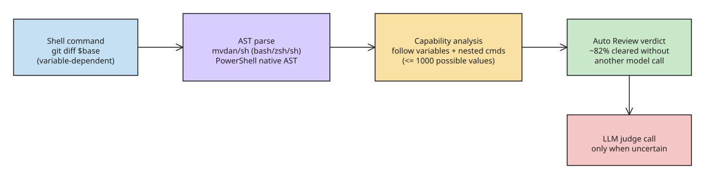

# LM Studio Bionic Shell Judge and Auto Review — Structural Safety for AI-Generated Commands

LM Studio's coding agent **Bionic** runs shell commands generated by an LLM. A command as ordinary as `git diff` becomes dangerous once a variable is involved: `git diff $base` behaves normally when `$base` holds a commit hash, but if it resolves to `--output=/some/file`, Git writes the result to the filesystem. String-matching for "dangerous" tokens cannot catch this — the behavior depends on variables, redirects, and nested commands. LM Studio's answer is **Auto Review**, a first-layer safety gate that clears as many as **82% of Bionic's commands without another model call** (the author calls the figure anecdotal, not a benchmark), escalating to a second language-model judge only when it cannot decide.

## How the Shell Judge works

Instead of pattern-matching raw strings, the judge parses the command into an **abstract syntax tree (AST)** and analyzes structure:

- **Parsers**: `mvdan/sh` for Bash/Zsh/SH; PowerShell uses its native AST support.
- **Capabilities**: from the AST the judge derives what the command *could* read or change — LM Studio calls these the command's "capabilities."
- **Value tracking across commands**: if an agent runs `git merge-base` and feeds the result into `git diff`, the judge carries that value forward when evaluating the second command. When a variable has several possible values, Bionic follows **up to 1,000 of them** before giving up on exhaustive accounting.
- **Test corpus**: LM Studio built **11,651 test cases** covering the many ways this analysis can go wrong — evidence that structural analysis is a real engineering surface, not a thin wrapper.

## Why this matters for agent security design

- **The judge and the defendant are both LLMs.** The article's framing — "the judge started agreeing with the defendant" — is the core risk: a second model reviewing a first model's output shares blind spots, and prompt injection in tool *output* can steer the reviewer. Structural analysis (AST + capabilities) is what keeps the fast path from being pure vibes; the LLM fallback is only for cases structure cannot resolve.
- **Variables are the attack surface.** Any agent that interpolates untrusted data into shell commands inherits this class of bug: a "read-only" command becomes a write when its argument resolves to an option flag (`--output=`, `--stdin-command=`, etc.). Capability analysis is the mitigation; bounding value tracking (1,000 values) is where precision gives out.
- **Cost structure**: clearing ~82% of commands without a second model call makes per-command safety economically viable at agent scale — the design pattern (cheap deterministic gate first, expensive LLM judge only on uncertainty) generalizes to any high-frequency agent action.

## References

- [LM Studio built a judge for AI commands. Then the judge started agreeing with the defendant. (The New Stack)](https://thenewstack.io/bionic-shell-command-safety/)
- [How Auto Review works (LM Studio blog)](https://lmstudio.ai/blog/how-auto-review-works)

## Further Reading

- [LM Studio Bionic Clears 82% of Shell Commands Without AI; Reviewer Yields to Prompt Injection — TechTimes (2026-08-31)](https://www.techtimes.com/articles/325987/20260831/lm-studio-bionic-clears-82-shell-commands-without-ai-reviewer-yields-prompt-injection.htm) — independent press coverage of the launch, reiterating that the 82% figure is the team's anecdotal estimate and foregrounding the second-layer judge's suggestibility.
- [LM Studio Bionic Adds Auto Review for Shell Command Approval — How2Shout](https://www.how2shout.com/news/lm-studio-bionic-auto-review.html) — feature-launch detail on the AST shell judge and escalation path.

## Status check (2026-11-10)

Re-verified ~10 weeks after publication: no public changelog entry or follow-up report was found showing a fix (or mitigation guidance) for the second-layer judge's "agreeing with the defendant" malleability issue. The AST first-layer design and the 82% figure stand as originally reported. Treat the LLM judge escalation as advisory, not a security boundary, until LM Studio publishes hardening details.

## Related
- [[explanation-openai-hugging-face-agent-incident]]
- [[howto-mcp-security-hardening]]
- [[explanation-llm-inference-engine-exploits]]
