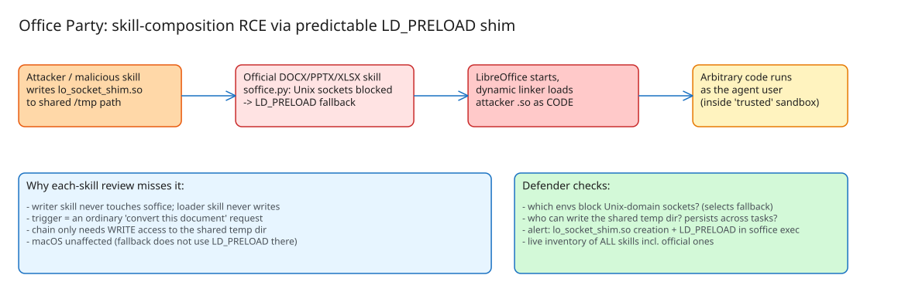

# Office Party: LD_PRELOAD Skill-Composition RCE in Claude Document Skills

**Office Party** is a flaw in Anthropic's official DOCX, PPTX, and XLSX document skills, found by AIR Security (reported May 2026). A **fixed temporary-file path** makes LibreOffice load and execute an attacker-supplied shared library on Linux — the code runs with the privileges of the user operating the AI agent. Anthropic acknowledged it but treats it as **outside its security boundary** because the code runs inside a sandbox; the helper script remains unchanged.

## The mechanism

The vulnerable component is `soffice.py`, the helper that starts LibreOffice for document conversion (e.g. rendering Word → PDF). On Linux environments where **Unix-domain sockets are blocked** — including some container security configurations and Claude Code's own sandbox — the script falls back to a workaround using `LD_PRELOAD`.

`LD_PRELOAD` tells the dynamic linker to load a named shared library *before* any other — anything chosen through it becomes executable code in the new process. The helper checks a shared temporary directory for a library literally named `lo_socket_shim.so` and, if present, preloads it **without verifying origin or contents**. Plant the file at that path; the next ordinary "convert this document" request executes it. The user never touches the planted file — the trusted document skill supplies the execution path.

macOS is unaffected: the fallback there does not load the library through `LD_PRELOAD`.

## Why it's a composition problem, not a code bug in one skill

AIR demonstrated two trigger paths:

1. Researchers manually placed a malicious `.so` in the shared temp directory, then asked Claude Code to generate a document.
2. **A separate, otherwise-legitimate AI skill unpacked a supporting file into that directory** (under a different name — the exploit only needs the expected filename to land there). The official document skill later found and loaded it.

Case 2 is the assessment-relevant one: a malicious or compromised skill never invokes the vulnerable helper or touches LibreOffice. It only needs **write access to a directory shared with the official skill**. Per-skill security review cannot see this — the dangerous behavior is an interaction between a component that writes files and a component that treats an existing file as trusted executable code. Shared writable temp storage makes the interaction easy to arrange.

## Defender checklist

- Inventory Linux agent deployments using the official DOCX/PPTX/XLSX skills.
- Determine whether their execution environment blocks Unix-domain sockets — that condition selects the vulnerable fallback.
- Inspect the shared temp dir mount: which processes/skills can write it, and does it persist across otherwise separate tasks?
- Telemetry that matters: creation/replacement of `lo_socket_shim.so` in the relevant temp location, **followed by** LibreOffice execution with `LD_PRELOAD` set. A file appearing *before* a conversion is far more useful than document-content inspection.
- Check whether untrusted skills can extract arbitrary supporting files into shared temp storage.
- Maintain a **live inventory of all installed agent skills and add-ons — official ones included** — and review their scripts, update state, filesystem access, and cross-skill interactions as software dependencies.

## The sandbox-boundary dispute

Sandboxing limits what the malicious library can reach, but AIR disputes that as sufficient: code inside the sandbox still runs **with the user's permissions, where the user's files and work already live**. Prioritize by *what the sandbox can access*, not merely by whether one exists. This is the same reasoning pattern to apply to any agent tool that preloads, `eval`s, or imports from predictable shared paths.

## References

- [Claude Office Party Enables Linux Code Execution — DEV.to](https://dev.to/randomchaos/claude-office-party-enables-linux-code-execution-41h) (original source; reports AIR Security research)
- [LD_PRELOAD, dynamic linker](https://man7.org/linux/man-pages/man8/ld.so.8.html)

Related: [[explanation-agent-guardrail-stack]], [[howto-mobileprobe-mobile-agent-red-teaming]]
