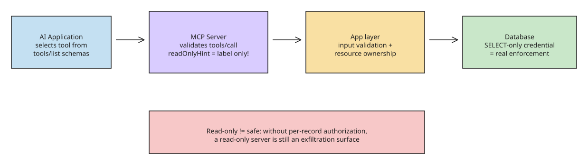

# Read-Only MCP Server Design: Why readOnlyHint Is a Label, Not a Control

A useful on-ramp for connecting AI agents to real systems is the **read-only MCP server**: the agent can retrieve information but (by design) never modify anything. The article's most valuable insight is the gap between *described* and *enforced* read-only behavior — and why read-only access is still a data-exfiltration surface.

## Architecture and the tool lifecycle

The MCP pattern inserts a protocol boundary between agent reasoning and backend execution:

```
AI Application → MCP Client → MCP Server → Backend Services / Database
```

Instead of per-system custom integrations, the server exposes a small, fixed tool surface — e.g. for a document support assistant: `search_documents(query)`, `get_document(document_id)`, `get_ticket_status(ticket_id)`.

Tool interaction follows three protocol steps:

1. **Discovery** — client sends `tools/list`; server returns names, descriptions, and input schemas.
2. **Selection** — the AI application picks a tool from the definitions for the user's request ("status of ticket 1042" → `get_ticket_status`).
3. **Execution** — client sends `tools/call` with tool name + arguments; the server **validates the request**, fetches from the backend, and returns a predictable result.

## The readOnlyHint trap

MCP offers a `readOnlyHint` annotation marking a tool as not expected to modify its environment. **It is descriptive only** — it does nothing to stop the underlying implementation from performing writes. A tool labeled read-only that runs `UPDATE` or `DELETE` internally will happily do so.

Enforcement therefore has to be layered (principle of least privilege at every boundary):

| Layer | Control |
|---|---|
| Tool | Only expose retrieval operations; no write tools at all |
| Application | Validate inputs, enforce resource ownership, reject out-of-scope requests |
| Database | Credentials restricted to `SELECT` on required tables/views |
| API | Scoped credentials; never grant incidental write capability |

The database layer is the load-bearing one: a read-only **DB credential** cannot be bypassed by a buggy or prompt-influenced tool implementation, whereas `readOnlyHint` and code review can both fail.

And the corollary: **read-only ≠ safe**. A server that cannot modify records can still leak confidential data if authorization is poorly implemented — every record must still be checked against the requesting user's scope.

## Test plan for a read-only MCP server

A server that boots is not production-ready. The five areas worth testing, plus failure modes:

1. **Tool discovery** — client sees exactly the expected tools and schemas (nothing extra).
2. **Successful execution** — valid inputs return correct documents/tickets.
3. **Input validation** — missing arguments, invalid identifiers, unexpected types.
4. **Access control** — users cannot retrieve records outside their authorized scope.
5. **Read-only enforcement** — exposed operations cannot modify data, *including via unexpected inputs or implementation mistakes*.

Plus predictable behavior on backend failures: unavailable records, dead database connections. Agents downstream depend on deterministic tool responses to plan next steps.

## Why it matters in production

Model quality (reasoning, planning, tool selection) is not the reliability bottleneck. An agent can pick the right tool with valid arguments and still fail on insufficient authorization, unexpected responses, or undefined permissions. MCP standardizes the *interaction*; it does not replace authentication, authorization, validation, logging, error handling, and least-privilege access. Build the read-only server first, establish discovery/execution reliability with a bounded blast radius, and only then introduce create/update/delete tools.



## Related notes

- `security-privacy/ai-agent-security/howto-mcp-security-hardening.md` — broader MCP hardening checklist.
- `security-privacy/ai-agent-security/explanation-mcp-filesystem-capability-laundering-mcp-fsd.md` — how MCP tools can launder capabilities beyond their label.

## Corroboration (KB Zookeeper, 2026-11-23)

The official MCP blog post *"Tool Annotations as Risk Vocabulary: What Hints Can and Can't Do"* (2026-03-16) confirms and sharpens the note's central claim:

- The full `ToolAnnotations` interface — shipped in the `2025-03-26` spec revision, current as of `2025-11-25` — is four booleans plus a display title, **all hints**: `readOnlyHint` (default `false`), `destructiveHint` (default `true`), `idempotentHint` (default `false`), `openWorldHint` (default `true`). The defaults are deliberately pessimistic: an un-annotated tool is assumed writable, destructive, non-idempotent, and open-world.
- Spec language: annotations "are not guaranteed to faithfully describe tool behavior, and clients **must** treat them as untrusted unless they come from a trusted server" — `readOnlyHint` is a label, exactly as the note argues.
- The trust gap was known at design time: co-creator Justin Spahr-Summers asked during the original PR #185 review how a client "makes use of this flag knowing that it's *not* trustable"; the spec's answer was the hint/untrusted-by-default compromise.
- Official guidance mirrors the note's layered-enforcement table: clients should use annotations "for UX, but keep your actual safety guarantees in deterministic controls" — the DB-layer `SELECT`-only credential is precisely such a deterministic control.
- Current status: five SEPs propose richer annotations (trust/sensitivity #1913, governance/UX #1984, `unsafeOutputHint`, `secretHint`, `trustedHint`) — none would make existing hints enforceable; a Tool Annotations Interest Group is forming.

## References

- **Day 29/90 — Building a Read-Only MCP Server (DEV.to)**: https://dev.to/rimsha_kanwal/day-2990-building-a-read-only-mcp-server-a-practical-approach-to-safer-ai-agents-1n73
- **Model Context Protocol specification**: https://modelcontextprotocol.io/
- **MCP official blog — Tool Annotations as Risk Vocabulary: What Hints Can and Can't Do (2026-03-16)**: https://blog.modelcontextprotocol.io/posts/2026-03-16-tool-annotations/
- **MCP spec — ToolAnnotations schema (2025-11-25 revision)**: https://modelcontextprotocol.io/specification/2025-11-25/schema#toolannotations
