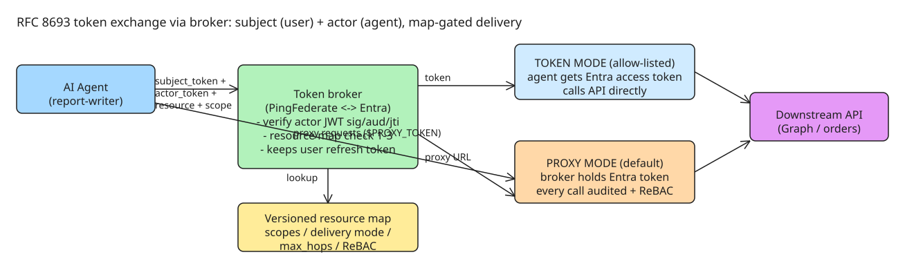

# RFC 8693 Token Exchange: Letting AI Agents Act For Users Without Borrowing Their Identity

When an AI agent calls a downstream API (Microsoft Graph, an internal orders API), an awkward question surfaces: **whose access is it?** If the answer is "the user's", the agent can do everything the user can do. If the answer is "the agent's own service account", the audit log stops saying who asked for what. Both are the borrowed-identity failure mode (the anticipated companion note "Five Identity Patterns Production AI Agents Need" does not exist in the vault yet).

The pattern here (from the `ping-entra-broker` reference implementation sitting between PingFederate and Microsoft Entra ID) resolves it with a **standard token exchange**: the issued token names *both* the user it acts for (subject) and the agent doing the work (actor), and is narrowed to the single resource the agent asked for.

## The exchange request (RFC 8693 + RFC 8707)

RFC 8693 gives the request a fixed shape — subject token, actor token, and a target named with `resource` (RFC 8707):

```
POST /broker/oauth/token
Content-Type: application/x-www-form-urlencoded

grant_type=urn:ietf:params:oauth:grant-type:token-exchange
&subject_token=<the user's PF access token>
&subject_token_type=urn:ietf:params:oauth:token-type:access_token
&actor_token=<the agent's signed client assertion>
&actor_token_type=urn:ietf:params:oauth:token-type:jwt
&client_assertion_type=urn:ietf:params:oauth:client-assertion-type:jwt-bearer
&client_assertion=<the same signed assertion>
&resource=https://graph.microsoft.com
&scope=User.Read
```

Each field has a specific job and a specific check behind it:

| Field | Who supplies it | What the broker checks |
| --- | --- | --- |
| `subject_token` | the agent, from the user's session | a valid IdP access token — this is *whose* access it is |
| `actor_token` | the agent | JWT signed by the agent's registered key, with `iss` and `sub` equal to the agent's client id |
| `client_assertion` | the agent | same assertion, authenticating the agent to the broker |
| `resource` | the agent | must exist in the resource map and be allowed for this agent |
| `scope` | the agent | must be a subset of the scopes the map lists for the agent |

Two anti-replay details carry the security weight:

- The broker **verifies the assertion's audience**, so one captured assertion cannot be redeemed at another service.
- The broker **records each assertion's `jti`**, so a replayed assertion is refused — a captured assertion cannot be used twice.

Two design rules constrain the agent further: the agent **never builds IdP scope strings** (an infrastructure detail that changes and agents get wrong), and the agent **never holds the user's refresh token** — the broker keeps it and performs the exchange on the agent's behalf.

## The resource map decides what is allowed

The broker never trusts a resource URI the agent asks for. It looks the URI up in a **versioned resource map** (a YAML file) that records, per resource: its tenant, the IdP audience and scopes it needs, its allowed delivery mode, a `max_hops` bound, per-HTTP-method scopes, and optional ReBAC rules:

```yaml
version: 1
resources:
  - resource: https://api.contoso.com/orders
    type: api
    tenant: 11111111-1111-1111-1111-111111111111
    entra_audience: api://orders-api
    scopes: [orders.read, orders.write]
    delivery: { default: proxy, allow_token_mode: false }
    max_hops: 2
    method_scopes: { GET: orders.read, PATCH: orders.write, DELETE: orders.write }
    rebac:
      required: true
      object_from: path
      object_type: order
      relations: { GET: viewer, PATCH: editor, DELETE: owner }

agents:
  - pf_client_id: report-writer
    allow:
      https://api.contoso.com/orders: [orders.read]
      https://graph.microsoft.com: [User.Read]
    allow_token_mode: true
    max_hops: 2
```

The broker applies three checks in order:

1. **Is the resource known?** An unlisted URI is refused — a typo can never reach an unexpected audience.
2. **Is this agent allowed it?** The broker takes the *intersection* of requested and allowed scopes; asking for more than allowed is **refused, not quietly narrowed** (`invalid_scope` in the RFC 6749 error shape, plus an audit event recording the attempt).
3. **Is the delivery mode allowed?** `allow_token_mode` gates whether the agent may hold the downstream token itself.

`max_hops` bounds agent-to-agent delegation chains: every hop counts, the chain can never be longer than the smallest limit along it, and **no hop can widen the rights of the one before it**.

## Two delivery modes: token vs proxy

- **Token mode** — the broker returns the downstream access token directly (`"delivery": "token"` in the exchange response). Allow-listed per resource, because a bearer token in an agent's hands works anywhere until it expires.
- **Proxy mode** — the broker keeps the downstream token and calls the API itself; the agent gets a proxy URL and calls it with a proxy-scoped token:

```bash
curl -sS 'https://broker.example.com/broker/proxy/orders/orders/1001' \
  -H 'authorization: Bearer $PROXY_TOKEN'
```

The downstream token **never leaves the broker** in proxy mode. Every call passes through one place where it can be logged, rate-limited, and checked against the map's ReBAC rules — which is why proxy is the sensible default for write-capable APIs, and token mode only for low-sensitivity reads.



## Why this beats the two defaults

| Approach | Audit trail | Blast radius |
| --- | --- | --- |
| Agent uses user's token/refresh token | Actions attributed to the human | Full user capability |
| Agent uses its own service account | "Who asked" is lost | Shared-SA over-grant |
| RFC 8693 exchange via broker | Token names subject **and** actor; refusals audited too | Intersection of map + allow-list, per resource, hop-bounded |

The refusal is the point of the design: the agent learns what it may not do, and the audit log records that it tried.

## References

- Original article: [Letting AI agents act for users: the RFC 8693 token exchange](https://dev.to/darkedges/letting-ai-agents-act-for-users-the-rfc-8693-token-exchange-2jg0) (DEV.to, 2026-11-03)
- [RFC 8693 — OAuth 2.0 Token Exchange](https://datatracker.ietf.org/doc/html/rfc8693)
- [RFC 8707 — Resource Indicators for OAuth 2.0](https://datatracker.ietf.org/doc/html/rfc8707)
- Related (not yet written): "Five Identity Patterns Production AI Agents Need" — candidate for a future research pass.
