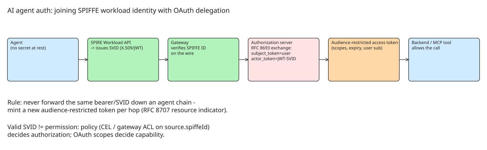

# SPIFFE vs OAuth for AI Agents — Attested Workload Identity Meets Scoped Delegation

**Core idea:** SPIFFE and OAuth are not rivals — they answer different questions. **SPIFFE proves *which process* is calling**, without any provisioned secret at rest; **OAuth scopes *what it may do* and, with a human in the loop, *for whom***. Identity is not authorization: a verified name is not a permission. Most production agent platforms need both, joined by assertion or token exchange.

The framing metaphor worth putting in an ADR (Lin Sun, CNCF, "Agent Auth: a lawyer's day in court"): the lawyer is not the client. You need **agent identity + principal identity + a delegation artifact**, then policy on top.

## What each side gives — and does not

| | Gives you | Does NOT give you |
|---|---|---|
| **SPIFFE/SPIRE** | Attested short-lived workload identity: SPIRE attests the calling process (Docker label; on K8s, namespace + service account) and issues an X.509 or JWT **SVID** via the Workload API. Verified name like `spiffe://example.org/ns/demo/sa/agent-alpha`, mTLS/JWT-SVID, secretless bootstrap, certs rotate in place in minutes. | Permission model, scopes, third-party API audiences, human `sub`. A valid SVID still gets 403 when policy (e.g. CEL) allows only another SPIFFE ID. |
| **OAuth access token** | Permission envelope: scopes, audience, expiry, and (with on-behalf-of) a user `sub`. Resource decides what this caller may do for whom. | Platform attestation that *this process* is the agent. A held client secret/private key is possession of a credential, not workload identity; a fleet sharing one `client_id` audits a credential, not a workload; stolen bearers are ambient authority until expiry. |

Note that MCP's shipped enterprise auth authenticates the **employee via IdP, not the unattended agent** — the agent-identity gap remains.

## When each alone is enough

| Situation | Reach for | Because |
|---|---|---|
| In-cluster agent → gateway → model, single trust domain, no human OBO | SPIFFE (or mesh) | Policy is an ACL on `source.spiffeId` |
| Agent acting for a logged-in human | **Both** | Agent principal *and* OBO/subject token |
| Third-party SaaS that only speaks OAuth client auth | OAuth (+ SPIFFE in front if you can attest) | The SaaS won't verify your SVID; your gateway still should |
| CI / laptop / serverless with no SPIRE | OAuth or platform OIDC | No SPIFFE-style workload attestation available — disclose it |
| Multi-hop agent-to-agent | **Both, joined per hop** | Each hop needs a fresh audience; never forward the same bearer |
| MCP tools with different risk profiles | **Both** | A SPIFFE name is not a tool allowlist; a user token is not a workload |

A "SPIFFE only" demo makes the point concretely: an agent holding **zero provider credentials** (`{'env': 'none', 'key_files': 'none'`) still gets HTTP 200 because the gateway injects the upstream key and authenticates its own SVID — identity terminates at the hop. And a second agent with a perfectly valid SVID gets **HTTP 403** because policy names only the first one: valid identity ≠ permission.

## Joining them (the production pattern)

1. Agent fetches an SVID from the Workload API (no cert file on disk).
2. The SVID becomes either a **client assertion** or an **actor token**:
   - **SVID as client credential** — [draft-ietf-oauth-spiffe-client-auth-02](https://datatracker.ietf.org/doc/html/draft-ietf-oauth-spiffe-client-auth-02) (OAuth WG Internet-Draft, not yet RFC) profiles RFC 7521/7523 so a workload presents a JWT-SVID, WIT-SVID, or X.509-SVID as the client assertion. No static client secret.
   - **SVID as actor token** — RFC 8693 token exchange with `subject_token` = the user and `actor_token` = the JWT-SVID; result is an audience-restricted access token for the next hop. Gateways such as agentgateway perform the exchange on the outbound path.
3. The authorization server mints a token for **one audience** with the scopes that hop needs (kagent v0.10 can additionally send an RFC 8707 resource indicator on the exchange).
4. The gateway verifies SPIFFE on the wire, authorizes the tool/model call, and forwards the exchanged token to OAuth-speaking backends. Provider keys and MCP tool allowlists stay at the gateway.

**Hard rule:** never pass bearer JWT-SVIDs down an agent chain. A JWT-SVID copied to agent B is onward impersonation, not proof of possession — mint a new audience-restricted token per hop.

## Failure modes of picking only one

- **OAuth only:** shared client secrets, one fleet-wide `client_id`, stolen bearer tokens, audit trails that name a credential instead of a workload.
- **SPIFFE only:** a name mistaken for permission; no human attribution for user-directed agent actions; third-party APIs still demand OAuth; multi-tenant tool entitlements need more than `source.spiffeId`.

## Sizing for small teams

SPIFFE is often overkill *as step one*: start with platform OIDC and hard scopes; adopt SPIRE when you have multi-team agents, a shared MCP plane, or a compliance requirement for attested workload identity. Also remember that identity on the intended path does not stop agents that CONNECT elsewhere — egress bypass is the complementary failure class.

Related in this KB: [AI Agent Identity Patterns in Production](explanation-ai-agent-identity-patterns-production.md), OAuth2 Authorization Best Practices

## Diagram

## References

- [Do AI Agents Need SPIFFE or OAuth? — dev.to](https://dev.to/webofmike/do-ai-agents-need-spiffe-or-oauth-5gfl)
- [SPIFFE vs OAuth for AI agents — webofmike.com (original)](https://webofmike.com/spiffe-vs-oauth-for-ai-agents/)
- [Agent Auth: a lawyer's day in court — CNCF blog](https://www.cncf.io/blog/2026-06-23/agent-auth-a-lawyers-day-in-court/)
- [draft-ietf-oauth-spiffe-client-auth-02 — IETF Datatracker](https://datatracker.ietf.org/doc/html/draft-ietf-oauth-spiffe-client-auth-02)
- [Token exchange + workload identity for agentic workflows — Ping Identity](https://developer.pingidentity.com/blog/securing-agentic-workflows-with-token-exchange-and-workload-identity/)
