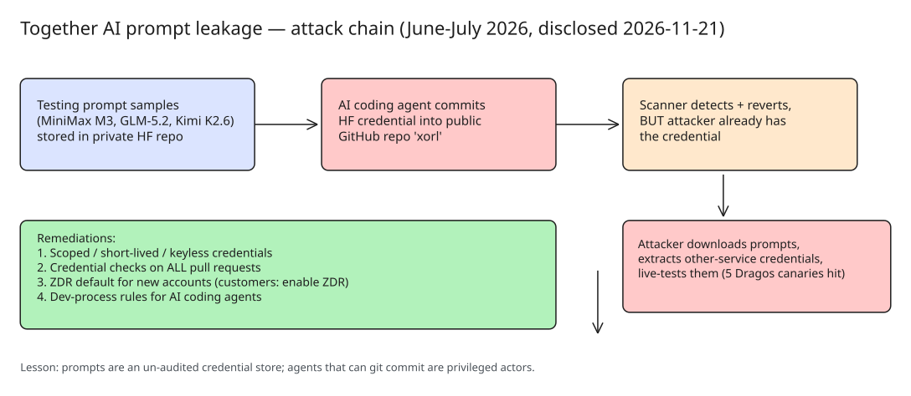

# Together AI Prompt Leakage: When an AI Coding Agent Commits the Keys

On 2026-11-21 Together AI disclosed a security incident in which an **unauthorized party downloaded stored customer prompt samples** from a private Hugging Face repository. The root cause is a new-for-2026 failure mode: **an AI coding agent committed a live credential into a public GitHub repository** during normal development work. It is the clearest production case yet of the "agentic development pipeline as attack surface" pattern.

## What happened (the incident chain)

1. **Collection**: As part of routine software testing, Together collected prompt samples (authorized for that use) from requests to the **MiniMax M3, GLM-5.2, and Kimi K2.6** models, primarily on June 24, July 4, July 8, and July 14, 2026. They were stored in a **private Hugging Face repository**.
2. **Exposure**: While developing Together's public GitHub repository `xorl`, **an AI coding agent committed a credential** granting access to that private HF repo. Together's automated secret scanning detected the exposure and the commit was reverted — **but not before an unauthorized party obtained the credential**.
3. **Exfiltration & second-order attack**: The attacker downloaded the prompt samples and then **searched the prompts themselves for credentials to other services and tested whether they were valid** — turning a prompt leak into a credential-hunting campaign. Five credentials tested were **canary credentials** associated with a Dragos security experiment (i.e., the attacker's probing was observably triggered against decoys).
4. **Response**: External forensic firm + law enforcement engaged. Together found no evidence of leakage beyond this incident; content-level review for exposed personal data was still ongoing at disclosure.

## Why this matters: three distinct lessons

### 1. The dev pipeline is now an agent, and agents handle secrets

The commit was not a careless engineer pasting a token — it was an **AI coding agent** with repository context doing "helpful" work. Agents routinely see credentials in env vars, config files, and shell history while operating, and they optimize for task completion, not secret hygiene. Any AI-agent-assisted workflow that can `git commit` to a public repo needs the same guardrails as a CI system with deploy keys: minimal scope, no long-lived tokens, mandatory pre-commit/pre-PR scanning.

### 2. Prompts are a credential store you forgot to audit

The attacker's immediate next move was **grep the prompts for other-service credentials and live-test them**. Prompts routinely contain API keys, connection strings, session tokens, and internal hostnames pasted in for debugging. Treat prompt retention like password-logging: a compliance and exposure problem in its own right. This is exactly the threat model behind **Zero Data Retention (ZDR)** offers from inference providers.

### 3. "Reverted the commit" is not a fix

Once a credential touches a public repo, assume compromise: **revoke and rotate**, don't just delete. Automated scanning bought detection, not prevention. Together's remediation list is the right checklist to copy into your own agent-policy:

| Control | What it addresses |
| --- | --- |
| Scoped / short-lived credentials, keyless access where supported | Shrinks the blast radius of any single exposure |
| Credential checks on **all** pull requests | Catches agent commits before merge-to-public |
| **ZDR default for new accounts** | Removes the prompt-at-rest data to steal |
| Updated development processes governing AI coding agents | Treats agents as privileged actors in process design |

## Actions to take

- If you use inference APIs (Together or any provider) with sensitive prompts: **enable ZDR** in account settings (Together now defaults new accounts to ZDR; existing accounts must opt in). Contact security@together.ai if you submitted prompts in June–July 2026 on the affected model paths.
- Audit your own public repos' git history for secrets (e.g. `gitleaks`/`trufflehog` over full history, not just HEAD), especially repos touched by AI coding agents.
- Put pre-commit + pre-PR secret scanning on every repository where agents contribute, and forbid agents from using long-lived production credentials.

## Related notes

- `explanation-claude-code-dont-ask-again-secret-leaks.md` — same root class: agent-mediated secret exposure.
- `../llm-privacy/explanation-openrouter-zdr-inference-provider-incidents.md` — ZDR trust model for inference providers.
- `explanation-miasma-worm-agentic-supply-chain-attack.md` — agentic supply chain as attack surface.

## References

- [Together AI security notice — Security event: Prompt leakage for requests in June and July of 2026](https://www.together.ai/blog/security-event-prompt-leakage-for-requests-in-june-and-july-of-2026)
- [StartupHub.ai coverage — Together AI says coding agent leaked user prompts](https://www.startuphub.ai/) (independent confirmation of the `xorl` agent-commit vector)
