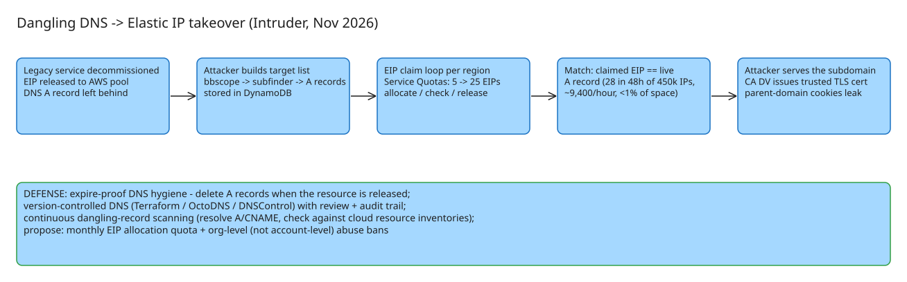

# Dangling DNS and Elastic IPs: How $3 Subdomain Takeovers of US Treasury Domains Work

Intruder's research team proved (published 2026-11-24) that the classic **dangling-DNS subdomain takeover** still works in 2026 against AWS Elastic IPs — and cost them **$3 per valid takeover**. By blindly allocating and releasing Elastic IPs from AWS's regional pools, they claimed **28 live IPs that matched DNS A records** in public bug-bounty scopes in just 48 hours — including **five US Treasury subdomains**: `ftp.treasury.gov`, `irssearch.treasury.gov`, `pcp.treasury.gov`, `rdgw.treasury.gov`, `ww5.treasury.gov`. They covered **&lt;1% of the ~80M IP EIP space**.

## The precondition: a dangling A record

When an EC2 instance is terminated and its Elastic IP is **released without deleting the DNS A record**, the address returns to AWS's regional pool — where **anyone can re-allocate it**. The A record now points at infrastructure an attacker can simply buy.

## The attack pipeline

The researchers automated a brute-force sweep of the EIP space:

1. **Build targets**: pull wildcard scope entries from the [bbscope](https://bbscope.com/) API, enumerate subdomains with [subfinder](https://github.com/projectdiscovery/subfinder), resolve A records, store public-range addresses in DynamoDB.
2. **Raise quota**: new AWS accounts hold 5 EIPs/region; [Service Quotas](https://docs.aws.amazon.com/servicequotas/) auto-approves **25 EIPs/region** with no support case — requested in every region.
3. **Loop per region**: allocate 25 EIPs → check each against the target DB → keep matches, release non-matches → next region (rotating regions matters: releasing and immediately re-allocating in one region often returns the *same* IP — AWS recycles recently released addresses first).
4. **Result**: 450,000 unique IPs in 48 hours (~9,400/hour) before AWS abuse-banned the account.

### The ban was cosmetic

AWS "Blocked the ability to allocate and associate Elastic IP in all regions" — but **EIPs can be transferred between accounts**, so the matched IPs were moved to a fresh account inside the *same organization*, where they kept working. New org accounts skip re-verification. Suggested fixes (a monthly allocation quota; org-level instead of account-level bans) were **rejected by AWS** on 2026-11-17: they consider it a customer-side DNS problem. The vulnerability class remains open.

## Why it matters once you own the IP

- Full control of what the subdomain serves — the .gov + HTTPS trust signal passes, and the attacker can complete a CA **domain-validation** challenge to get a genuinely trusted TLS certificate.
- Credential phishing on a real government domain, and harvesting of credentials from any stale automation still pointing at the record.
- **Cookie blast**: cookies scoped `Domain=treasury.gov` are sent to *every* subdomain — including the attacker-controlled one — enabling session theft across sibling applications.

## How practical is full-scale abuse?

At 9,400 IP/hour, one account needs ~a year to sweep all 80M published EC2 IPv4 addresses; **10 accounts ≈ five weeks**, and the *acquirable* space is much smaller (many IPs are auto-assigned or long-held). An opportunistic attacker needs no full sweep: at 0.56% coverage the team already landed 28 takeovers, nearly half government.

## Defense checklist

- **Delete the DNS record when you release the resource** — treat DNS as configuration that ships with infrastructure teardown, not after.
- **Version-controlled DNS** (Terraform, OctoDNS, DNSControl): every add/delete reviewed, approved, logged — an audit trail for how a dangling record appeared (OWASP recommendation).
- **Continuous dangling-record scanning**: resolve all A/CNAME records in your zones, compare against live cloud resource inventories (AWS's own guidance: see References).
- Prioritise decommissioning workflows: every retired instance, load balancer, or S3/CloudFront distribution should trigger a DNS cleanup task.

## See also

- `explanation-dns-security-benchmark-dmarc-caa-gaps.md` — the same "public DNS has no marketing department" lesson applied to DMARC/SPF/CAA posture.

## References

- [Taking over US Treasury subdomains for $3 each — Intruder research](https://www.intruder.io/research/taking-over-us-treasury-subdomains-for-3-each)
- [Threat tactic spotlight: Subdomain takeover — AWS Security Blog](https://aws.amazon.com/blogs/security/threat-tactic-spotlight-subdomain-takeover/)
- [Subdomain Takeover Prevention — OWASP Cheat Sheet Series](https://cheatsheetseries.owasp.org/cheatsheets/Subdomain_Takeover_Prevention.html)
- [Hunting Dangling DNS in AWS — jsmon.sh](https://blogs.jsmon.sh/hunting-dangling-dns-how-to-exploit-aws-elastic-ips-cloudfront-and-s3/)
