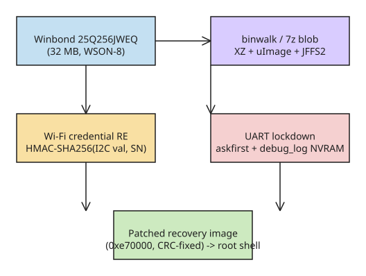

# Eufy HomeBase 2 Firmware Teardown: Predictable Wi-Fi Credential Algorithm and UART Lockdown Bypass

The Adepts of 0xCC published a second installment of their Eufy ecosystem analysis, dissecting the **Eufy HomeBase 2** (firmware **3.4.2.2h**, 2026-06-05) — the hub that must be bought to deploy their doorbell in their city. The research covers firmware extraction from a soldered flash chip, reverse engineering of the **OCEAN_XXXXXX management Wi-Fi credential algorithm**, and a bypass of the **UART console lockdown** via a patched recovery image.

## Hardware and firmware extraction

- Flash: **Winbond 25Q256JWEQ** (WSON-8 package, 32 MB), soldered directly to the board with no exposed test points.
- In-circuit SPI reads via a spring clip + Raspberry Pi SPI0 produced three dumps with **different checksums** — the read power-up activated other board components that interfered with the memory. Solution: **desolder the chip** and dump it off-board.
- Cost of desoldering: a 64 KB block at `0x500000` (the main image load address) was destroyed.
- `binwalk` on the 32 MB dump: U-Boot 1.1.3 string, multiple **XZ** streams (a 11.5 MB main stream with 358 LZMA2 streams), a **uImage** header (MIPS32, load `0x80000000`, entry `0x802E04F0`), and a **JFFS2** filesystem (3,426 nodes, ~12.3 MB).
- With so many XZ streams, they dumped everything with `7z e -y -o7z_mandanga homestation2_firmware00.bin` into one 42 MB blob and carved files out of it with `strings`/`rg` needles.

## Wi-Fi credential generation (OCEAN_XXXXXX management network)

A simple `strings | grep` over the firmware blob located the NVRAM layout: `SSID1=OCEAN_E9A5FC`, `WPAPSK1=F1VSXfNQL_ZCd3k`, plus `AuthMode=WPAPSKWPA2PSK`, `EncrypType=AES`.

**ESSID construction** (from a shell script in the firmware):

```sh
SSID_MAC="`ifconfig ra0 | grep HWaddr | awk '{print $5}' | awk -F ':' '{print $4$5$6}'`"
WIFI_SSID=$ssid_prefix$SSID_MAC   # ssid_prefix defaults to "OCEAN_"
```

i.e. `OCEAN_` + the **last three bytes of the ra0 MAC address**, applied via `iwpriv ra0 set SSID=...` (Ralink MT7628 driver).

**Password construction** — the interesting part, found by carving the ELF that references `WPAPSK1` (MIPS32, uClibc, stripped) and analyzing `sym.set_wifi_pwd` in radare2:

1. For device-type `base_param == 0x0C` (HomeBase class), a helper `z8GetSN()` talks to a co-processor over **I2C** (command `0xC1`, reads 0x11 bytes) and translates the response into a 32-character string. This value is **not** the device serial.
2. `mac_func()` computes **HMAC-SHA256** with the I2C value as the *message* and the **HomeBase serial number** (`T8010...`) as the *key*.
3. `zx_Memory_Encode` base64url-encodes the digest (alphabet `A-Za-z0-9-_`) into the final passphrase.
4. The result is written to NVRAM `WPAPSK1` and applied with `iwpriv ra0 set WPAPSK=%s`.

**Assessment:** the algorithm is not a fixed weak key (unlike the 2024 doorbell paper findings), but it is *derivable*: the device serial follows a known template, and the only secret input is the I2C value that never leaves the hardware. Anyone with physical access (UART/I2C) can compute or observe the management Wi-Fi password; the management network itself is an additional attack surface with WPA2-PSK.

## UART lockdown and its bypass

Connecting to the serial port (`/dev/ttyS1`) yields a BusyBox `askfirst` loop:

```
ttyS1::askfirst:/sbin/login.sh
```

```sh
#!/bin/sh
DEBUG_LOG="`nvram_get debug_log`"
if [ "$DEBUG_LOG" = "1" -o -f "/mnt/enable_console" ];then
	echo "enter debug mode" > /dev/console
	/bin/login
fi
```

Enabling debug is a chicken-and-egg problem: one path needs a file in the filesystem (no write access yet), the other is a proprietary **ARP-encapsulated magic protocol with packets signed by a private key** that is not present in the firmware.

**Bypass:** patch the **recovery image** (a U-Boot image at `0xe70000`, intact even though the main image at `0x500000` was damaged):

- 64-byte uImage header: magic `0x27051956`, header CRC32, timestamp, payload length `0x3455d9`, load `0x80000000`, entry `0x802e04f0`, payload CRC32, flags `05 05 02 03`.
- Minimal **size-preserving** patch of `login.sh` inside the matrioska of XZ/JFFS2 layers:

```python
old_condition = b'if [ "$DEBUG_LOG" = "1" ];then'
new_condition = b'if [ 1 = 1 ];then' + b' ' * 13
old_login = b'\t/bin/login\n'
new_login = b'\t/bin/sh   \n'
```

- The patch was rebuilt with matching CRCs, and the chip's **write protection** was disabled by following the Winbond datasheet pin diagram, the patched recovery image was written, the chip re-soldered, and the bootloader (with the damaged main image) fell through to the backdoored recovery image → **root shell on UART**.

## Filesystem gardening for dynamic debugging

The recovery image is too minimal (no Wi-Fi/I2C kernel modules, no debug tooling), and its filesystem is not persistent. The working setup:

- An old TP-Link router as network bridge; the device's built-in `wget` pulls a **custom BusyBox** (extra applets) from a PC.
- A "staged" rootfs under `/media/homeapp-debug` bind-mounted over the needed paths; `overcommit_ratio` kernel parameter adjusted.
- The goal is to run `homeapp_security` — the main binary containing the Wi-Fi logic — against the live hardware.
- The whole procedure was re-recorded into an all-in-one bootstrap script (`homeapp-restore-v5.sh`) generated from `picocom` session logs, since every boot starts from the limited recovery image.

## Lessons for IoT security review

1. **Soldered flash ≠ secure**: WSON clips + off-board SPI dumps remain a viable extraction path; write-protection pins are a physical bypass, not a cryptographic one.
2. **`askfirst` + NVRAM flag is not a console lock**: the check is trivially patchable when the boot loader falls back to a recovery image; the real defenses are the (absent) signed-boot chain and the signed ARP debug protocol.
3. **Management-network credentials derived from on-device secrets** keep the threat physical, but every additional ad-hoc SSID is another RF attack surface.
4. **Keep session logs of hardware work** — they enabled scripting the three-hour "hit and miss" recovery bootstrap into a repeatable procedure.

## Related KB notes

- [XRay Core pinned-cert MiTM bypass](../tlsssl/explanation-xray-core-pinned-cert-mitm-bypass.md) — vendor trust assumptions in security tooling.
- [Telnetd CVE-2026-32746](../websecurity/explanation-telnetd-cve-2026-32746-linemode-slc-buffer-overflow.md) — long-lived embedded-networking bugs.

## Diagram



## References

- [Adepts of 0xCC — A story of wifi secrets, UART lockdowns and a damaged flash memory chip](https://adepts.of0x.cc/eufy-homestation2-firmware/) (primary source)
- [Adepts of 0xCC — From your doorbell to your home network](https://adepts.of0x.cc/eufy-doorbell-hacking/) (previous installment, required context)
- [bitroot — Eufy HomeBase 2 firmware cracked: Wi-Fi keys, UART shell, and a damaged flash](https://bitroot.org/blog/2026-10-12-eufy-homebase-2-firmware-cracked-wifi-keys-uart-sh/) (independent coverage)
- [BleepingComputer — Anker Eufy smart home hubs exposed to RCE attacks by critical flaw](https://www.bleepingcomputer.com/news/security/anker-eufy-smart-home-hubs-exposed-to-rce-attacks-by-critical-flaw/) (related HomeBase 2 vulnerabilities)
