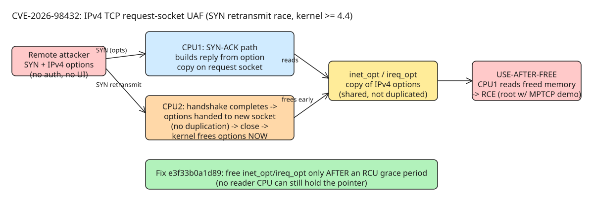

# CVE-2026-98432: Pre-Auth IPv4 TCP Use-After-Free, CVSS 9.8 — Race, Root RCE, and the Patch Gap

A use-after-free in the Linux kernel's **IPv4 connection-request path** gives a remote, unauthenticated attacker code execution against any listening IPv4 TCP port — no privileges, no user interaction, exploited by timing crafted packets. The Linux kernel CVE team scores it **CVSS 9.8 (Critical)**; the bug has been present since **Linux 4.4**. It matters twice over: as a textbook listener-side race, and as a live case study in how far vendor patch delivery can lag a critical fix (Ubuntu 22.04 / 24.04 / 26.04 LTS remained without a vendor kernel ~3 weeks after disclosure, with no announced ETA).

Notably, the bug was reported by Anthropic researcher **Xinyang Ge**, found with Claude ([Anthropic's writeup](https://www.anthropic.com/research/discovering-vulnerabilities-with-claude)); the upstream fix was written by **Eric Dumazet**, reviewed by **Kuniyuki Iwashima**.

## The race, step by step

When a TCP SYN arrives **carrying IPv4 options**, the kernel keeps a copy of those options on the pending request socket so it can echo them in the SYN-ACK. The lifetime of that copy is the bug:

1. Handshake completes → the options copy is handed over to the new connection's socket **as-is, without duplication**.
2. The client **retransmits its SYN** → another CPU can be building a SYN-ACK from *those same options* at that very moment.
3. Nothing stops the new connection from being closed and its socket freed meanwhile — and the kernel **freed the options immediately**.
4. The CPU still building the SYN-ACK reads freed memory → use-after-free → controlled corruption → RCE.

A similar window exists when request-socket migration is enabled (`net.ipv4.tcp_migrate_req` sysctl, or a BPF program that migrates requests) — off by default.

The upstream fix ([commit e3f33b0a1d89](https://git.kernel.org/stable/c/e3f33b0a1d89d738e2b913dab519226eaf76e15b), *"ipv4: free inet_opt and ireq_opt after an RCU grace period"*) does what the kernel already does elsewhere: **wait until no other CPU can still be reading the options before freeing them**.

## Trigger conditions and exposure

- Reached by a **SYN packet carrying IPv4 options** sent to a **listening IPv4 TCP port** — the vulnerable code runs before any application sees the connection.
- **IPv6 is not affected** by the main issue.
- Exploitation needs precise timing of network requests but **no privileges or user interaction**.
- Any system accepting IPv4 TCP connections from untrusted networks should be treated as exposed.
- **MPTCP nuance:** Anthropic's demonstrated root-RCE exploit targeted servers with a multipath TCP listener (MPTCP ships disabled by default on AlmaLinux). But Red Hat is explicit that **MPTCP is not a condition of the flaw** — it lives in the regular IPv4 TCP code, so default-configured hosts still need the fix.



## Vendor status (as of 2026-11-03)

| Vendor | Status |
| --- | --- |
| Ubuntu 22.04 / 24.04 / 26.04 LTS | **No fixed kernel shipped; no ETA announced** |
| RHEL 8 / 9 / 10, OpenShift 4, RHEL CoreOS | Affected (RHSB-2026-016); Red Hat "expediting" fixes, no fixed kernel at time of writing |
| AlmaLinux 8 / 9 / 10 | **Fixed** — ALESCo approved backporting ahead of RHEL; fix in production repos since 2026-11-02: `kernel-4.18.0-553.182.1.el8_10`, `kernel-5.14.0-687.64.1.el9_8`, `kernel-6.12.0-211.72.1.el10_2` |

Verify after reboot: `uname -r` (or `rpm -q kernel`) against the patched version for your release.

## Temporary mitigation: drop IPv4-option packets

The trigger requires IPv4 options, which normal traffic almost never uses (standard TCP options live in the TCP *header* and remain permitted). So dropping incoming IPv4 TCP packets with IP options blocks the trigger while regular connections keep working.

AlmaLinux's tested nftables mitigation (prerouting hook, works alongside firewalld, idempotent):

```bash
sudo nft -f - <<'EOF'
add table ip cve_2026_98432
delete table ip cve_2026_98432
table ip cve_2026_98432 {
    chain prerouting {
        type filter hook prerouting priority -300; policy accept;
        meta l4proto tcp ip hdrlength > 5 counter drop
    }
}
EOF
```

Red Hat's variant uses an `inet` table at the input hook with `priority -310` and `ip protocol tcp ip hdrlength > 5 counter drop`, applied via `nft --check --file` first.

Operational caveats:

- The rule **does not survive a reboot** — re-apply until patched. Check the drop counter with `sudo nft list table ip cve_2026_98432`; remove with `sudo nft delete table ip cve_2026_98432`.
- It protects the host and containers receiving traffic *through* it (default Podman/Docker); **container-to-container traffic on the same host may bypass it**. On OpenShift, pod-to-pod traffic inside the SDN is not filtered — filter at the network boundary instead.
- If the system **routes for other machines**, forwarded TCP packets with options are dropped too.
- Do **not** apply it on networks relying on **CIPSO security labels (NetLabel)** — those are carried in IPv4 options.

Also confirm MPTCP posture (removes the demonstrated exploit setup, not the bug):

```bash
sysctl net.mptcp.enabled            # expect: net.mptcp.enabled = 0
echo 'net.mptcp.enabled = 0' | sudo tee /etc/sysctl.d/90-disable-mptcp.conf
sudo sysctl -w net.mptcp.enabled=0
sudo ss -lnMp                        # list lingering MPTCP listeners; restart owning services
```

**Neither the firewall rule nor disabling MPTCP is a fix.** Install the patched kernel and reboot as soon as possible; on Ubuntu LTS, weigh staying on the stock kernel vs. out-of-tree mitigation vs. moving workloads to a release whose kernel already carries the patch.

## Why this class of bug keeps landing

Listener-side races on connection setup are maximally dangerous: they run **pre-auth, pre-application**, in code every networked service depends on. The defect here was an ownership handoff without duplication plus an eager free — the standard cure is deferral until readers quiesce (RCU grace period). When auditing kernel-adjacent code, any "hand pointer to new owner, free immediately" pattern on objects reachable from concurrent packet handlers deserves scrutiny.

## References

- Trigger/status article: [Ubuntu LTS kernels still unfixed for critical CVE-2026-98432](https://freenode.net/article/ubuntu-lts-kernels-still-unfixed-for-critical-cve-2026-98432) (freenode, 2026-10-31)
- Full technical breakdown + mitigation: [CVE-2026-98432: Patched kernels released](https://almalinux.org/blog/2026-10-30-cve-2026-98432/) (AlmaLinux, 2026-10-30, updated 2026-11-02)
- Vendor bulletin: [RHSB-2026-016 — Use-after-free, kernel IPv4](https://access.redhat.com/security/vulnerabilities/RHSB-2026-016) (Red Hat)
- Upstream fix commit: [e3f33b0a1d89 — ipv4: free inet_opt and ireq_opt after an RCU grace period](https://git.kernel.org/stable/c/e3f33b0a1d89d738e2b913dab519226eaf76e15b)
- Discovery report: [Discovering vulnerabilities with Claude](https://www.anthropic.com/research/discovering-vulnerabilities-with-claude) (Anthropic)
