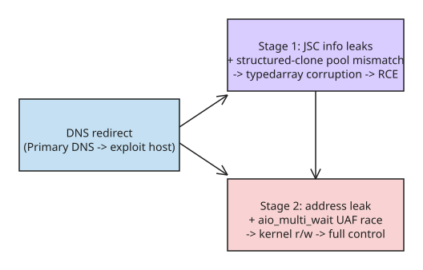

# PS5 Relapse Exploit — Browser-to-Kernel Chain for Firmware 7.00–13.60

**Relapse** is a public (MIT-licensed) exploit chain for PS5 firmware **7.00
through 13.60**, by ntfargo and collaborators (ufm42, Sonic_Iso, Jordy, Dr.
Yenyen, TheFlow, SlidyBat, Flatz, cow, nhk, bollarz, Sleirsgoevy, EchoStretch,
EarthOnion). It is a two-stage browser-to-kernel chain: WebKit/JSC in the PS5's
browser for userland code execution, then a kernel UAF race for arbitrary
kernel read/write.

## Delivery mechanism (DNS redirection)

The chain is delivered through the console's own network stack — no physical
access or devkit needed:

1. Set the PS5's **Primary DNS to `45.56.67.85`** in network settings, which
   redirects the browser to the exploit host (or run `python serve.py` locally
   and open the served page).
2. The page runs the browser stage; after success, default payloads are stored
   in `payloads/` and an **ELF loader listens on port 9021** for follow-up
   payload delivery.

## Stage 1: WebKit/JSC userland code execution

The browser stage combines two primitives:

- **JSC info leaks** — leaking internal JavaScriptCore state (addresses,
  object layout) from the engine itself.
- A **structured clone object pool mismatch** — structured clone (the
  serialization mechanism for passing objects across contexts/workers) is made
  to allocate into a different object pool than expected, which is used to
  **corrupt a typed array**.

The corrupted typed array gives attacker-controlled memory writes in the
browser process → userland code execution.

## Stage 2: kernel read/write via `aio_multi_wait` UAF race

From userland, the kernel stage combines:

- An **address leak** (kernel ASLR bypass), and
- A use-after-free **race on `aio_multi_wait`** — the async I/O wait syscall's
  object is freed while still referenced; winning the race yields a dangling
  pointer that can be controlled.

Together these establish **arbitrary kernel read/write**, from which full
kernel control follows (the standard privilege-escalation path).

## Stability notes (from the README)

- The WebKit stage may need **several attempts** — reload if the browser stalls.
- The kernel exploit can **hang or panic the console**; reboot before retrying.
- Per-version offsets live in `offsets/`; payloads are version-specific
  (recent commit removed compatibility-issue payloads).

## Why this matters technically

- **DNS as an attack vector on a game console**: the PS5's network settings let
  a user (or a coerced configuration) point primary DNS at an attacker host —
  the browser then fetches the exploit page. This is the same class of issue
  as classic "evil DNS" attacks, but here it leads to kernel code execution on
  a shipping consumer device across a wide firmware range (7.00–13.60).
- **Structured clone pool mismatch** is an interesting WebKit primitive: the
  serialization boundary between contexts is where object-pool assumptions can
  be violated, turning a serialization feature into a memory-corruption
  gadget.
- **`aio_multi_wait` UAF race**: Linux async-I/O wait paths are a recurring
  kernel-exploitation target (similar to past `io_uring`/AIO races); the PS5's
  FreeBSD-derived kernel exposes this surface, and combining an address leak
  with the race is the standard recipe for reliable kernel r/w.

## Key takeaways

- Wide firmware coverage (7.00–13.60) means most current consoles are in scope
  until patched — a patching-priority signal for Sony.
- The chain's shape (info leak → typedarray corruption → userland RCE → ASLR
  bypass → UAF race → kernel r/w) is the canonical modern browser-to-kernel
  escalation template, now demonstrated on console hardware.
- For defenders: DNS configuration integrity and WebKit hardening are both part
  of the attack surface; for researchers, the repo's `offsets/` layout shows how
  per-firmware offset tables keep a single chain working across versions.

## References

- [PS5 Relapse Exploit repository](https://github.com/ntfargo/Relapse-Exploit)
- [Hosted exploit page (ntfargo.github.io)](https://ntfargo.github.io/Relapse-Exploit/)
