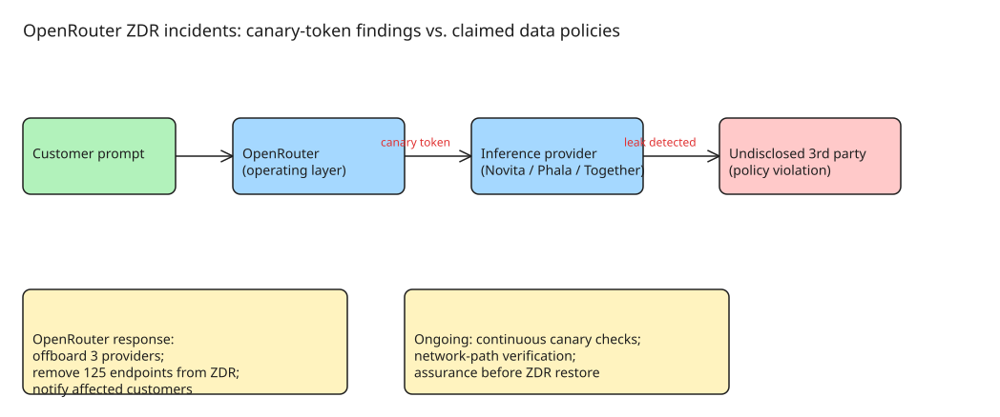

# OpenRouter ZDR Incidents: Verifying Inference-Provider Data Policies with Canary Tokens

In November 2026, security researchers (Dragos, using **canary tokens** planted in AI-supply-chain traffic) reported evidence that several LLM **inference providers** were not upholding their stated data policies — prompts were compromised or forwarded beyond what their Zero Data Retention (ZDR) commitments allowed. OpenRouter, the routing layer between customers and providers, published an incident coordination post. Key point: **no breach of OpenRouter itself** was found — the failures were at individual providers.

## Why this matters conceptually

ZDR has historically been a **contractual claim, not a verifiable property**. A provider's "we don't log your prompts" is trust-based; the customer has no direct line of sight into the request path once a request leaves the router. This incident demonstrates the canary-token technique applied to the AI supply chain: plant distinctive content, observe whether it appears where it should not (third-party systems, logs, training corpora), and treat any appearance as falsification of the data policy. The same logic as honeytokens for credential theft, moved up the inference supply chain.

## What happened (concrete actions)

OpenRouter's response after collaborating with the researchers and providers:

- **Off-boarded three providers** from the platform based on investigation results.
- **Removed 125 endpoints from ZDR eligibility** — the researcher-flagged providers plus additional endpoints removed *precautionarily*.
- **Notified all potentially affected customers**, including where providers had not posted publicly.

Ongoing work announced:

1. **Continuous canary testing** — adapting the researchers' testing approach for ongoing, in-house checks.
2. **Technical verification of network paths** — identifying where requests/responses may be forwarded to third parties (i.e., auditing the actual routing topology, not just provider attestations).
3. **Restoration gating** — providers must give "appropriate assurances and validation" before ZDR eligibility is restored.

## Providers with public incident posts

- **Atlas Cloud** — "Our commitment to your security and privacy" post.
- **Novita** — privacy notice regarding MiniMax requests (requests handled outside claimed boundaries).
- **Phala** — November preliminary incident report.
- **Together** — security event: **prompt leakage** for requests in June–July 2026.

Not all affected providers posted publicly; OpenRouter committed to keeping the list updated and to "raising the bar" for platform admission.

## Architectural takeaway

For anyone building on routed LLM infrastructure:

- A ZDR label on an endpoint is a **claim about a downstream chain you do not control**. Treat it like a supply-chain attestation: useful, but unverifiable without active testing.
- The defensive pattern that worked here was **outsider-detectable falsification** (canary content surfacing where it shouldn't), not policy documents. If you buy inference via routers or resellers, ask whether *anyone* actively tests the ZDR claims, and how removal/restoration is gated.
- Precautionary mass removal (125 endpoints) shows the blast radius: when one verification method succeeds, it typically invalidates many previously trusted endpoints at once — inventory your model-serving dependencies before, not after, an incident.

## Corroboration (KB Zookeeper audit, 2026-11-23)

All load-bearing claims verified verbatim against the official OpenRouter incident post (published 2026-11-22):

- Researcher report originated with **Dragos** ("AI supply chain security canary tokens"); OpenRouter collaborating with researchers and providers.
- **"These findings did not show any breach or unauthorized access of OpenRouter"** — confirmed; failures localized to individual inference providers.
- Actions confirmed: **off-boarded three providers**, **removed 125 endpoints from ZDR eligibility** (researcher-flagged + precautionary), **notified all potentially affected customers**.
- Ongoing work confirmed: adapting the researchers' testing approach for **ongoing/in-house checks**, **technical verification of network paths** for third-party forwarding, and **restoration gating** ("appropriate assurances and validation" before ZDR eligibility is restored).
- Provider security announcements list confirmed as **four** public posts: Atlas Cloud, Novita (MiniMax requests), Phala (November preliminary report), Together (June–July 2026 prompt leakage) — the earlier version of this note listed only three; Atlas Cloud added.

## References

- [OpenRouter: Data Processing Incidents on Inference Providers (2026-11-22)](https://openrouter.ai/blog/announcements/data-processing-incidents-on-inference-providers/)
- [Dragos: AI supply chain security canary tokens](https://www.dragos.com/blog/ai-supply-chain-security-canary-tokens)
- [Atlas Cloud: Our commitment to your security and privacy](https://www.atlascloud.ai/blog/ai-updates/security-and-privacy-commitment)
- [Novita privacy notice: MiniMax requests](https://novita.ai/blog/minimax-requests-privacy-notice/)
- [Phala November preliminary incident report](https://phala.com/posts/phala-november-preliminary-incident-report)
- [Together AI: prompt leakage security event (June–July 2026)](https://www.together.ai/blog/security-event-prompt-leakage-for-requests-in-june-and-july-of-2026)
