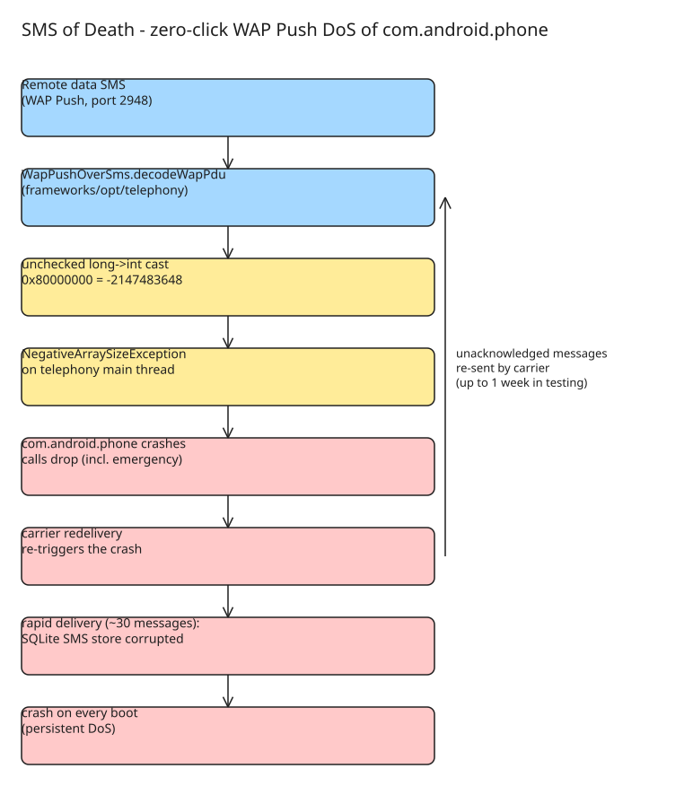

# SMS of Death: Zero-Click WAP Push DoS of Android Telephony (com.android.phone)

A single malformed **WAP Push** SMS delivered as a data SMS crashes `com.android.phone` on Android with **zero victim interaction**: active calls drop (including emergency calls), and with rapid delivery the SMS SQLite store can be corrupted so the device crashes on every boot. Reported 5 May 2026 to the Android & Devices VRP by Mark Blaszczyk (independent researcher); disclosed 29 October 2026 after the 90-day window, after Google declined across three tickets and four engineers, classifying it as a Non-Security "Won't Fix" (no CVE issued).

## The vulnerability

`WapPushOverSms.decodeWapPdu()` in `frameworks/opt/telephony` reads the WSP header length as a `uintvar`. The value comes back as a `long`, is cast to `int` with **no range check**, and is used directly as the size of a new byte array:

```java
// WapPushOverSms.java:217  header length read as long, cast with no bounds check
int headerLength = (int) pduDecoder.getValue32();
    ...
// WapPushOverSms.java:244  the cast value is used as an array size
byte[] header = new byte[headerLength];
```

A 5-byte uintvar payload of `88 80 80 80 00` decodes to `0x80000000`. Cast to a signed 32-bit `int`, that is `-2147483648`. Allocating `new byte[-2147483648]` throws an uncaught `NegativeArraySizeException` on the telephony main thread, killing `com.android.phone`:

```text
E AndroidRuntime: FATAL EXCEPTION: main
E AndroidRuntime: Process: com.android.phone
E AndroidRuntime: java.lang.NegativeArraySizeException: -2147483648
E AndroidRuntime:   at ...WapPushOverSms.decodeWapPdu(WapPushOverSms.java:244)
E AndroidRuntime:   at ...WapPushOverSms.dispatchWapPdu(WapPushOverSms.java:339)
E AndroidRuntime:   at ...InboundSmsHandler.processMessagePart(InboundSmsHandler.java:1169)
E AndroidRuntime:   at ...InboundSmsHandler$DeliveringState.processMessage(InboundSmsHandler.java:627)
```

The suggested fix (provided to Google the same day as the first report) is a bounds check before the cast:

```java
long rawHeaderLen = pduDecoder.getValue32();
if (rawHeaderLen < 0 || rawHeaderLen > pdu.length) {
    result.statusCode = Intents.RESULT_SMS_GENERIC_ERROR;
    return result;
}
int headerLength = (int) rawHeaderLen;
```

## Why it is dangerous

| Property | Detail |
| --- | --- |
| Interaction | Zero-click: no tap, no open, no notification |
| Visibility | Silent: delivered as a data SMS, nothing in the inbox, victim never sees the sender's number |
| Vector | Remote SMS, WAP Push, port 2948 |
| Call impact | Active voice calls terminate with `DisconnectCause CS_DEATH` as the process restarts — **including emergency calls** |
| Outage per message | 1–2 seconds of telephony blackout while `com.android.phone` restarts |
| Amplification | Carrier redelivery: unacknowledged messages are re-sent and re-crash the phone; a single message caused intermittent outages for up to a week in testing |
| Scale | ~20 messages render the device unusable for an extended period |
| Persistence | Rapid repeated delivery corrupts the SQLite SMS store → crash on every boot (below) |

The message never appears in Messages and the sender's number is never shown, so the victim has no forensic trace of the attack.



## Escalation: the SQLite race turns a crash into a bricked phone

Sending the payload rapidly in succession (≈30 messages) is materially worse than a single message: the crashes interleave with the telephony provider's writes to the SMS store and hit a **race condition that corrupts the SQLite database** holding the device's messages.

Once the database is corrupt, `com.android.phone` no longer needs a fresh message to fail — it **crashes immediately on every boot** as it reads the damaged store. A restart does not clear it.

Recovery is hostile:

- A **factory reset only helps temporarily**, because the carrier re-sends the unacknowledged payload and re-triggers the crash.
- Full recovery required: (1) remove the physical SIM and insert it into a **non-Android device** (e.g. an iPhone) so the carrier's retried messages are acknowledged and redelivery stops; then (2) clear the SMS records / corrupt database over **ADB**.
- On a device using an **eSIM**, where the SIM can't simply be moved to another handset, recovery is significantly harder — for a non-technical user, effectively out of reach.

This is the distinction the report turns on: it is not a transient crash but a **remote, zero-click, persistent denial of service requiring a factory reset (and more) to recover** — the exact shape of a "Destructive Remote DoS" in the VRP's own rules. The safety consequence is severe: while under attack or bricked, the device cannot reliably reach emergency services (000/911).

## Disclosure timeline

| Date | Event |
| --- | --- |
| 5 May 2026 | Report filed via Android & Devices VRP (issue 509520497): zero-click WAP Push crash in `WapPushOverSms`; suggested fix provided the same day |
| 5 May 2026 | Android Security: assigned for investigation; researcher asked to follow coordinated disclosure |
| 15 May 2026 | Researcher requests higher priority: reproduced on 5 handsets, emergency-call impact, carrier regulations |
| 20 Jun 2026 | Closed **Won't Fix (Infeasible)**: "not a security vulnerability" |
| 20 Jun 2026 | Resubmitted as appeal (issues 525810560, 525816147, "SMS of DEATH"); appeal closed within 3 minutes **Won't Fix (Not Reproducible)** |
| 22 Jun 2026 | SQLite corruption from rapid sends reported (crash on boot; recovery needs SIM swap + ADB) |
| 23 Jun 2026 | Android Security requests disclosure plans, reminds of the 90-day VRP timeline |
| 2 Jul 2026 | Appeal marked Duplicate of the original; re-evaluation confirms same root cause |
| 16 Jul 2026 | Original reopened after the issue surfaced on Discord, then confirmed a duplicate again; "4 engineers will have evaluated the report" |
| 29 Oct 2026 | Final decision: **Won't Fix**, quoted as "does not meet the severity threshold … considered a Non-Security Issue (NSI)" |

No CVE was issued. Full disclosure follows the 90-day window because the issue was held privately and declined across three tickets and four engineers, so users, carriers and downstream OEMs can assess the risk and mitigate.

## Impact assessment

Tested across multiple makes and models — **Pixel 9 (April 2026 firmware) and various Samsung Galaxy and A-series** — with a **100% reproduction rate**.

## Historical context

`WapPushOverSms` / WAP Push handling has a track record: an older **SQL injection in `WAPPushManager` on Android &lt;5.0** (exploit-db 35382). WAP Push is a legacy protocol kept alive for carrier services (balance alerts, banking notifications), which is why this attack surface still exists in modern Android and is inherited by downstream OEM builds.

## Defensive takeaways (operators, OEMs, users)

- **WAP Push validation**: bounds-check every length/size field read from the PDU (the one-line fix above); treat out-of-range `uintvar` values as protocol errors, never as allocation sizes. Audit other `uintvar` consumers in the same code path.
- **Rate limiting / anomaly detection**: flag bursts of data-SMS WAP Push (port 2948) from a single source; carrier-side suppression of redelivery storms for unacknowledged WAP Push messages.
- **Process hardening**: a `com.android.phone` crash should not remove emergency-call capability — a watchdog that restores emergency-only dialing, or a crash-restart path that does not require a full reboot, would break the CS_DEATH chain.
- **SMS store resilience**: protect the SQLite SMS database from concurrent writes during crash/restart races (journaling/WAL, boot-time integrity check with a safe fallback copy) so a corrupted store degrades to "no messages" rather than "no telephony".
- **OEMs**: patch `frameworks/opt/telephony` even where Google triages the issue as NSI; downstream builds inherit the bug.
- **Detection**: monitor for `NegativeArraySizeException` / `FATAL EXCEPTION` in `com.android.phone` and spikes in `DisconnectCause CS_DEATH`.
- **Users**: if a phone starts crashing on boot with no telephony and you suspect an attack, the recovery path is SIM into a non-Android device (to stop redelivery) + ADB clear of the SMS store; eSIM devices are much harder.

## Proof of concept (authorised testing only)

A working PoC APK + source is published: [github.com/MarkBlah/smsofdeath](https://github.com/MarkBlah/smsofdeath) (Apache-2.0). It crafts the malformed WAP Push PDU and sends it as a data SMS to a target number. **Warning: this is a working weapon** — it can remotely disrupt and brick mobile phones. Use it only against devices you own or are explicitly authorised to test; interfering with a person's ability to reach emergency services is a serious criminal offence in most jurisdictions.

## Upstream status (2026-10-29)

Verified against AOSP `main` (`frameworks/telephony/.../WapPushOverSms.java`): the unchecked cast is **still present** —

```java
int headerLength = (int) pduDecoder.getValue32();   // no bounds check
byte[] header = new byte[headerLength];
```

so the researcher's proposed fix (a `headerLength > pduLength - headerPosition` check, plus a length guard on the `body` allocation) has **not been merged** as of 2026-10-29, and the zero-click DoS remains live on AOSP-derived builds. Related history worth knowing: an earlier AOSP commit (567ea11, "Fix OOBE crash/DoS after receiving 0-byte WAP push") hardened a *different* path in the same file — it wraps `dispatchWapPdu` in try/catch so a 0-byte PDU produces an `ArrayIndexOutOfBoundsException` that is caught and logged rather than crashing `com.android.phone`. That hardening does not touch the uintvar header-length cast, which is what this note targets.

OEMs: the note's "wait for vendor patches" guidance still stands; no vendor has published a fix for this specific cast bug as of 2026-10-29.

## References

- [SMS of Death: zero-click Android telephony DoS](https://smsofdeath.com/)
- [PoC APK + source (GitHub, Apache-2.0)](https://github.com/MarkBlah/smsofdeath)
- [Google issue tracker: WapPushOverSms zero-click DoS (509520497)](https://issuetracker.google.com/issues/509520497)
- [AOSP commit 567ea11 — Fix OOBE crash/DoS after receiving 0-byte WAP push (related, different path)](https://android.googlesource.com/platform/frameworks/base/+/567ea11c42187657624f07d195b84a59b80b184e)
- [Historical context: WAPPushManager SQL injection on Android &lt;5.0 (exploit-db 35382)](https://www.exploit-db.com/exploits/35382)
