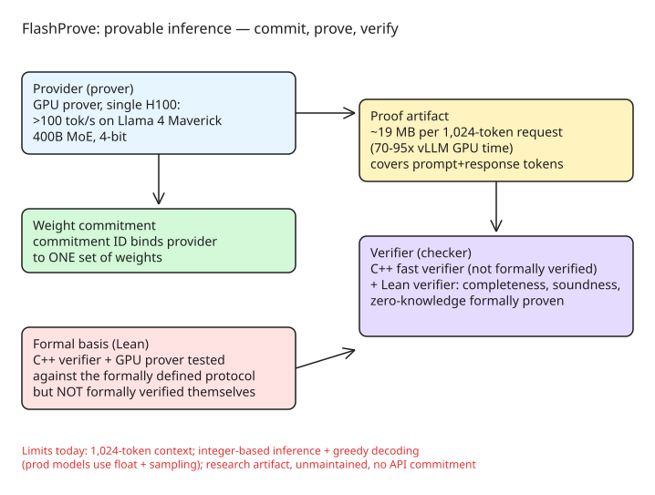

# FlashProve: Provable Inference for Model Attribution

Anthropic open-sourced **FlashProve** ([anthropics/FlashProve](https://github.com/anthropics/FlashProve), initial public release dated 2026-10-30 in the repo changelog; publicly announced Tuesday 2026-11-03), a research prototype for **provable inference**: a provider generates a cryptographic proof that a response was produced by one specific, *committed* set of model weights — without revealing the weights. It answers "which model actually answered me?" for cases where API proxies, resellers, or fine-tuning farms may silently substitute a cheaper model.

## How it works (protocol shape)

1. **Weight commitment** — the provider publishes a *commitment ID* binding it to exactly one set of weights.
2. **Proving** — alongside the response, a GPU prover generates a proof covering the prompt + response tokens.
3. **Verification** — a checker validates the proof against the commitment: accepts valid proofs (completeness), rejects forgeries with overwhelming probability (soundness), and reveals nothing about the weights beyond what responses already disclose (zero-knowledge).

## Concrete performance numbers

From the release (Anthropic research post + The New Stack, Nov 2026):

- **Prover:** single H100 GPU, **>100 tokens/second** on a 400B-parameter MoE model (Llama 4 Maverick, 4-bit quantized).
- **Proof size:** ~**19 MB per 1,024-token request**.
- **Overhead:** proofs take **~70–95× the GPU time** vLLM needs to process the same prompt — prohibitive for routine API traffic.
- **Baseline for comparison:** the earlier open-source system **VerInf** needed **14.3 hours** to prove 1,000 tokens, producing a **93.6 GB** proof that took nearly a day to verify. FlashProve is orders of magnitude faster but still not production-cheap.

## Trust boundary of the verifiers

The repo ships three executables: the GPU prover, a fast **C++ verifier**, and a **Lean verifier** backed by formal proofs.

- The protocol's completeness, soundness, and zero-knowledge properties were **formally verified in Lean** (machine-checked proofs).
- Claude itself contributed many of the optimizations that made the proofs fast — but researchers still had to verify those AI-generated optimizations didn't weaken the security guarantees.
- The **C++ verifier and the GPU prover are NOT formally verified**. They were tested against the formally defined protocol and passed comparison tests, but only the Lean verifier carries mathematical guarantees. In practice, the fast verifier is the trusted path — a divergence between C++ and Lean behavior is the attack surface.

## Why it is not production-ready

- **1,024-token context limit** per proof.
- **Integer-based inference + greedy decoding**, while production models use floating point and sampling — proofs cover an idealized inference stack, not the deployed one.
- Released as a **research artifact**: no maintenance, no contributions, no indication it will reach the Claude API.

## Assessment

FlashProve establishes that model attribution at MoE scale is *possible* (the 70–95× overhead and 19 MB/1k tokens are the honest cost of the current construction), but practical deployment needs cheaper proving, float/sampling support, longer contexts, and a formally verified fast verifier. Until then, it's a verification *reference implementation* and a template for how to pair Lean formalization with practical provers — a pattern worth copying for any cryptographic protocol release.

## References

- [Anthropic found a way to prove which AI model answered you — The New Stack](https://thenewstack.io/anthropic-flashprove-model-verification/)
- [Progress on provable inference — Anthropic research](https://www.anthropic.com/research/provable-inference)
- [anthropics/FlashProve on GitHub](https://github.com/anthropics/FlashProve)
- [VerInf baseline implementation](https://github.com/JamesPetrie/VerInf)
- [Help Net Security coverage](https://www.helpnetsecurity.com/2026-11-04/anthropic-flashprove-provable-inference/)

Related KB notes: [[explanation-slsa-in-toto-provenance-trust]] (artifact provenance vs model provenance)
