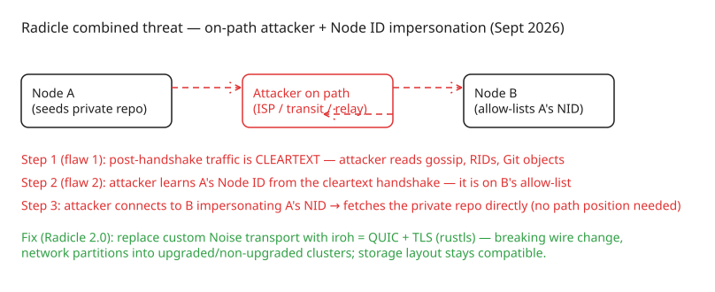

# Radicle Network Protocol Disclosure — Cleartext Transport and Node ID Impersonation

Radicle (a peer-to-peer, local-first code collaboration stack built on Git) disclosed (2026-09-23) **two critical vulnerabilities in the network protocol used by its nodes**, affecting **all released versions** (up to 1.10.3 at disclosure time). The flaws are in the *node transport layer*, not the repository data model: Git objects and signed references are still verified at the storage layer, so an attacker cannot forge code or identities — but confidentiality is gone and peer identity can be spoofed.

## Vulnerability 1: cleartext after the Noise handshake (reported 2026-06-24)

Every Radicle connection starts with a **Noise XK handshake** (the same pattern WireGuard and Lightning use), which proves the remote node holds the private key behind its Node ID. The expectation is that everything after the split is encrypted under the derived session keys. In practice, **everything after the handshake goes over plain TCP**: gossip messages, repository IDs, peer addresses, and Git objects — including private repositories.

The root cause (per [Kostis Maninakis's write-up](https://maninak.com/blog/radicle-cleartext-transport-vulnerability/)): in `radicle-node`, the encryption condition is `!self.session.is_established()` — which is true both *before* setup and, due to how state transitions are checked, at exactly the moment the handshake completes. Both "too early" and "too late" take the same branch, so **both sides write in the clear**. The `noise-framework` crate does derive and store both ciphers (`sending_cipher`/`receiving_cipher` on `NoiseState::Active`, with working `encrypt_with_ad`), but exposes no accessor for them — only `get_handshake_hash` and `get_remote_static_key`. The keys exist; nothing reads them.

Concrete evidence: the first inbound byte after the handshake (offset 32 of a live connection to a production seed) is the ASCII `r` of `rad`. Anyone on the network path between two nodes — an ISP, transit provider, relay — can read all of it. There is no published byte-level spec for the post-handshake protocol; framing and message types exist only in Rust source (`heartwood`).

## Vulnerability 2: broken peer authentication → Node ID impersonation (reported 2026-08-12)

Peer authentication in the connection handshake is broken, allowing an attacker to **connect to your node presenting a Node ID that is not its own**. Private repositories are shared only with allow-listed Node IDs; an attacker who fakes an allow-listed Node ID can fetch a private repository *directly*, without being on the network path.

On its own this is harder than it sounds — the allow-list isn't public, so an off-path attacker must guess a valid Node ID. **Combined with vulnerability 1**, though, the threat becomes practical: an on-path attacker sees both endpoints' Node IDs (both normally on each other's allow-lists), reads everything exchanged while watching, and then uses an observed Node ID to fetch the whole repository on demand. The realistic threat model is *anyone on the path between your node and the nodes it syncs with* — no setting or allow-list protects against them.

## What is NOT affected

- **Integrity**: Git objects and signed references are verified at the storage layer as before; an attacker cannot forge code or identities.
- **Public repositories**: information leakage matters far less there (though still worth noting).
- The flaws do not reach into the data model — this is a transport-layer confidentiality/authentication failure, which is why the fix can be a protocol replacement rather than a data migration.

## Immediate workarounds (from the disclosure)

```bash
# List private repositories in storage
rad ls --private --all

# Stop seeding each one: use `block`, not `unseed`
rad block <RID>

# Or stop the node entirely
rad node stop
```

Why `rad block` instead of `rad unseed`: `unseed` only removes the per-repo policy and falls back to the node's *default* seeding policy — if you changed that default to `allow`, the repository keeps being served. `block` sets an explicit block that is checked first, so it works either way.

Three limits on what this achieves:

1. It stops your node from serving the repo but does **not** delete your local copy (it stays in `$(rad path)/storage/<RID without rad: prefix>` — only remove it if you understand you're deleting the repository and every fork you hold).
2. It does not reach copies that authorized peers already fetched — those nodes have the same flaws; ask them to block too.
3. It does not undo past exposure — **treat everything transmitted over the network as leaked**, and rotate any unencrypted credentials, keys, or tokens it contained.

**Tor/I2P/VPN are NOT sufficient**: they hide traffic from on-path readers (mitigating flaw 1) but do nothing about peer impersonation (flaw 2), which can still lead to exfiltration of private repository contents under a targeted attack.

## Resolution: replace the transport with iroh

Because Radicle's protocol has no version negotiation and the fix is wire-incompatible, **no backward-compatible mitigation exists** — the fix ships as a breaking major release (Radicle 2.0). The plan: replace the custom Noise-based transport with [iroh](https://www.iroh.computer/), an open-source P2P networking stack built on open standards — in practice **QUIC with TLS via rustls**, giving confidentiality by construction, plus NAT traversal and multiplexing for reliability.

Consequences of the wire break:

- The network **partitions into upgraded and non-upgraded clusters** that cannot communicate; upgrading a node to 2.0 cuts it off from the 1.x network until peers follow.
- Storage layout stays compatible — the breakage is focused on the network end, so local repositories survive the upgrade.
- Context: iroh was already under discussion for Radicle since mid-2025; the disclosures accelerated and sealed the decision. Related ecosystem pieces: `radicle-artifact`'s `radiroh://` URI scheme (iroh-blobs fetches with BLAKE3 verification, endpoint identity as Ed25519 key) and third-party tooling like [git-remote-iroh](https://github.com/magik6k/git-remote-iroh), which tunnels git's native smart protocol over iroh.

## Lessons for P2P protocol design

1. **A handshake that proves identity is not a transport.** Noise XK authenticates the *endpoint*, but if the post-handshake ciphers are never applied, you have authenticated cleartext — arguably worse than plain cleartext because it creates false assurance.
2. **"The keys exist" is not "encryption happens."** The bug lived in an API gap: `noise-framework` stored the ciphers but offered no accessor and no transport phase (no framing, no nonce-exhaustion guard). A library that computes session state but doesn't expose a way to *use* it invites exactly this failure.
3. **Protocol specs must cover bytes, not just concepts.** Radicle's RIPs explain gossip/replication concepts; the actual wire format existed only in source code — which is also how an independent researcher (running a node inside a browser tab) found the flaw by byte-comparing his own TypeScript reimplementation against real nodes.
4. **Confidentiality and authentication failures compound.** Each flaw alone was partially mitigable (public repos; guessing Node IDs); together they form a complete exfiltration path for private repositories.

## Diagram: combined attack chain



## References

- [Radicle: Disclosure of Vulnerability in the Network Protocol](https://radicle.dev/2026/09/23/disclosure-of-vulnerability-in-network-protocol)
- [Kostis Maninakis: Radicle nodes send private repositories in cleartext (root-cause analysis)](https://maninak.com/blog/radicle-cleartext-transport-vulnerability/)
- [Radicle Protocol Guide (Heartwood, Noise XK, gossip, replication)](https://radicle.dev/guides/protocol)
- [iroh: open-source P2P networking stack](https://www.iroh.computer/)
- [git-remote-iroh: git smart protocol over iroh](https://github.com/magik6k/git-remote-iroh)
