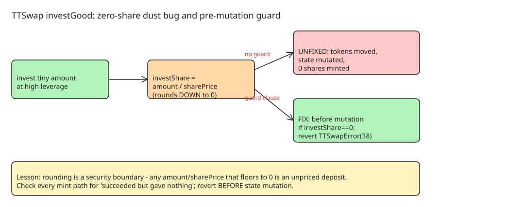

# Zero-Share Rounding Bugs: TTSwap investGood and Rounding as a Security Boundary

A Solidity/DeFi bug class illustrated by TTSwap's `investGood` (bounty PR #336, from a nine-fix audit sweep): the function **accepted investments so small they minted zero shares — and kept the tokens**.

## The bug class

Share accounting in pool contracts is integer division. At high leverage, a tiny invest makes the computed share amount round **down to zero**:

- `investShare == 0` after `amount / sharePrice`
- the caller's tokens move into the pool
- contract state mutates
- **nothing is minted back** — the "invest" returns success

The minimal reproduction: invest **1 raw unit at 31x leverage**; on unfixed code the share balance comes back `0` while the call "succeeds".

Why it is worse than free tokens: those **unowned deposits inflate the pool's virtual quantities without a corresponding claim**, skewing the invariants every later computation depends on. The submission claimed this could permanently brick the good via the `getInvestPower` arithmetic path (same underflow class as a separately verified sibling finding, bounty #328). Notably, QA scoped this precisely: the zero-share accept was **reproduced and verified**, the brick mechanism was labeled "plausible and consistent" but **UNVERIFIED end-to-end** — and the fix's validity does not depend on it. That verified-mechanism / disclosed-boundary discipline is the reporting model worth copying.

## The fix pattern

Reject the degenerate case **before any state changes**:

```solidity
if (investResult_.investShare == 0) {
    revert TTSwapError(38);
}
```

One guard in `L_Good.investGood`, placed before mutation. On the fix branch: dedicated tests pass — zero-share invests revert with error 38, normal invests unaffected. On base, the PoC fails exactly as claimed ("next call did not revert as expected").

## Generalizable rules

1. **Rounding is a security boundary.** Any `amount / sharePrice` that can floor to zero is an *unpriced deposit*: value enters the system with no owner.
2. **Audit every mint path for the "succeeded but gave nothing" case** — deposit, invest, stake, addLiquidity, vault shares.
3. **Revert before state mutation, not after.** A guard placed after token transfers/state writes leaves the invariant already broken.
4. When reporting findings: **prove the mechanism you executed, label the impact you didn't.** Corroborating findings (the verified #328 underflow) strengthen claims without blurring verification status.



## References

- [The invest that minted nothing — TTSwap's zero-share dust bug (DEV.to)](https://dev.to/nexusfoundry/the-invest-that-minted-nothing-ttswaps-zero-share-dust-bug-55g5)
