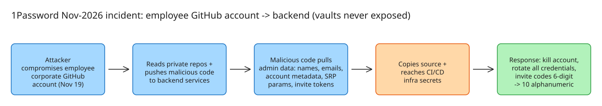

# The 1Password November 2026 Backend Incident: GitHub Account Compromise, CI/CD Exposure, and Why the Vault Survived

On 2026-11-19 1Password began investigating indications that an attacker had gained access to an **employee's corporate GitHub account**. The attacker used it to read private source repositories and to **push malicious code to backend services**, which then downloaded administrative (non-vault) customer data. The disclosure was published 2026-11-25. The headline outcome — vault contents and the keys protecting them were never reachable — is a working demonstration of a zero-knowledge architecture under a real backend compromise.

## What was exposed

Account records for a subset of users:

- Names and email addresses.
- Account/user identifiers, account creation and last-sign-in timestamps.
- **Public keys** — public by design, no security impact.
- **Secure Remote Password (SRP) protocol parameters** — 1Password states these cannot be used to access an account.
- **Tokens from emailed invitation/provisioning/account-recovery links** (SCIM Bridge and Hosted Provisioning invites). These only complete a flow when combined with an SSO sign-in or a code sent to the registered email; the token alone grants nothing. A small number of users were in that state and were individually notified.
- Internal architecture metadata (numeric version/file identifiers).

The attacker also **copied private-repository source code and reached the CI/CD system**, which holds infrastructure secrets needed to operate the product. All potentially exposed credentials were rotated or revoked.

## What was not exposed

Vaults and their items; the keys that protect vaults (1Password stores neither the account password nor the Secret Key); account recovery keys; the apps and browser extensions. The stated design property: a breach of 1Password's systems cannot expose vault contents because encryption keys are held only by users.

## The two defenses worth stealing

1. **Brute-force-resistant out-of-band codes.** The invitation/recovery flow's six-digit numeric code was expanded to **ten alphanumeric characters** specifically to make guessing the second factor impractical after the email tokens leaked. Any product with "token + short code" email flows should compute the guess space: 10^6 ≈ 10^6 vs 36^10 ≈ 3.6×10^15.
2. **Assume the phishing wave and say it out loud.** 1Password explicitly warned that attackers will now send convincing "invitation / account recovery" emails using real names and addresses, and restated the never-ask-for-your-Secret-Key rule. A breach disclosure that only lists affected fields misses the actual downstream harm vector — targeted phishing with perfectly personalised pretexts.

## Incident-response pattern

The public record maps to a clean containment/eradication/recovery sequence: disable the affected GitHub account, revoke the stolen token, remove attacker-created access; rotate everything the CI/CD could sign with; tighten GitHub/CI/CD/endpoint controls and add detections for this attack class; verify no account takeovers occurred using exposed tokens ("no internal evidence"); bring in independent security experts to validate containment. The disclosure post is maintained live — a good transparency norm (their Security Whitepaper has been public since 2015).

## Lessons

- **An employee GitHub account is production infrastructure.** Third-party SaaS backend services are built from that GitHub org; one non-human-grade credential bridge (repos → deployable backend) made a workstation-level phish into a backend RCE-equivalent. Treat org owners/admins and deploy-capable tokens as crown-jewel credentials (hardware-bound passkeys, short-lived OIDC federation from CI rather than long-lived PATs).
- **Zero-knowledge is incident insurance, not incident prevention.** Everything the attacker got would have been far worse if vault blobs or wrapping keys had been server-accessible. Design so the blast radius of "attacker can run code in our backend" still has a hard crypto ceiling.
- **Leaked recovery-link tokens are a user-side risk even when they are "not enough alone."** Rate-limit and lengthen the companion factor rather than relying on the second factor's obscurity.

## See also

- `explanation-litellm-1-107-0-pypi-compromise-cook-stealer.md` — another case where the compromise landed in the build/release path rather than the data store.
- `explanation-microsoft-agent-framework-pypi-compromise.md` — CI/CD-adjacent credential theft in OSS release pipelines.

## References

- [Update on a security incident involving 1Password's backend systems — 1Password blog, 2026-11-25](https://1password.com/blog/update-on-nov-2026-security-incident)
- [1Password Security Whitepaper (design docs since 2015)](https://agilebits.github.io/security-design/)
- [How we use SRP — 1Password engineering](https://1password.com/blog/developers-how-we-use-srp-and-you-can-too)
