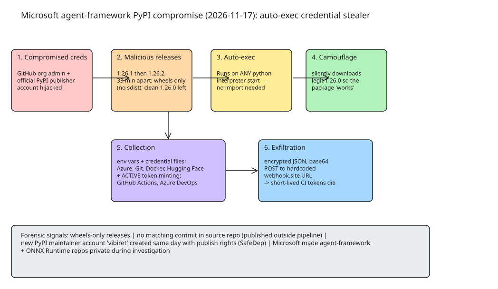

# Microsoft agent-framework PyPI Compromise: Auto-Executing Malware in Releases 1.26.1/1.26.2

On **2026-11-17** an attacker published two malicious versions (**1.26.1 and 1.26.2**, ~33 minutes apart) of Microsoft's official `agent-framework` package on PyPI — the company's Python framework for building AI agents, with ~**200,000 downloads/month**. Both were quarantined on PyPI; **1.26.0 remains the last clean release**. The malware exfiltrates developer credentials and environment variables and can mint *new* cloud tokens — dangerous specifically for CI/CD and cloud build environments.

## Attack chain

1. **Access:** the attacker appears to have obtained unauthorized access to Microsoft's GitHub organization admin credentials and the official PyPI publishing account.
2. **Publication:** 1.26.1 was pushed, quickly "restored to a safe version" — then the attacker immediately pushed the malicious 1.26.2, showing the compromised credentials were still usable during the incident.
3. **Camouflage:** the malicious package **silently downloads the legitimate 1.26.0** in the background so behavior appears normal to users and smoke tests.
4. **Execution:** the payload executes **as soon as a Python interpreter starts** in any environment where the package is installed — no explicit `import` required (import-time/installation-time auto-execution).
5. **Collection:** environment variables plus credential/secret files for critical developer services — **Azure, Git, Docker, Hugging Face**.
6. **Active token minting:** beyond passive theft, the malware makes live requests to obtain **new identity tokens** from GitHub Actions, Azure DevOps and Azure. Per OpenSourceMalware, this makes even **short-lived tokens** exploitable because exfiltration is immediate.
7. **Exfiltration:** stolen data is encrypted, Base64-encoded as JSON, and POSTed to a **webhook.site URL hardcoded in the package**.

Notably the malware has **no persistence mechanism** — it only lives as long as the compromised version sits in the package directory. The threat is velocity of theft in build pipelines, not long-term implantation.

## Forensic signals

- Malicious releases shipped **wheels only** — legitimate releases ship both binary wheels and sdists (Endor Labs/Wiz observation).
- **Wiz found no corresponding commit or malicious code in Microsoft's source repo** → the packages were likely built/published **outside the normal release pipeline** (provenance gap: no source ↔ artifact correspondence).
- **SafeDep** identified a PyPI maintainer account, **`vibiret`**, created **the day of the attack**, holding publish rights on the package and five associated projects — involvement unconfirmed, but same-day account creation with elevated rights is a strong tamper signal.
- Microsoft response: temporarily took several GitHub repos private, including `agent-framework` and **ONNX Runtime**, "while investigating malicious content."
- Independent analyses: OX Security, Wiz, Endor Labs, SafeDep, OpenSourceMalware.

## Why CI/CD is the killer environment

In a developer laptop, stolen env vars are bad. In a **cloud build pipeline**, the runner legitimately holds *fresh, scoped, high-value* tokens (GitHub Actions OIDC, Azure DevOps) at exactly the moment the malware executes. Immediate exfiltration collapses the assumed safety of short-lived credentials: TTL protects against stolen-token *reuse later*, not against *real-time theft*. Combined with auto-execution on interpreter start, simply **having the package installed** in the build image is enough — you do not have to import or use it.

## Precise timeline and payload internals (Chainguard / StepSecurity)

- **20:35:20 UTC** Nov 17 — malicious **1.26.1** published via the Microsoft-associated PyPI
  publisher; quarantined by PyPI at **21:06:16**. Payload: `agent_framework_meta.pth` +
  `_telemetry.py`.
- **21:08:39 UTC** — **1.26.2** published **2 min 23 s after** the quarantine, same technique with
  renamed files (`af_runtime_diag.pth` + `af_runtime_diag.py`).
- The auto-execution trick is a **`.pth` file in site-packages**: Python executes `.pth` contents
  at interpreter startup, so the stealer runs on `pip`, `pytest`, IDE language servers and every
  script in the environment — the 23-byte `.pth` is a single `import` of the payload, which sets
  an `_AF_TEL=1` double-run guard and forks a child process (daemon-thread fallback).
- **Harvest scope is far wider than Azure/Git/Docker/HF**: env vars matching `TOKEN`, `SECRET`,
  `PASSWORD`, `KEY`, `AZURE`, `AWS`, `GITHUB`, `OPENAI`, `PIP`, `NPM`, `NUGET`; files including
  Azure CLI JSON, `pip.conf`, `.npmrc`, `.netrc`, Git credential stores, Docker `config.json`,
  HF tokens, Azure Pipelines `.credentials`, `.env` files and GitHub Actions runner temp files;
  even **`/proc/<pid>/environ` of other processes**. Live minting covers GitHub Actions OIDC,
  Azure DevOps OIDC, Azure managed-identity tokens for **nine resource types**, and IMDS data.
- **Exfil fingerprint**: zlib-compressed, Base64-encoded JSON POSTed over HTTPS to the
  webhook.site endpoint (hidden behind a Base64 string in the package) with
  `User-Agent: runtime-diagnostics/1` — a greppable signal for egress/proxy logs.
- **Still-open risk**: the PyPI publisher account was quarantined, but researchers believe the
  attacker may **still hold publishing access** — treat any `agent-framework` release from
  Nov 17–18 as suspect until Microsoft confirms cleanup. Microsoft acknowledged the incident in a
  GitHub discussion (compromised releases removed, investigation ongoing).
- **On-host rule (Chainguard)**: on any host that installed either version, **do not start
  Python** (any interpreter start triggers the stealer). Remove the `.pth` and payload files with
  shell tools, isolate the host, rotate every credential it could reach, and revoke GitHub Actions
  / Azure DevOps runtime credentials. Chainguard caught 1.26.1 in 48 s and 1.26.2 in 42 s — a
  useful yardstick for how fast registry-level detection has to be.

## Response checklist

1. **Scan** dev environments, CI/CD pipelines and container images for `agent-framework==1.26.1` or `==1.26.2` (lockfiles, SBOMs, registry caches).
2. **Replace** any install with the verified 1.26.0 (or a later verified release) from a pinned, checksummed source.
3. **Treat every credential in affected environments as exposed**: env vars, Azure/Git/Docker/Hugging Face secrets; **rotate immediately**, including service principals and publish tokens.
4. **Review account security**: recent maintainer additions on your own PyPI/GitHub projects (compare account creation dates against incident window), audit CI logs for unexpected outbound POSTs to `webhook.site`.
5. **Harden publishing**: trusted publishing / OIDC-bound uploads and 2OA on maintainer accounts remove the long-lived credential this attack traded in; enforce provenance attestations so wheels-without-source become a blocking signal.

## Related

- [[explanation-tanstack-mini-shai-hulud-npm-worm-supply-chain-attack]] — same registry-trust failure mode on npm
- [[explanation-litellm-1-107-0-pypi-compromise-cook-stealer]] — earlier PyPI package compromise
- [[explanation-slsa-in-toto-provenance-trust]] — the provenance gap (artifact with no matching source) this incident dramatizes
- [[../../ai-machine-learning/agent-architecture/INDEX]] — agent frameworks are now first-class supply-chain targets

## References

- Incident report: [Hijacked Microsoft Agent Framework releases steal Azure and CI credentials — OX Security](https://www.ox.security/blog/breaking-hijacked-releases-of-microsofts-official-agent-framework-steals-azure-and-ci-credentials/)
- [Full payload walkthrough, timeline and removal guidance — Chainguard](https://www.chainguard.dev/unchained/microsoft-agent-framework-compromised-on-pypi-november-2026)
- [Detection, logs and IOCs — Spectrum Security](https://www.spectrum.security/threats/agent-framework-pypi-compromise)
- [Versions 1.26.1/1.26.2 steal cloud credentials — Orca Security](https://orca.security/resources/research/microsoft-agent-framework-pypi-supply-chain-attack-versions-1-26-1-and-1-26-2-steal-cloud-credentials/)
- [Agent Framework compromised: software supply chain attack — Endor Labs](https://www.endorlabs.com/learn/agent-framework-compromised-software-supply-chain-attack)
- [PyPI maintainer analysis — SafeDep](https://safedep.io/blog/microsoft-agent-framework-pypi-compromise)
- French summary: [Developpez.com](https://microsoft.developpez.com/actu/389288/Le-framework-Python-officiel-de-Microsoft-pour-les-agents-IA-a-ete-detourne-pour-diffuser-des-logiciels-malveillants-concus-pour-exfiltrer-des-identifiants-sensibles-et-des-variables-d-environnement/)
