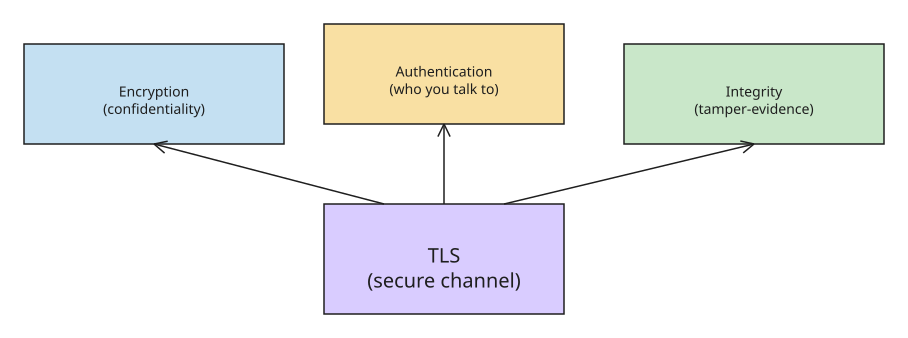

# TLS Does Three Jobs — and a New Certificate Is Usually Not the Outage

Runbooks still say "renew the SSL certificate" when the browser warning is
**obsolete protocol**. The certificate can be brand new and the tunnel still
negotiate TLS 1.0. "SSL cert" is a vendor phrase: the file is an X.509
certificate; the handshake that uses it is **TLS** (1.2 or 1.3). SSL 3.0 is
withdrawn (POODLE and friends).



## The tunnel's three jobs

1. **Confidentiality** — encryption so a tap yields no plaintext.
2. **Integrity** — a MAC (today AEAD) so a MITM cannot flip bits unnoticed.
3. **Authentication** — the certificate binds this hostname to a key a CA
   vouches for.

`https` means the bits on the wire are for that name, encrypted, and unmodified.
XSS and a malicious origin are a *different* layer.

## The outage that is not the certificate

- **Symptom:** new Let's Encrypt leaf, browsers still report obsolete TLS or
  refuse the handshake.
- **Cause:** nginx/Apache/OpenSSL still allow TLS 1.0/1.1, or the server has no
  1.2+. Renewing the certificate does nothing.

Check, do not guess:

```bash
# must FAIL
openssl s_client -connect example.com:443 -tls1
# must WORK
openssl s_client -connect example.com:443 -tls1_2
```

nginx:

```nginx
ssl_protocols TLSv1.2 TLSv1.3;
ssl_prefer_server_ciphers off;
```

Keep 1.2 next to 1.3 if you still have old Android/Java; new services can prefer
1.3. One gotcha worth knowing: **nginx 1.18.0+ implicitly enables TLS 1.3**
even when `ssl_protocols` lists only `TLSv1.2` — if you see 1.3 in the
handshake that you did not configure, that is why, not a rogue client.

## Cipher line

- Key exchange: **ECDHE** (forward secrecy). Static RSA key exchange is how
  yesterday's traffic gets decrypted after a key leak.
- Bulk: **AES-GCM** or **ChaCha20-Poly1305**. CBC+HMAC keeps producing
  Lucky-Thirteen-class bugs.
- Drop: 3DES, RC4, MD5, SHA-1 as a PRF.
- Run OpenSSL 3.x LTS (1.0.2/1.1.1 are past EOL). `chmod 400` or `600` the
  private key, owned by the daemon user. Turn compression off
  (`SSL_OP_NO_COMPRESSION`) — CRIME/BREACH.

### Concrete suite list (Mozilla intermediate profile)

The widely-used "intermediate" configuration (TLS 1.2 + 1.3, works with nearly
every client from the last five years):

```nginx
ssl_protocols TLSv1.2 TLSv1.3;
ssl_ciphers ECDHE-ECDSA-AES128-GCM-SHA256:ECDHE-RSA-AES128-GCM-SHA256: \
ECDHE-ECDSA-AES256-GCM-SHA384:ECDHE-RSA-AES256-GCM-SHA384: \
ECDHE-ECDSA-CHACHA20-POLY1305:ECDHE-RSA-CHACHA20-POLY1305;
ssl_prefer_server_ciphers off;
```

Notes on this list:

- **TLS 1.3 suites are fixed** (`TLS_AES_128_GCM_SHA256`, `TLS_AES_256_GCM_SHA384`,
  `TLS_CHACHA20_POLY1305_SHA256`) and cannot be disabled individually — the
  `ssl_ciphers` line only controls the TLS 1.2 fallback.
- **Allow-list, don't block-list**: every exclusion above corresponds to a named
  attack (RC4 statistically breakable, 3DES → SWEET32, CBC padding oracles,
  static RSA = no forward secrecy). A new weak suite in a future OpenSSL version
  is never automatically permitted.
- **`ssl_prefer_server_ciphers off`** lets the client pick between AES-GCM and
  ChaCha20-Poly1305 based on which its hardware accelerates — with an all-AEAD
  list there is no "bad option" to protect against, so forcing server order buys
  nothing. Set it `on` only if you deliberately need a fixed preference.
- **Modern profile** (TLS 1.3 only) is for internal/controlled environments where
  every client supports 1.3; public services should use intermediate.

## Post-quantum hybrid key exchange (2026)

The three jobs above now have a fourth worry: **harvest-now-decrypt-later**. The
countermeasure already live in production is hybrid key exchange in **TLS 1.3
only**, combining a classical X25519 shared secret with NIST's standardized
ML-KEM (FIPS 203, Aug 2024):

- The negotiated group to look for is **X25519MLKEM768**, standardized as
  **RFC 10024** (Aug 2026). More than two-thirds of browser traffic to
  Cloudflare was already post-quantum by 2026.
- Verify from the client side:

```bash
openssl s_client -groups X25519MLKEM768 -connect example.com:443
# look for: Negotiated TLS1.3 group: X25519MLKEM768
```

- `testssl.sh` (recent versions) reports the negotiated key-exchange group,
  including the hybrid PQ groups.

Two operational gotchas that connect back to the protocol-hygiene theme:

1. **ML-KEM hybrid applies only to TLS 1.3.** If you still allow TLS 1.2, a
   client can negotiate a purely classical handshake — the "keep 1.2 next to
   1.3" compatibility advice above is exactly what lets PQ protection be
   silently downgraded.
2. **ClientHello size.** An ML-KEM key share is ~1.2 KB, pushing the
   ClientHello past a single TCP segment; broken middleboxes that can't
   reassemble it are the usual cause of "works everywhere except one network"
   PQ reports.

## Let's Encrypt vs OpenSSL

Let's Encrypt *issues* the certificate; OpenSSL (or BoringSSL, or the language
runtime) *runs the handshake*. Buying a cert does not harden `ssl_protocols`.

## References

- [Stop saying SSL: TLS only does three jobs (dev.to)](https://dev.to/sunshoutkernel/stop-saying-ssl-tls-only-does-three-jobs-and-your-ssl-cert-is-usually-not-the-outage-26dh)
- [nginx 1.18.0 implicitly enables TLS 1.3 (nginx mailing list)](https://mailman.nginx.org/pipermail/nginx/2020-November/060180.html)
- [OpenSSL docs: openssl-ciphers (cipher list display and selection)](https://docs.openssl.org/master/man1/openssl-ciphers/)
- [Mozilla Server Side TLS — intermediate/modern profiles](https://wiki.mozilla.org/Security/Server_Side_TLS)
- [TLS 1.3 Hybrid Key Exchange using X25519Kyber768 / ML-KEM (netmeister, handshake walkthrough)](https://www.netmeister.org/blog/tls-hybrid-kex.html)
- [NGINX docs — Enable post-quantum cryptography (ML-KEM requires TLS 1.3)](https://docs.nginx.com/app-delivery/aws/quickstart/pqc/)

## Related
- [[explanation-openai-hugging-face-agent-incident]]
- [[howto-s3-exfiltration-incident-response]]
