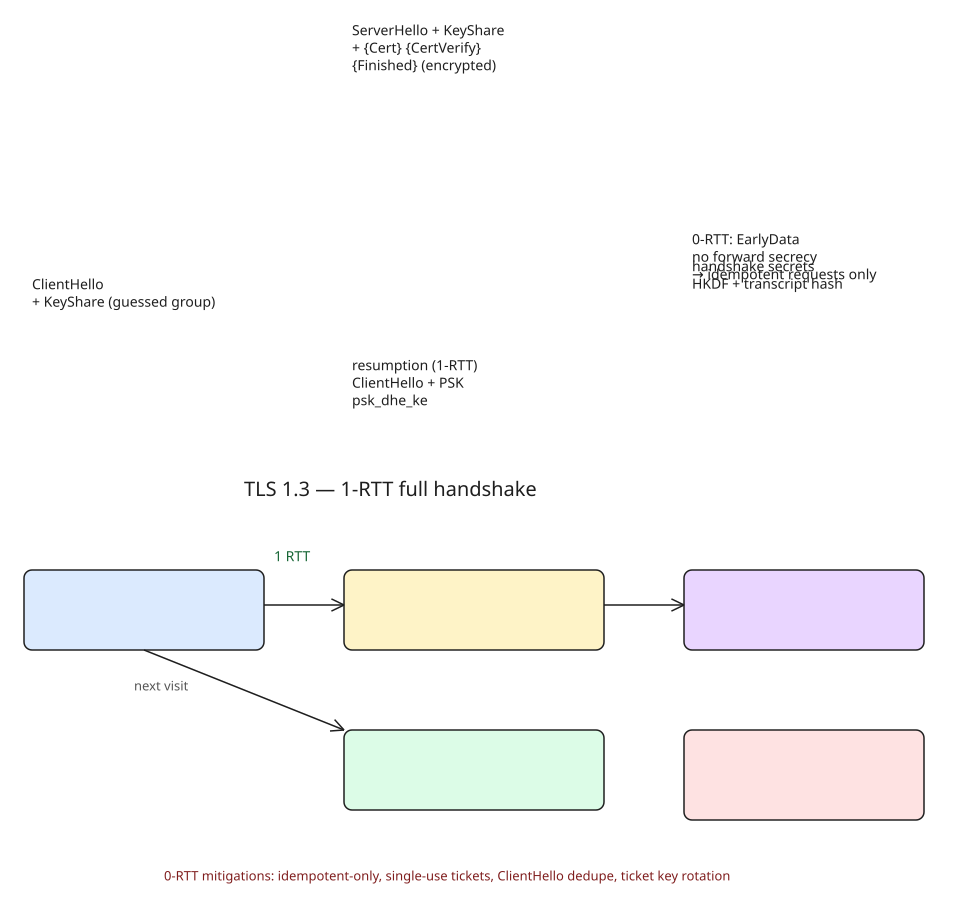

# TLS 1.3 Handshake Explained: 1-RTT, 0-RTT, and Why HTTPS Got Faster

TLS 1.2 full handshakes took **2 round-trips**: the client had to wait for the server's `KeyShare` before computing the shared secret, and the server's certificate traveled in **plaintext**. TLS 1.3 rearranges the flow so the client **speculatively sends its key share** in the first message.

## The 1-RTT handshake
```
Client                                              Server
  |--- ClientHello + KeyShare(s) ------------------>|
  |<-- ServerHello + KeyShare, {EncryptedExtensions}|
  |<-- {Certificate}, {CertificateVerify}, {Finished}|
  |--- {ClientFinished} ---------------------------->|
  |<-- [Application Data] <------------------------>|
```
`{}` = encrypted under handshake keys; `[]` = application-traffic keys.

- **ClientHello** carries `legacy_version: 0x0303` (middlebox compat), cipher list (`TLS_AES_256_GCM_SHA384`, `TLS_CHACHA20_POLY1305_SHA256`, ...), and a `key_share` extension with ephemeral public keys for the groups the client guesses the server supports (`x25519`, `secp256r1`, `secp384r1`). A miss (rare) triggers `HelloRetryRequest` → 2-RTT fallback.
- The server derives **handshake traffic secrets** immediately, then everything from `EncryptedExtensions` is encrypted: `{Certificate}` (no longer visible on the wire), `{CertificateVerify}` (signature over the *entire* handshake transcript), `{Finished}` (HMAC key confirmation). The client derives application traffic secrets and sends `{Finished}`.
- **Key schedule**: HKDF-based hierarchy (PSK/DHE → Early Secret → Handshake Secret → per-side handshake keys → Master Secret → application traffic secrets). Every derivation mixes the running **transcript hash**, binding keys to the exact handshake that produced them.

## 1.2 vs 1.3
| Aspect | TLS 1.2 | TLS 1.3 |
| --- | --- | --- |
| Round-trips (full) | 2 | 1 |
| Certificate visibility | plaintext | encrypted |
| Key exchange | RSA, DH, ECDHE | (EC)DHE only |
| Cipher suites | ~300 | 5 mandatory, all AEAD |
| Resumption | session ID / ticket | PSK only |
| 0-RTT | no | yes |

The five suites: `TLS_AES_256_GCM_SHA384`, `TLS_CHACHA20_POLY1305_SHA256`, `TLS_AES_128_GCM_SHA256`, `TLS_AES_128_CCM_SHA256`, `TLS_AES_128_CCM_8_SHA256` — AEAD only; no RC4, SHA-1, 3DES, or CBC padding oracles. RSA key transport was dropped: no forward secrecy, no key separation, Bleichenbacher padding-oracle exposure.

## Resumption: PSK replaces session IDs and tickets
After a handshake the server sends `NewSessionTicket` (`ticket_lifetime`, `ticket_age_add`, `ticket_nonce`, opaque `ticket` — either a stateful reference or a stateless encrypted PSK). Next connection: `ClientHello + PSK (+ KeyShare)` → 1-RTT. Two key-exchange modes:
- `psk_ke`: keys from PSK + nonces only — **no forward secrecy**, low-latency use cases.
- `psk_dhe_ke`: fresh (EC)DHE mixed in — forward secrecy; **browsers only offer this** and fall back to a full handshake if the server lacks it.

Stateless tickets (encrypted PSK under a server-held **ticket key**) let you scale horizontally without a shared session cache — but rotate that key (Cloudflare rotates **hourly**); a compromised key decrypts all 0-RTT data from that period.

## 0-RTT: data before the handshake completes
`ClientHello + PSK + EarlyData`; early data is encrypted under `client_early_traffic_secret` (PSK + ClientHello only — no server input).
**The catch**: no forward secrecy, no replay protection. A captured `ClientHello + EarlyData` can be replayed — a replayed `POST /transfer?amount=500` executes multiple times. The protocol cannot fix this; mitigations are server-side:
1. Allow 0-RTT only for idempotent requests (GET/HEAD/OPTIONS)
2. Reject 0-RTT on state-changing endpoints (force full 1-RTT)
3. Single-use tickets (requires state)
4. Remember recent ClientHello hashes, reject duplicates
5. Freshness checks (timestamps in tickets)

Browsers do **not** send 0-RTT for navigations; it is opt-in (Fetch `credentials: 'include'` same-origin, `curl --tls-13-early-data`, some CDNs). nginx/Apache/Caddy support per-location control — disable it on non-idempotent endpoints.

## What developers actually need to know
1. **1-RTT is the default** — on a 100 ms link that's ~100 ms saved per connection vs 1.2, zero config.
2. **0-RTT is opt-in and dangerous by default** — gate it per endpoint.
3. **Resumption is stateless by default** — share the ticket key across instances; rotate regularly.
4. **Certificate verification happens after key agreement** — the client derives handshake keys first, then decrypts and verifies the certificate (which is why it's encrypted).
5. **Middleboxes broke 1.3 deployment** — `legacy_version=0x0303` + `supported_versions` are compatibility hacks; seeing `HelloRetryRequest` or a 1.2 fallback usually means a firewall/AV is interfering.



## References
- [What Actually Happens During a TLS 1.3 Handshake (DEV.to)](https://dev.to/syed_anzar/what-actually-happens-during-a-tls-13-handshake-1-rtt-0-rtt-and-why-your-https-is-faster-than-4ahc)
- [RFC 8446](https://www.rfc-editor.org/rfc/rfc8446) (spec) · [RFC 8448](https://www.rfc-editor.org/rfc/rfc8448) (example handshake traces)
- [Cloudflare: TLS 1.3 Overview and Q&A](https://blog.cloudflare.com/tls-1-3-overview-and-q-and-a/)
