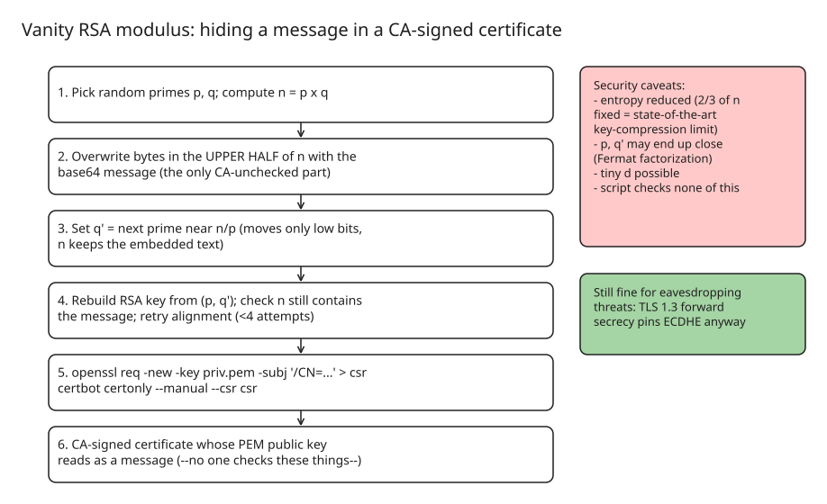

# Horrible Public Key Tricks: Vanity RSA Moduli in CA-Signed Certificates

A walkthrough of hiding a readable message inside a **trusted, CA-signed TLS certificate** — by crafting the RSA modulus `n` so its base64 PEM encoding spells out text. The point: in an X.509 certificate, the only part the requester fully controls is the public key, and nobody checks it. (Protest art à la tom7's "world's worst TLS server", but with a genuinely working certificate.)



## Why the modulus is the canvas

RSA key structure:

```
public key:  (n, e)     ciphertext = plaintext^e mod n
private key: (n, d)     plaintext = ciphertext^d mod n    (d = e⁻¹ mod φ(n), needs p,q)
```

- The CA refuses non-standard public exponents, so `e = 65537` is fixed.
- Subject/SAN fields are validated and policy-checked.
- The **modulus is 2,048 or 4,096 "user-controlled" bits** — nobody looks at it. In base64 PEM that yields ~150 usable characters (RSA-2048) or ~320 (RSA-4096): enough for a whole manifesto.

## The construction (how a vanity `n` stays factorable)

1. Pick random primes `p`, `q`; compute `n = p·q`.
2. Overwrite bytes in the **upper half** of `n` with the message. This `n` is no longer `p·q` — that's fine:
3. Recompute `q' = n / p`, round, and take the **next prime** above it. Since `p` and `q` are the same bit-size, a small change to `q` (typically a few hundred) only perturbs the **least-significant half** of the product — the embedded message in the upper half survives.
4. `(p, q')` now reconstruct a functional private key for the vanity modulus.
5. Get it signed like any other key:

```bash
# Single domain
openssl req -new -key priv.pem -subj '/C=US/CN=example.com' > cert_request
certbot certonly --manual --csr cert_request

# Wildcard: put subjectAltName in an OpenSSL config, then
openssl req -new -key priv.pem -config config -subj '/C=US/CN=example.com' > cert_request
certbot certonly --manual --csr cert_request
```

Because base64 works on 3-byte groups, the message can land misaligned — but the certificate DER layout is static, so shifting the message's placement fixes it in **&lt; 4 attempts**. Renewal is just resubmitting the CSR through ACME, so it automates. You can verify a cert like this with:

```bash
openssl s_client -connect example.com:443 </dev/null 2>/dev/null \
  | sed -n /BEGIN/,/END/p | grep -zE '////.?\*////' --color=yes
```

## Security analysis (the actually interesting part)

- **Entropy loss**: fixing the upper half of `n` removes ~half the key's entropy. Historically this was a *compression* technique — state of the art fixes ~2/3 of `n`, shrinking RSA to ~1/3 size at similar security — which is the practical bound on how much message you can embed. (These schemes were abandoned in favor of cryptosystems with natively small keys.)
- **Close-prime risk**: nudging `q` to the next prime *could* leave `p` and `q'` unusually close → Fermat factorization recovers the private key. A tiny `d` is another hazard. The author's script checks neither.
- **Forward secrecy saves the threat model anyway**: modern TLS 1.3 handshakes pin ECDHE key exchange, so even a compromised RSA key doesn't hand an eavesdropper past traffic — that requires active MITM. Which is the honest limit of what a vanity cert endangers.
- Trust-side lesson: CAs verify names, not keys. A certificate is only as audited as its auditors bother to be — relevant next to real incidents like the eMudhra "key 4" debacle referenced in the piece.

## Cross-references in this KB

- [Go Distrusts eMudhra Intermediates (CVE-2026-111943)](explanation-go-emudhra-distrusted-intermediates-cve-2026-111943.md)
- [ccTLD Registry Hijacks Yield Counterfeit TLS Certificates](explanation-cctld-hijack-counterfeit-tls-certificates.md)
- [TLS 1.3 Handshake Explained: 1-RTT, 0-RTT](explanation-tls-1-3-handshake-1rtt-0rtt.md) — why forward secrecy bounds the damage

## References

- [Horible public key tricks — maurycyz.com/projects/badcert/ (2026-11-08)](https://maurycyz.com/projects/badcert/)
- [gen.py — vanity RSA key generator from the article](https://maurycyz.com/projects/badcert/gen.py)
- [World's worst TLS server (httpv) — tom7](https://tom7.org/httpv/httpv.pdf)
- [More vanity certificate tricks — rya.nc](https://rya.nc/cert-tricks.html)
- [Partial-fixed-modulus RSA compression, LNCS (cryptographers' opinion on fixing part of n)](https://doi.org/10.1007/978-3-540-79104-1_9)
